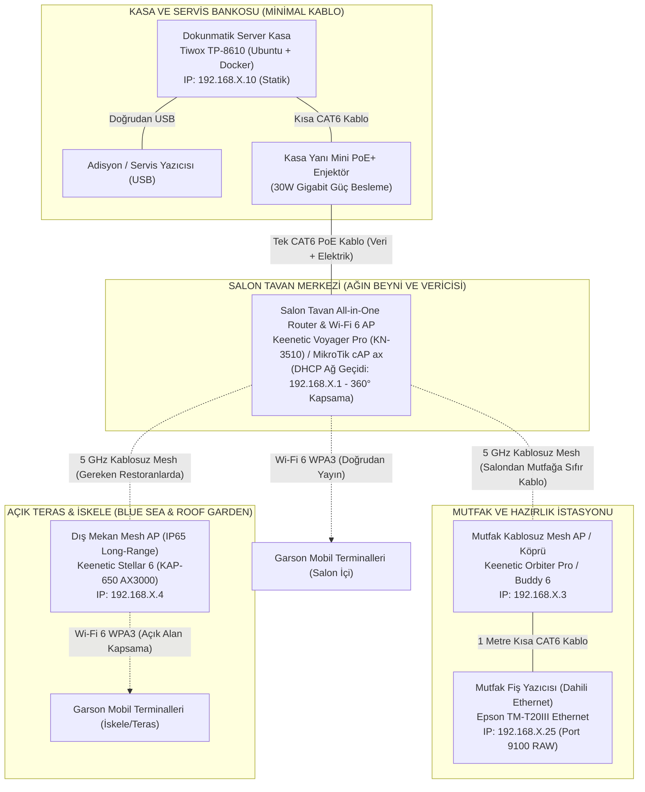

# ALACARTE — Restoran Başına Donanım Paketi ve Bağlantı Planı

**Belge türü:** Donanım standartları, All-in-One Router özellikli tavan Wi-Fi 6 mimarisi ve 5 restoran fiziksel menzil analizi  
**Kurulum modeli:** Uygulama Merit Royal'deki 5 A La Carte restorana bağımsız olarak ayrı ayrı kurulur. Merkezi ağ/panel ve restoranlar arası donanım paylaşımı yoktur.  
**Güncelleme tarihi:** 14.10.2026  
**Mimari:** Her restoran için bağımsız, internetsiz kapalı LAN (Air-Gapped); Router Özellikli Tavan AP (All-in-One Gateway) + Kablosuz Mutfak Mesh Köprüsü  
**Durum:** Kasa Arkası Mini Router Elendi; Tavan Router/AP & Dış Mekan Long-Range Mimarisi Onaylandı  

---

## 1. MİMARİ VE YAZDIRMA AKIŞLARI (ALL-IN-ONE TAVAN ROUTER/AP & KABLOSUZ MESH)

Kasa arkasındaki gereksiz kablo ve harici router kutusu kalabalığını tamamen ortadan kaldırmak amacıyla, hem **DHCP Router/Ağ Yöneticisi** hem de **Wi-Fi 6 Tavan Vericisi** rollerini tek bir kurumsal cihazda toplayan **Router Özellikli Tavan AP (Keenetic Voyager Pro KN-3510 / MikroTik cAP ax)** mimarisine geçilmiştir:

### Neden Bu Mimari?
1. **Kasa Arkasında Sıfır Kutu Kalabalığı:** Kasa arkasındaki harici mini router kutusu iptal edilmiştir. Dokunmatik kasadan çıkan tek bir CAT6 kablo, kasa arkasındaki kibrit kutusu büyüklüğündeki küçük bir **PoE+ Güç Enjektöründen** geçerek doğrudan tavandaki cihaza gider.
2. **Tavanda 220V Priz İhtiyacı Yok (PoE İle Besleme):** Tavana elektrikçi çağırıp priz çektirmeye gerek yoktur; CAT6 kablosu hem veriyi taşır hem de tavan AP/Router'ına elektrik sağlar.
3. **Tek Cihaz Hem Router Hem Tavan Vericisi:** Tavandaki kubbe cihaz (Keenetic Voyager Pro), bağımsız bir DHCP sunucusu olarak çalışarak restoranın kapalı IP havuzunu (`192.168.X.1`) yönetir; aynı zamanda 360° kubbe şeklinde yüksek güçlü Wi-Fi 6 basar.
4. **Mutfaktan Kasaya Sıfır Kablo:** Mutfaktaki Access Point, salondaki tavan router'ına 5 GHz kablosuz mesh ile bağlanır; altındaki Gigabit Ethernet portundan mutfak fiş yazıcısını besler.
5. **Hızlı Dolaşım (802.11k/v/r Fast Roaming):** Garsonlar salondan terasa, iskeleye veya mutfağa geçerken bağlantı sıfır milisaniye gecikmeyle en güçlü AP'ye aktarılır.



---

## 2. RESTORAN BAŞINA STANDART DONANIM SATIN ALMA LİSTESİ (BOM)

Merit Royal'in 5 alakart restoranı için standartlaştırılmış 7 kalemlik donanım satın alma paketi:

| Sıra | Donanım Kalemi | Adet | Önerilen Model / Teknik Özellik | Tahmini Birim Fiyat | Toplam Tutar |
|---|---|:---:|---|---:|---:|
| **1** | **Dokunmatik Server Kasa** | 1 | **Tiwox TP-8610 All-in-One POS (veya muadili)**<br>• Ubuntu Linux 24.04 LTS kurulu<br>• Docker üzerinde çalışan veritabanı ve web sunucusunu barındıran hepsi-bir-arada dokunmatik terminal<br>• 15.6" - 18.5" Kapasitif Dokunmatik, 16 GB RAM & 256 GB SSD | 37.780 TL | 37.780 TL |
| **2** | **Garson Mobil Terminali / Akıllı Cihazlar** | 1 | **İşletme Tarafından Sağlanan Mobil Cihazlar (Android / iOS)**<br>• Yalnızca yerel Wi-Fi'a bağlanan, modern PWA mobil istemcisi<br>• Hızlı masa/ürün seçimi, dokunmatik titreşim ve tam ekran çalışma | 0 TL *(Mevcut Envanter)* | 0 TL |
| **3** | **Termal Adisyon Yazıcısı (80mm)** | 1 | **Epson TM-T20III USB (Model 011)**<br>• Kasa yanında yer alan masa servis dökümü yazıcısı<br>• Doğrudan Kasaya 1.5m USB kablosuyla bağlı, otomatik kağıt kesici<br>• Fiyatsız masa servis koordinasyon dökümü için kullanılır | 7.722 TL | 7.722 TL |
| **4** | **Termal Mutfak Yazıcısı (80mm Ethernet)** | 1 | **Epson TM-T20III Ethernet (C31CH51012 / Model 012)**<br>*(Alternatif: Bixolon SRP-350III Ethernet)*<br>• Mutfak hazırlık istasyonuna bağlı, dayanıklı fiş yazıcısı<br>• Dahili 10/100 RJ45 Ethernet portu ve sesli ikaz zili (Buzzer) uyumlu | 8.250 TL | 8.250 TL |
| **5** | **Salon Tavan All-in-One Router & Wi-Fi 6 AP** | 1 | **Keenetic Voyager Pro KN-3510 (AX1800)**<br>*(Alternatif: MikroTik cAP ax)*<br>• Tavana monte estetik kubbe formunda, dahili Gigabit Router ve bağımsız DHCP sunucusu barındıran Wi-Fi 6 erişim noktası<br>• Kasa arkasındaki harici router ihtiyacını ortadan kaldırır; 2x Gigabit port, 360° kubbe tavan yayılımı | 3.750 TL | 3.750 TL |
| **6** | **Kasa Yanı Gigabit PoE+ Enjektör** | 1 | **Keenetic / TP-Link TL-POE160S (Gigabit 802.3at 30W)**<br>• Kasa arkasında mini boyutta çalışır; kasadan çıkan CAT6 kabloya elektrik basarak tavandaki Voyager Pro'yu tek kabloyla besler<br>• Tavanda 220V priz ihtiyacını tamamen ortadan kaldırır | 590 TL | 590 TL |
| **7** | **Mutfak Kablosuz Mesh Access Point / Köprü** | 1 | **Keenetic Orbiter Pro KN-3610 / Buddy 6 (veya Keenetic Mesh Node)**<br>• Mutfak servis bankosuna bağlı, salondaki tavan Voyager Pro'ya 5 GHz kablosuz mesh ile bağlı (mutfaktan kasaya sıfır kablo çekimi)<br>• Arkasındaki Gigabit Ethernet portundan mutfak yazıcısına köprü sağlar | 2.850 TL | 2.850 TL |
| **TOPLAM** | **Restoran Başına Donanım Paketi** | **7 Kalem** | **Standart Donanım Paketi (All-in-One Tavan Ağ Ekipmanları Dahil)** | | **60.942 TL** |

> [!NOTE]
> **5 Restoran Toplam Standart Donanım Yatırım Tutarı:** 5 x 60.942 TL = **304.710 TL**.  
> Garson mobil terminalleri ve yedekleme USB bellekleri otel işletme envanterinden tahsis edilir.

---

## 3. 5 ALACARTE RESTORANIN FİZİKSEL MİMARİSİ VE RF MENZİL DEĞERLENDİRMESİ

Merit Royal Hotel & Casino bünyesindeki 5 restoranın fiziksel mimari büyüklükleri, mimari engelleri ve sinyal menzil analizleri:

| Restoran Adı | Kapalı Alan (m²) | Açık Teras / İskele | Kritik Fiziksel Engeller | Standart Tavan AP Kapsama Yeterliliği | İlave Donanım İhtiyacı & Çözüm |
|---|:---:|:---:|---|:---:|---|
| **The Steak House** | ~250 m² | ~150 m² Havuz Başı | Mermer kolonlar, Dry-Aged cam dolapları, döküm ızgara gövdesi | **Tam Kapsar (%100)** | İlave gerekmez; tavan Voyager Pro açık havuz başı terasını cam arkasından rahatça kapsar. |
| **Royal Mandarin** | ~220 m² | ~80 m² Sakin Bahçe | Ahşap/bambu dekoratif paneller, suşi bankosu | **Tam Kapsar (%100)** | İlave gerekmez; ahşap ve bambu malzemeler RF sinyalini kırmaz (düşük zayıflama). |
| **Bella Merit** | ~200 m² | ~100 m² Bahçe Terası | Taş/tuğla pizza fırını kütlesi, kalın rustik kemerler | **Tam Kapsar (%100)** | İlave gerekmez; tavan cihazı pizza fırınının arkasına değil, salonun merkezine asılır. |
| **The Roof Garden** | ~180 m² Lounge | ~250 m² Açık Teras | Çatı rüzgarı, çift lamine rüzgar camları, 40+ metre mesafe | **Lounge Kapsar, Teras Uç Masalar Zayıflar** | **1x Keenetic Stellar 6 (KAP-650 Outdoor IP65)** dış teras saçak altına ilave edilir. |
| **Blue Sea Seafood** | ~200 m² İç Salon | **50–80m Açık Deniz İskelesi** | Yüksek nem, deniz tuzu serpintisi, su yansıması, 80m mesafe | **İç Salon Kapsar, İskele Ucu Sinyal Yetersiz** | **1x Keenetic Stellar 6 (KAP-650 Outdoor IP65)** iskele aydınlatma direğine ilave edilir. |

---

### 3.1. Restoran Bazında Detaylı Mühendislik Değerlendirmesi

#### 1. The Steak House (Merit Royal Diamond - Havuz Başı):
* **Fiziksel Özellikler:** ~250 m² kapalı şık salon ve geniş açılır sürgülü cam kapılarla ulaşılan ~150 m² havuz başı açık teras.
* **RF Analizi:** Salondaki mermer kolonlar ve büyük kuru dinlendirme (Dry-Aged) et dolapları sinyal gölgesi yapabilir. Bu nedenle Voyager Pro tavan cihazı salonun tam geometrik merkezine monte edilir. 
* **Menzil:** Wi-Fi 6 sinyali tavan yüksekliğinden (3.20m) kubbe şeklinde yayılarak 18-20 metre yarıçaptaki tüm iç salon masalarını ve havuz başındaki teras masalarını `-58 dBm` ile `-65 dBm` arasında güçlü bir seviyede kapsar. Ek dış üniteye gerek yoktur.
* **Mutfak:** Mutfak servis bankosuna 1x Keenetic Orbiter Pro konur; döküm ızgara mutfağına sıfır kablo ile fiş basılır.

#### 2. Royal Mandarin (Uzak Doğu & Sushi Bar):
* **Fiziksel Özellikler:** ~220 m² kompakt iç salon ve ~80 m² teras.
* **RF Analizi:** Doğu dekorasyonunda kullanılan ahşap kafesler ve bambu separatörler yüksek frekanslı 5 GHz sinyallerinde yalnızca 1.5–2.5 dB zayıflama yaratır. Mermer veya beton gibi sinyali kesmez.
* **Menzil:** Tek bir tavan Voyager Pro cihazı tüm salonu, suşi barını ve dış masaları kusursuz kapsar.
* **Mutfak:** Wok ve Dim Sum mutfağının pass penceresine 1x Mesh AP konur.

#### 3. Bella Merit (İtalyan Trattoria):
* **Fiziksel Özellikler:** ~200 m² rustik salon, odun/taş pizza fırını ve ~100 m² bahçe alanı.
* **RF Analizi:** Taş pizza fırınının devasa kütlesi arkasında kalan alanlar için kör nokta yaratabilir. Cihaz fırının hemen önüne veya arkasına değil, misafir oturma grupları ile bahçe kapısının ortasına yerleştirilir.
* **Menzil:** Standart tavan Voyager Pro tüm masaları rahatlıkla kapsar.

#### 4. The Roof Garden Restaurant & Lounge (Çatı Katı Panoramik Teras):
* **Fiziksel Özellikler:** ~180 m² kapalı lounge ve ~250 m² panoramik açık teras (toplam ~430 m²). Çatı katında yoğun rüzgar ve çift kat lamine rüzgar kırıcı cam paneller mevcuttur.
* **RF Analizi:** Salondaki tavan Voyager Pro kapalı lounge'ı ve terasa yakın ilk sıra masaları mükemmel kapsar. Ancak terasın en uç köşesindeki (çatı kenarındaki) masalar salondan 40 metreden uzakta kalır ve çift kat lamine camlar 5 GHz sinyalini ~8-10 dB zayıflatır.
* **Uygulanan Çözüm:** Terasın dış cephe saçak altına **1x Keenetic Stellar 6 (KAP-650 Outdoor IP65 AX3000)** ilave edilir (5.200 TL).
  - Tavan Voyager Pro ile 5 GHz kablosuz mesh üzerinden eşleşir.
  - Açık havadaki teras masalarına doğrudan görüş açısıyla (Line-of-Sight) kesintisiz `-45 dBm` güçlü sinyal basar.

#### 5. Blue Sea Seafood Restaurant (Denize Sıfır & Açık Deniz İskelesi):
* **Fiziksel Özellikler:** Denize sıfır kıyı salonu (~200 m²) ve Akdeniz üzerine doğru uzanan **50–80 metre uzunluğunda ahşap açık deniz iskelesi**.
* **RF Analizi:** Deniz tuzu serpintisi, aşırı nem ve su yüzeyinden kaynaklanan sinyal kırılmaları (multipath reflection) nedeniyle salondaki bir iç tavan cihazının sinyali iskelenin 70-80 metre ilerisindeki uç masalara ulaşamaz (sinyal `-78 dBm` altına düşer, garson cihazları kopar).
* **Uygulanan Çözüm:** İskelenin başlangıç noktasına / aydınlatma direğine **1x Keenetic Stellar 6 (KAP-650 Outdoor IP65 AX3000)** monte edilir (5.200 TL).
  - ASA mühendislik plastiği gövdesi sayesinde tuza, neme, UV güneş ışınlarına ve fırtınaya karşı tam dirençlidir (IP65).
  - İskelenin en uç masasına kadar 80 metre mesafede garson mobil terminallerine sıfır kayıpla sinyal ulaştırır.
  - Tek SSID ve şifreye sahiptir; garson salondan iskeleye yürüdüğünde sıfır kesintiyle dolaşır (802.11k/v/r Fast Roaming).

---

## 4. KABLOLAMA VE IP DAĞITIM PLANI

Kasa arkasındaki harici router kutusu kalktığı için kablolama son derece basitleşmiştir:

```text
KASA BÖLGESİ (Sıfır Router Kutusu):
 Dokunmatik Server Kasa (192.168.X.10)
   ├── Doğrudan USB Kablosu ────────> Adisyon Yazıcısı (Fiyatsız Servis Özeti)
   └── Kısa CAT6 Kablosu ───────────> Kasa Yanı Mini PoE+ Enjektör (LAN Portu)
                                            │
                                            ▼ (PoE Çıkış Portu)
                           Tek CAT6 Kablo (Tavana Giden Hat: Veri + Elektrik)
                                            │
SALON TAVANI:                               ▼
 Salon Tavan All-in-One Router & AP (Keenetic Voyager Pro - 192.168.X.1):
   ├── Ağ Rolü: Kapalı LAN DHCP Sunucusu & Ağ Geçidi (İnternetsiz)
   ├── Wi-Fi Rolü: Wi-Fi 6 WPA3 (SSID: MR-[RESTORAN]-POS)
   │
   ├── [5 GHz Kablosuz Mesh] ───> Mutfak AP (192.168.X.3)
   │                                  │
   │                                  └── (1m CAT6 Kablo) ──> Mutfak Yazıcısı (192.168.X.25)
   │
   └── [5 GHz Kablosuz Mesh] ───> (Blue Sea & Roof Garden) Dış Mekan AP (192.168.X.4)
                                      │
                                      └── Açık İskele ve Teras Masaları Kapsaması
```

### 5 Restoranın IP Blokları:
* **The Roof Garden:** Subnet `192.168.11.0/24` | Tavan Router: `.1` | Kasa: `.10` | Mutfak: `.25`
* **The Steak House:** Subnet `192.168.12.0/24` | Tavan Router: `.1` | Kasa: `.10` | Mutfak: `.25`
* **Blue Sea:** Subnet `192.168.13.0/24` | Tavan Router: `.1` | Kasa: `.10` | Mutfak: `.25`
* **Royal Mandarin:** Subnet `192.168.14.0/24` | Tavan Router: `.1` | Kasa: `.10` | Mutfak: `.25`
* **Bella Merit:** Subnet `192.168.15.0/24` | Tavan Router: `.1` | Kasa: `.10` | Mutfak: `.25`

---

## 5. PİLOT VE TEST KABUL PROTOKOLÜ

Kurulum tamamlandığında sahada uygulanacak testler:

1. **All-in-One Tavan Router DHCP ve İletişim Testi:**
   - Kasanın tavan Voyager Pro üzerinden statik IP (`192.168.X.10`) ile haberleştiği, garson terminallerinin tavan cihazından 2 saniye içinde DHCP IP aldığı doğrulanır.
2. **Kablosuz Mutfak Mesh İletişim Testi:**
   - Kasadan mutfak yazıcısına ping ve soket testi yapılır: `nc -zv 192.168.X.25 9100`.
   - Yanıt süresinin <5 ms olduğu ve kablosuz köprüde paket kaybı (%0 packet loss) yaşanmadığı doğrulanır.
3. **Blue Sea İskele ve Roof Garden Teras Uç Nokta Wi-Fi Testi:**
   - Garson el terminali ile Blue Sea iskelesinin en uç masasına (80m) ve Roof Garden terasının rüzgarlı köşesine gidilir.
   - Sinyal seviyesinin `-65 dBm` veya daha güçlü olduğu, sipariş gönderiminin 1 saniyenin altında kasaya ulaştığı teyit edilir.
4. **Mutfak Fişi Dayanıklılık Testi:**
   - Kasadan arka arkaya 50 adet mutfak sipariş ve iptal fişi tetiklenir; mutfak yazıcısının sesli ikaz zilinin çaldığı, kağıdın düzgün kesildiği teyit edilir.
5. **Masa Adisyon Teyit Testi:**
   - USB adisyon yazıcısından servis özeti basılır; hiçbir fiyat veya ödeme verisi bulunmadığı teyit edilir.
6. **İzole Ağ Doğrulaması:**
   - Sistemin otel PMS ağına (Opera) ve internete kesinlikle kapalı olduğu yerel güvenlik denetimiyle onaylanır.
