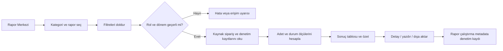
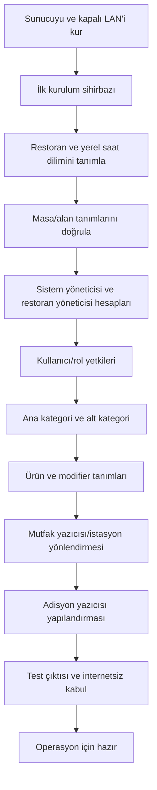
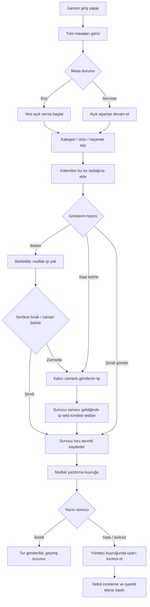
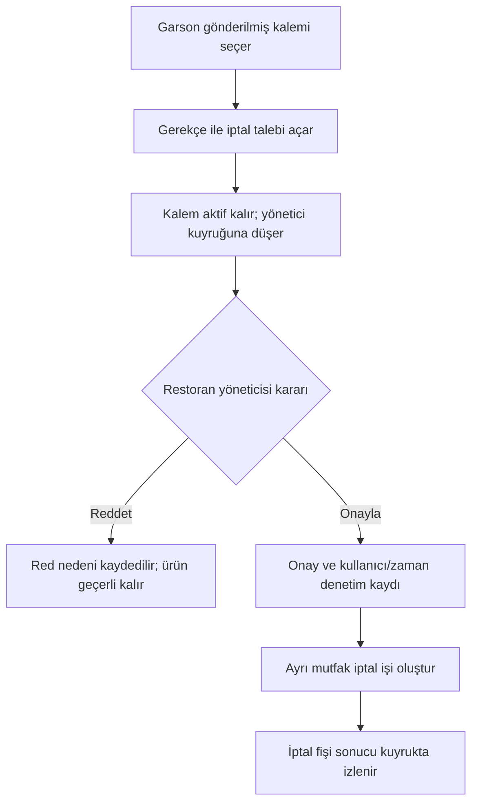
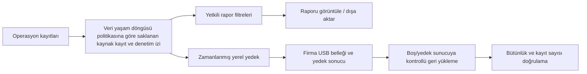
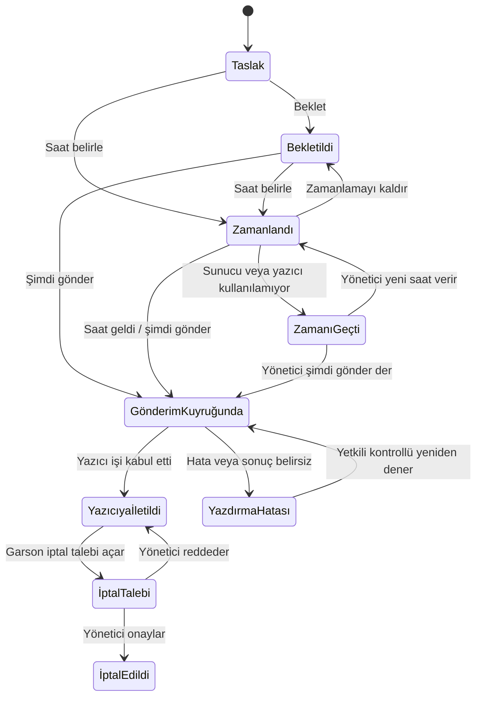
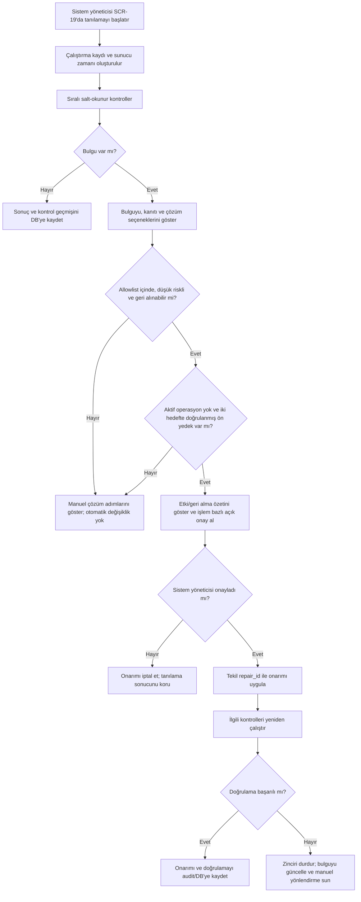

# ALACARTE — Ürün Mimarisi ve Çalışma Prensipleri Şartnamesi

**Belge türü:** Ürün kapsamı, fonksiyonel şartname, sistem mimarisi ve çalışma prensipleri  
**Tarih:** 14.10.2026  
**Durum:** Yürürlükte — Ürün Şartnamesi ve Mimarisi  
**Temel kısıt:** Bu belge, Alacarte restoran otomasyonunun ürün içeriğini, çalışma prensiplerini, ekran akışlarını ve sistem mimarisini tanımlar. Saha kurulum ve devreye alma fazları için `ALACARTE_UYGULAMA_VE_DEVREYE_ALMA_FAZLARI.md` belgesi esas alınır.

**Dağıtım kapsamı:** Ürün ilk olarak tek restoran için geliştirilir; daha sonra aynı sürüm toplam beş restorana ayrı ayrı kurulur. Her restoranın kendi sunucusu, veritabanı ve kapalı ağı bulunur. Restoranlar arası ağ bağlantısı, ortak merkezi panel, çok kiracılı tek veritabanı ve uzaktan merkezi yönetim kapsam dışıdır. Her kurulumun yönetimi o restorandaki yerel sistem yöneticisindedir.

**Demo/üretim ayrımı:** Mevcut gösterim ve değerlendirme ortamı Coolify üzerinde Docker Compose ile çalışır. Bu internet üzerinden erişilebilen demo; restoranın üretim LAN'ına, router/AP'sine, USB belleğine veya fiziksel yazıcılarına bağlı değildir. Üretim hedefi restoran başına bağımsız yerel kurulumdur. Mevcut onaylı gereksinimde üretim sunucusu Windows ve OS yazdırma kuyruğu olarak kalır; Coolify/Linux seçimi bunu değiştirmez. Demo ekranlarında fiziksel olarak ölçülmeyen bileşenler “Bilinmiyor” gösterilir, çıktı ve yedek işleri gerçek teslim/doğrulama olmadan başarılı sayılmaz.

---

## 1. Amaç

Her alakart restoranın kendi kapalı yerel ağında çalışan; garsonların masa ve sipariş girdiği, siparişin restorandaki sunucuda kaydedildiği ve mutfak yazıcısından çıktığı bir restoran operasyon sistemi oluşturmak.

Sistem internet, otelin kurumsal ağı, otel PMS'i ve ödeme servisleri olmadan çalışmalıdır. MICROS restoran yönetim sisteminin masa, sipariş ve servis akışları ile ekran düzeni ve görsel yaklaşımı referans alınacaktır. Görsel olarak benzer, ancak Alacarte'a özgü ve özgün ekranlar üretilecektir.

## 2. Onaylı gereksinimler

| Alan | Karar |
|---|---|
| Restoran başına donanım | 1 dokunmatik sunucu-kasa (Ubuntu 24.04 LTS + Docker), 1 USB adisyon yazıcısı, 1 dahili Ethernet portlu mutfak yazıcısı, 1 kasa yanı PoE+ enjektör, 1 tavan All-in-One Router & Wi-Fi 6 AP (Keenetic Voyager Pro / MikroTik cAP ax), 1 mutfak kablosuz mesh AP (Keenetic Orbiter Pro); garson mobil terminalleri işletme envanterinden sağlanır. |
| Ağ | Her restoran için kendi kapalı LAN/Wi-Fi ağı; otel ağına ve internete bağlantı yok |
| Eşzamanlı kullanım | Aynı anda en fazla 10 garson hedefi |
| Masa görünürlüğü | Her garson bütün masaları görebilir |
| Mutfak İstasyonları ve Tek Yazıcı Eşlemesi | Restoranda fiziksel olarak 1 adet mutfak yazıcısı (80mm Ethernet) bulunur. Veritabanında ise 4 mantıksal istasyon (SICAK, SOĞUK/MEZE, IZGARA, TATLI) tanımlıdır ve hepsi varsayılan olarak bu tek mutfak kuyruğuna bağlıdır. Aynı turda farklı istasyonlara ait kalemler tek yazıcıdan otomatik kesimle istasyon başlıkları ayrı ayrı basılır (şefin ilgili tezgaha vermesi için). İleride 2. bir yazıcı eklenirse kod yazılmadan SCR-17'den eşleştirilebilir. |
| Zorunlu Modifier (Hazırlama Kuralları) | Sistem Yöneticisi SCR-14/15 üzerinden modifier gruplarını dinamik ekleyebilir/düzenleyebilir (Zorunlu kuralı, minSelect, maxSelect, seçenek listesi). Bir üründe zorunlu modifier tanımlıysa (örn: etin pişme derecesi), garson seçim yapmadan siparişi mutfağa basamaz; sistem gönderimi engelleyip eksik seçimi bildirir. |
| Ödeme/PMS | Ödeme alma ve otel PMS bağlantısı yok |
| Yedek | Günlük arka plan yedeği hem firma tarafından sağlanan sunucu USB belleğine hem sunucu/atanmış yerel dizine alınır; her hedefte en fazla 15 kopya tutulur. Yerel sistem yöneticisi manuel yedek/geri yükleme yapabilir. |
| Rapor geçmişi | Raporlar veritabanındaki kaynak kayıtlardan yeniden çalıştırılır; saklama/arşivleme/silme işlemlerini yerel sistem yöneticisi yönetir ve tüm değişiklikler audit'e alınır. |
| Başlangıç kurulumu | Restoran adı ve masa sayısı girilir |
| Menü kurulumu | Ana kategori, alt kategori, ürün ve zorunlu/isteğe bağlı modifier tanımları yapılır |
| Roller | Her restoranın yerel kurulumunda sistem yöneticisi, restoran yöneticisi, garson; restoranlar arasında hesap/rol eşitlemesi yok |
| Garson yetkisi | Masa seçimi, sipariş oluşturma/gönderme, iptal talebi oluşturma |
| İptal | Gönderilmiş siparişi iptal etme yönetici onayına bağlı |
| Teknoloji | Next.js, PostgreSQL, shadcn/ui |
| İşletim sistemi/yazdırma | Sunucu Ubuntu Linux (24.04 LTS) ve Docker kullanır. Adisyon kasaya doğrudan USB ile, mutfak ise kasadan kablo çekilmeden mutfaktaki kablosuz mesh AP'nin Ethernet portu (CAT6 / Port 9100 RAW) üzerinden bağlanır; mutfaktan kasaya fiziksel kablo çekimi yoktur. |
| MICROS referansı | İş akışları, ekran düzeni ve görsel yaklaşım referans alınır; görsel olarak benzer ama özgün Alacarte ekranları tasarlanır |

### Demo dağıtım profili (Coolify/Docker)

- Next.js, PostgreSQL ve yalnız iç Compose ağına bağlı zamanlı gönderim worker'ı ayrı container'lardadır; worker `SCHEDULER_SECRET` ile yetkili iç çağrı yapar. Compose etiketi ve dış `coolify` ağı yalnız demo dağıtımı için kullanılır. PostgreSQL dış porta açılmaz.
- Coolify Secret değişkenleri zorunludur: `DB_USER`, `DB_PASSWORD`, `DB_NAME`, `DATABASE_URL`. Güvenli oturum çerezi HTTPS'te `HttpOnly`, `Secure`, `SameSite=Lax` olur. Varsayılan/parola içeren ortam yapılandırması kullanılmaz.
- İlk seed varsayılan olarak kapalıdır. Yalnız boş demo veritabanında, açıkça etkinleştirilmiş ve Secret'lardan verilen kimlik bilgileriyle çalıştırılır; seed'in mevcut veriyi sildiği arayüz ve kurulum kılavuzunda açıklanır.
- Demo dışarıya açılacaksa test kullanıcı hesapları/menüsü gerçek çalışan bilgisi veya operasyonel üretim verisi içermez. `/api/health` yalnız minimal durum döndürür.
- Demo yazıcıya, kapalı LAN'a veya sunucu USB belleğine erişmez. Mutfak/adisyon çıktısı OS spooler teslimiyle doğrulanmadıkça `PENDING` kalır; yazıcı/AP/telefon durumu yapılandırma kaydından “sağlıklı” çıkarılmaz.
- Demo ortamında gerçek pg_dump + şifreleme/doğrulama/geri yükleme hedefi kurulana dek yedek/geri yükleme ve fiziksel onarım başarıyla tamamlanmış gibi gösterilmez. Bu aksiyonlar engellenir ve audit'e engel nedeni kaydedilir.
- Üretim yerel ağ profili için ayrı Compose yapılandırması ve dağıtım prosedürü gerekir: dış Coolify/Traefik ağı kaldırılır, uygulama yalnız restoran LAN'ında sunulur; Windows spooler/Print Bridge, gerçek USB/yedek yolları, zamanlayıcı ve cihaz tanılaması saha kabulünde etkinleştirilir. Bu profile geçiş ayrıca doğrulanmadan Coolify demo imajı üretim kabulü sayılmaz.

## 3. Kapsam ve sınırlar

### Kapsamda

- Restoran ilk kurulum sihirbazı
- Restoran, masa, kullanıcı ve rol tanımları
- Ana kategori, alt kategori, ürün ve mutfak istasyonu/yazıcı eşlemesi
- Masa açma, sipariş oluşturma, siparişi mutfağa gönderme ve ek sipariş
- Mutfak ve adisyon yazdırma
- İptal talebi ve yönetici onayı/red akışı
- Aktif masa ve siparişlerin yönetici görünümü
- Kullanıcı, sipariş, yazdırma ve iptal denetim geçmişi
- Veritabanında tutulan tüm tarihsel operasyon kayıtlarına göre raporlama; yapılandırılabilir veri saklama politikası
- Yerel yedekleme, geri yükleme ve çevrimdışı güncelleme yöntemi

### Kapsam dışında

- Kart, nakit veya başka yöntemle ödeme/tahsilat
- Fiyat, toplam, vergi veya ödeme bilgisini adisyon fişinde gösterme
- Otel PMS/oda hesabı entegrasyonu
- Otel ağı, internet, bulut servisleri veya dış API bağımlılığı
- MICROS marka varlıklarının veya ekranlarının birebir kopyalanması; hedef, MICROS'tan esinlenen benzer ama özgün Alacarte görsel tasarımıdır.

## 4. Hedef mimari

```text
Garson telefonu ───────┐
Kasa/yönetici tarayıcısı ├── Restorana özel Wi-Fi/LAN ── Yerel sunucu
Mutfak yazıcısı ────────┤                            ├─ Next.js uygulaması
Adisyon yazıcısı ───────┘                            ├─ PostgreSQL
                                                     ├─ Yazdırma kuyruğu/işçisi
                                                     ├─ İşletim sistemi yazdırma kuyrukları
                                                     └─ USB bellek (günlük, 15 günlük döngüsel yedek)
```

- Uygulama ve PostgreSQL restoranın yerel sunucusunda çalışır.
- İstemciler sunucuya yalnız restoranın LAN'ı üzerinden erişir. PostgreSQL portu kullanıcı cihazlarına açılmaz; yalnız uygulama sunucusu bağlanır.
- Otel ve misafir ağlarından erişim ağ kuralıyla engellenir. Yerel yönlendiricide WAN bağlantısı kapalı tutulur; bakım/güncelleme gerektiğinde paketler güvenilir bir bakım bilgisayarı üzerinden taşınır.
- Sunucu sabit yerel IP veya yerel DNS adıyla erişilir.
- Uygulama, adisyon ve mutfak yazdırma işlerini sunucuda oluşturur ve sunucunun işletim sistemi yazdırma kuyruklarına bırakır. Her yazıcı için işletim sistemi kuyruğu, uygun sürücü/ham baskı ayarı ve hedef bağlantısı kurulur; uygulamanın doğrudan USB portu veya yazıcı protokolünü yönetmesi gerekmez. Başarısız/bekleyen işler arayüzde görünür ve yetkili kontrollü tekrar deneyebilir.
- Uygulamanın yazdırma katmanı tek bir işletim sistemi kuyruğu veya Port 9100 RAW soket arayüzü kullanır. Mutfak yazıcısı doğrudan dahili Ethernet portu üzerinden mutfaktaki kablosuz mesh AP'nin Ethernet portuna bağlanır; mutfaktan kasaya kablo çekimi yoktur.
- Sipariş gönderimlerinde istemci tekrar denemeleri çift sipariş üretmemelidir. Sipariş ve yazdırma işi veritabanında izlenebilir kimliklerle kaydedilir.
- Next.js self-hosting belgeleri yerel sunucuda üretim dağıtımını ve tek sunuculu kurulumda yerel disk önbelleğini destekler; üretim dağıtımında reverse proxy değerlendirilecektir. Sistem internet bağlantısına veya CDN'e ihtiyaç duymayacak şekilde paketlenecektir. Kaynak: [Next.js self-hosting](https://nextjs.org/docs/app/guides/self-hosting).

## 5. Kullanıcı akışları

### 5.1 İlk kurulum

1. Yönetici kurulum ekranını açar.
2. Restoran adını, masa sayısını ve ilk sistem yöneticisini tanımlar.
3. Sistem masaları oluşturur; masa adları/numaraları düzenlenebilir.
4. Restoran yöneticisi ve garson hesapları açılır, roller atanır.
5. Ana kategoriler, alt kategoriler ve ürünler girilir.
6. Her ürünün mutfak yazıcısı/istasyonu atanır.
7. Adisyon ve mutfak yazıcısına test çıktısı gönderilir.
8. Sistem internet/otel ağı olmadan temel sipariş akışıyla çalıştığı doğrulanır.

### 5.2 Garson siparişi

1. Garson kişisel hesabıyla oturum açar.
2. Tüm masaları ve masa durumlarını görür; masayı seçer.
3. Kategori ve ürünü seçer; miktar ve mutfak notu girer.
4. Siparişi sunucuya gönderir.
5. Sunucu siparişi atomik olarak kaydeder, mutfak yazdırma işini sıraya koyar.
6. Garson siparişin kaydedildiğini ve yazdırma durumunu görür.
7. Ek sipariş ayrı bir ek fiş olarak yazdırılır; önceki sipariş kalemleri tekrar basılmaz.

### 5.3 İptal onayı

1. Garson gönderilmiş kalem için iptal talebi ve gerekçe oluşturur.
2. Kalem silinmez; yönetici ekranında bekleyen talep görünür.
3. Restoran yöneticisi talebi onaylar veya reddeder.
4. Karar, gerekçe, talep eden ve karar veren kullanıcı ile zaman damgası denetim kaydına yazılır.
5. Onay sonrası mutfağa iptal bildirimi çıktısı gönderilir; önceki sipariş ve çıktı geçmişi korunur.

### 5.4 Adisyon çıktısı

Sistem yöneticisi veya restoran yöneticisi, mutfak siparişinden ayrı bir **fiyatsız servis özeti** yazdırabilir. Bu bir ödeme/hesap kapatma işlemi değildir. Çıktı restoran adı, masa, sipariş kalemleri, adet, not/modifier, tarih-saat ve adisyon referansını içerebilir; fiyat, ara toplam, vergi, bakiye, ödeme/tahsilat, tender veya PMS/oda bilgisi içermez. Garsonun adisyon yazdırma yetkisi verilmesi bu planın kapsamı değildir.

### 5.5 Masa listesi ve açık siparişe devam etme

1. Oturum açan garson tüm masaları masa planında ve aranabilir listede görür.
2. Masa kartı en az masa numarası/adı, alanı ve aşağıdaki operasyon durumlarından birini taşır: **Boş**, **Serviste**, **Yeni sipariş gönderilecek**, **Mutfak çıktısı bekliyor/hatalı**, **İptal kararı bekliyor**. Kullanıcıya atama bu görünürlüğü kısıtlamaz.
3. Boş masa seçildiğinde yeni masa oturumu ve açık sipariş başlatılır. Sistem masa, açılış zamanı, oluşturan garson ve benzersiz sipariş referansını kaydeder.
4. Servisteki masa seçildiğinde yeni sipariş açılmaz; o masanın mevcut açık siparişi getirilir. Böylece sonraki garson veya aynı garson ek servis turuna devam edebilir.
5. Masa kartlarında ek sipariş bekliyor, mutfağa gönderim bekliyor, yazdırma hatası veya yönetici kararı bekliyor gibi iş durumları görsel işaretlerle ayrılır.
6. Masa servisi tamamlandı/masayı yeniden boşalt işlemi ayrı bir durum geçişidir; sipariş geçmişini silmez. Bu işlemi yalnız restoran yöneticisi yapabilir; eylem audit'e yazılır.
7. Aynı açık masaya iki garson aynı anda eriştiğinde her ikisi de son sipariş sürümünü görür. Değişiklikler sessizce birbirinin üzerine yazılmaz; yeni kalemler işlem kimliğiyle eklenir ve aynı gönderim tekrarlandığında mükerrer sipariş oluşturulmaz. Çakışan iptal talebi veya masa kapatma ikinci kez onaylanmaz.

Bu yaklaşım, Simphony masa servis ana ekranının açık check özetleri ve var olan check'i tekrar açma davranışından uyarlanmıştır. Kaynak: [TSR ana ekranı ve açık check'ler](https://docs.oracle.com/en/industries/food-beverage/simphony-essentials/simsl/c_tsr_home.htm), [masa durumları ve masa işlevleri](https://docs.oracle.com/en/industries/food-beverage/simphony/19.7/sipou/c_tms_table_status.htm).

### 5.6 Sipariş ekranında ürün seçimi

1. Açık sipariş ekranı masa ve sipariş referansını, açılış zamanını, garsonu ve isteğe bağlı misafir/kuver sayısını gösterir. Garson check açarken veya açık siparişte misafir sayısını girip değiştirebilir. Sipariş kalemlerine koltuk numarası atanması desteklenir; varsayılan olarak zorunlu değildir. Yerel sistem yöneticisi menü/ürün sınıfı ayarından yeni kalem eklenirken koltuk sorulmasını etkinleştirebilir.
2. Garson ana kategori → alt kategori → ürün tuşu yoluyla ürün seçer; ürün arama da sunulur.
3. Ürün tuşuna dokunulduğunda kalem sipariş özetine eklenir. Adet artırma/azaltma, ürün notu ve tanımlı modifier/tercihler kalemle ilişkilendirilir.
4. Özet önceki servis turlarını ve bu turdaki yeni kalemleri ayrı durum işaretleriyle gösterir. Fiyat veya ödeme alanları ürün seçim ekranında bulunmaz.
5. Ürün yanlışlıkla seçildiyse, gönderilmemiş taslak kalemin silinmesi de kullanıcı kimliği ve denetim olayıyla kaydedilir. Garsonun taslak düzeltmesi gönderilmiş siparişin iptalinden ayrıdır.

**Misafir ve koltuk yönetimi (Simphony referansı):** Misafir sayısı masa servis check'ine ait toplam kuver değeridir; koltuk numarası her bir sipariş kaleminin masada hangi misafire ait olduğunu gösterir. İşlem ekranından misafir sayısı artırılabilir/azaltılabilir veya sayı girişiyle belirlenebilir. Koltuklar işlem sırasında artırılabilir; kalem seçilip `Koltuk Değiştir` ile başka koltuğa taşınabilir. Paylaşılabilir olarak tanımlanan ürün birden fazla koltuğa atanabilir. Ürün sınıfı ayarı koltuk numarasını her ana ürün eklemesinde sormayı açıp kapatabilir. Alacarte varsayılanında koltuk ataması isteğe bağlıdır; işletme isterse bu soruyu ürün sınıfı bazında zorunlu hale getirir. Misafir sayısı ile atanmış koltuk sayısı uyuşmadığında sistem bunu sessizce düzeltmez; kullanıcıya gösterir ve yetkili düzeltmesine izin verir. Koltuk filtresi/ayrıntısı servis ve ürün teslimini kolaylaştırmak içindir; ödeme, hesap bölme, memo check veya tender işlemi bu sistemde bulunmaz. Kaynaklar: [Simphony Essentials işlem ekranı — misafir ve koltuk alanları](https://docs.oracle.com/en/industries/food-beverage/simphony-essentials/simsl/c_tsr_transactions.htm), [misafir/kuver sayısını check'e ekleme](https://docs.oracle.com/en/industries/food-beverage/simphony/19.6/sipou/t_checks_add_guest_count.htm), [koltuk düzenleme, taşıma ve paylaşma](https://docs.oracle.com/en/industries/food-beverage/simphony-essentials/simsl/t_check_func_edit_seat.htm), [ürün sınıfı seçenekleri: koltuk numarası sorma ve paylaşılabilir ürün](https://docs.oracle.com/en/industries/food-beverage/simphony/simcg/t_menu_items_configure_mi_classes.htm).

Simphony TSR işlem ekranı check ayrıntısı, ürün arama, misafir/koltuk, sipariş türü, menü grupları, ürün tuşları ve check işlevlerini bir işlem ekranında toplar. Alacarte aynı görev bölgelerini özgün tasarımla kullanır; maliyet, indirim, vergi ve ödeme öğelerini almaz. Kaynak: [TSR işlemleri ve ekran bölgeleri](https://docs.oracle.com/en/industries/food-beverage/simphony-essentials/simsl/c_tsr_transactions.htm), [mobil TSR işlem ekranı](https://docs.oracle.com/en/industries/food-beverage/simphony-essentials/simsl/c_mobile_tsr_transactions.htm).

### 5.7 Servis turu ve mutfağa gönderim

1. Garson yeni ürünleri seçtiğinde bu kalemler **Taslak / Bu tur** durumunda kalır; mevcut sipariş satırları değişmeden korunur.
2. Garson **Mutfağa Gönder** eylemini verdiğinde sunucu, açık siparişe bağlı yeni turu bir defa kaydeder ve mutfak yazdırma işini ayrı bir yazdırma kimliğiyle kuyruğa koyar.
3. Mutfak fişi yalnız bu turda gönderilen kalemleri, adetleri, masa/garson/sipariş referansını, zaman bilgisini ve mutfak notlarını içerir. Fiyat, toplam, vergi, ödeme ve PMS bilgisi basılmaz.
4. Sunucu onayı geldikten sonra tur **Kaydedildi / yazdırma bekliyor / yazıcıya iletildi / yazıcı hatası** durumlarından uygun olanına geçer. Ekran siparişin sunucuya kaydedilmesiyle yazıcının işi almasını birbirinden ayrı gösterir.
5. Yeni ek sipariş yeni tur ve ayrı mutfak fişi oluşturur; önceki turdaki ürünleri tekrar basmaz. Garson masaya geri dönüp açık siparişe devam edebilir.
6. Yazıcıdan çıktı alındığı belirsizse otomatik tekrarla ikinci bir sipariş üretilemez. Yönetici yazıcı kuyruğunu ve iş kimliğini inceler; tekrar baskı açıkça **TEKRAR BASKI** olarak işaretlenir.

#### Bekletme, serbest bırakma ve zamanlı gönderim

1. Garson sipariş taslağındaki tek ürünü veya seçili ürün grubunu **Beklet** olarak işaretleyebilir. Bekletilen ürün adisyon özetinde ve masa görünümünde belirgin bir etiketle kalır; mutfak yazdırma kuyruğuna henüz iş oluşturulmaz.
2. Garson, yeni eklediği ürünler için **Bu turdaki ürünleri beklet** seçeneğini açabilir. Seçenek açıkken eklenen her ürün bekletilir; kullanıcı seçeneği kapatıp durumunu ekranda doğrulayabilir.
3. Garson bekleyen kalem(ler)i seçip **Şimdi gönder** ile derhal mutfağa yönlendirebilir veya **Saat belirle** ile restoranın yerel saat diliminde gelecekteki gönderim zamanını seçebilir. Ürün bazında ya da seçili grup/tur için aynı zaman uygulanabilir.
4. Bekletilen kalemin durumu **Bekletildi**; saat atanmış kalemin durumu **Zamanlandı · GG.AA.YYYY SS:DD** olarak görünür. Sipariş listesi ve yönetici ekranı bu ürünleri ve yaklaşan gönderimleri filtreleyebilir.
5. Planlanmış saat geldiğinde yerel sunucu görevi yürütür; garson cihazının açık veya ağa bağlı olması gerekmez. Sunucu, zamanlanmış işi ve mutfak yazdırma işini tekil kimlikle ilişkilendirir; yeniden başlama/tekrar deneme aynı sipariş turunu veya fişi ikinci kez oluşturmaz.
6. Gönderim başlamadan önce garson kendi bekleyen/zamanlanmış ürününün saatini değiştirebilir veya zamanlamayı kaldırabilir. Restoran yöneticisi bütün masalardaki bekleyen/zamanlanmış işleri görebilir, saatini değiştirebilir, iptal edebilir veya **Şimdi gönder** ile serbest bırakabilir. Her değişiklik kullanıcı ve zaman bilgisiyle denetim kaydına yazılır.
7. Zamanlı gönderim sunucu saatine göre planlanan anda çalışır; normal işleyişte gecikmeli gönderim davranışı yoktur. Sunucu kapalıyken veya yazdırma kuyruğu kullanılamazken iş zamanında yürütülemezse sessizce geç gönderilmez: **Zamanında yürütülemedi** olarak işaretlenir ve yöneticiye bildirilir. Yönetici açıkça **Şimdi gönder** veya yeni saat seçer; böylece arıza sonrası eski sipariş mutfağa habersiz düşmez.
8. Zamanı gelerek mutfağa iletilmiş bir ürün artık bekleyen/zamanlanmış değildir; iptali 5.8'deki yönetici onaylı iptal akışına tabidir. Bekletme/zamanlama, iptal yetkisini atlatmaz.

Simphony `Send`/`Service Total` davranışlarında servis turunu mutfak cihazına gönderme ile check'in daha sonra çağrılabilmesi ayrışır. Tek kalemi/tüm turu bekletme, belirli saat için zamanlı gönderim, gönderim saatini değiştirme ve bekleyen kalemleri görüntüleme resmî belgelerde tanımlıdır. Alacarte bu işlevleri yerel sunucu tarafından yürütülen, fiyat/ödeme/PMS kapsamı dışında kalan sipariş durumları olarak uygular. Kaynak: [açık check'lerde sipariş yönetimi](https://docs.oracle.com/en/industries/food-beverage/simphony/sipou/c_checks_order_handling_open_checks_ug.htm), [kalemleri bekletme](https://docs.oracle.com/en/industries/food-beverage/simphony-essentials/simsl/t_check_func_hold_items.htm), [belirli saate zamanlı gönderim](https://docs.oracle.com/en/industries/food-beverage/simphony/19.3/sipou/t_checks_hold_selected_entire_preset.htm), [bekleyen siparişlerle servis turunu bitirme](https://docs.oracle.com/en/industries/food-beverage/simphony/19.5/sipou/t_checks_end_round_close_check.htm), [Service Total davranışı](https://docs.oracle.com/en/industries/food-beverage/simphony/19.7/simcg/c_checks_service_total.htm), [Simphony Table Service işlemleri](https://docs.oracle.com/en/industries/food-beverage/simphony-essentials/vid_tsr.html).

### 5.8 Gönderilmemiş turu iptal etme ve gönderilmiş kalemi iptal talebi

- Taslak tur gönderilmeden önce garsonca düzeltilebilir; her kaldırma yine denetim geçmişine yazılır. Bu taslak işlemi, mutfağa gönderilmiş kalemin iptaliyle aynı şey değildir.
- Mutfağa gönderilmiş bir veya daha fazla kalemin kaldırılması için garson gerekçe yazarak **iptal talebi** açar. Talep beklerken orijinal satır silinmez/değiştirilmez ve masa/sipariş geçmişinde görünür.
- Restoran yöneticisi talebi inceler, onaylar veya reddeder. Onay/ret kararı kimlik, zaman ve gerekçeyle kaydedilir. İptal, yalnızca yönetici onayı verildiğinde yürürlüğe girer.
- Onaylı ve daha önce mutfağa iletilmiş kalem için ayrı iptal bildirimi mutfak yazdırma kuyruğuna gönderilir. İptal bildirimi orijinal fişi değiştirmez; masa, sipariş turu, ürün, adet ve iptal referansını belirtir.
- Reddedilen talepte orijinal ürün siparişi geçerli kalır; garson ve yönetici karar sonucunu görür.
- Bir gönderim turundaki yalnız gönderilmemiş kalemlerin çıkarılması, Simphony `Cancel Transaction` benzeri bir durum olsa da Alacarte'ta sessiz silme yapılmaz; audit kaydı korunur. Garsonun gönderilmiş sipariş iptali için yönetici onayı her zaman zorunludur.

Simphony çalışan rolü/yetkisine göre POS işlevlerini sınırlar; iptal gerekçeleri yapılandırılmışsa `Void Item` sırasında gerekçe seçtirir. Garson rolünden ayrı, belirli POS yetkileri verilmiş çalışanlar yetkilendirme yapabilir; yönetici/süpervizör rollerinde void yetkileri örnek olarak bulunur. Ayrıca çalışan grubu kısıtları, hangi çalışanın başka bir çalışan adına yetkilendirme yapabileceğini etkiler. Oracle belgeleri, her işletmede yönetici yokken uygulanacak tek bir evrensel politika tarif etmez; davranış rol, yetki ve çalışan grubu yapılandırmasına bağlıdır. Kaynak: [Oracle Void Item ve iptal nedeni](https://docs.oracle.com/en/industries/food-beverage/simphony-essentials/simsl/t_check_func_void_item.htm), [Oracle çalışan rolleri ve POS yetkileri](https://docs.oracle.com/en/industries/food-beverage/simphony-essentials/sslcg/t_emc_create_employee_roles.htm), [Oracle authorization/rol modeli](https://docs.oracle.com/en/industries/food-beverage/simphony/19.3/simsg/c_auth_privs.htm), [çalışan grubu ve yetkilendirme kısıtı](https://docs.oracle.com/en/industries/food-beverage/simphony/19.8/simcg/c_config_emp_groups.htm).

**Alacarte için önerilen müdür yokluğu çözümü:** İşletme, vardiya başlamadan önce restoran yöneticisi dışında kendi hesabıyla giriş yapan bir veya daha fazla **vardiya iptal yetkilisi** belirleyebilir. Bu kişiye yalnız gönderilmiş kalem iptal talebini onaylama/reddetme yetkisi verilir; kullanıcı/menü/yedek/audit yönetimi gibi diğer yönetici ayrıcalıkları verilmez. Garson talebi açan kişi ise aynı talebi onaylayamaz. Gerekçe listesi zorunlu tutulur; seçilen nedenin yanında kısa açıklama alınır ve talep eden, karar veren, masa, kalem/adet, servis turu, zaman, gerekçe ve mutfağa giden iptal fişi tek audit zincirinde tutulur. Vardiya yetkilisi atanmamışsa veya erişilemiyorsa mevcut güvenli kural geçerlidir: talep bekler, sipariş satırı etkin kalır, otomatik/garson kaynaklı iptal yapılmaz. Yetkilendirme rollerinde yalnız gerekli iptal izni açılır ve Oracle’daki employee-group benzeri uygunluk kuralı gözetilir; kullanıcılar arasında parola/PIN paylaşımı kullanılmaz. Bu delege seçeneği Alacarte için ürün önerisidir, Oracle’ın zorunlu kuralı değildir; işletme onayı verilene kadar yalnız restoran yöneticisi iptal kararı verebilir.

### 5.9 Mutfak yazıcısı ve fiyatsız adisyon yazıcısı

- **Mutfak yazdırması:** garsonun gönderdiği servis turu veya yönetici onaylı iptal bildirimi mutfak yazdırma kuyruğuna gider. Mutfağa gönderim ile adisyon basımı ayrı eylem, ayrı çıktı şablonu ve ayrı yazdırma işi olarak tutulur.
- **Fiyatsız adisyon:** sistem yöneticisi veya restoran yöneticisinin başlattığı, masanın servis kalemlerini özetleyen misafir/operasyon çıktısıdır. Siparişi mutfağa göndermez, servisi/masayı kapatmaz ve ödeme kaydı oluşturmaz.
- Adisyon yazdırma isteği için sipariş sürümü kaydedilir; çıktının hangi servis turlarını kapsadığı, kim tarafından ve ne zaman alındığı kayda geçer.
- Yazıcı erişim hatası siparişi veritabanından geri almaz. Kuyruk hatası yöneticiye görünür ve yetkili yeniden deneyebilir. Sonucun belirsiz olduğu tekrar baskı ekranda ve çıktıda yeniden basım olarak belirtilir.

Simphony TSR işlem ekranındaki `Print` ve `Send` ayrı komutlardır. Alacarte bu ayrımı korur; Simphony'nin check maliyet/toplam/vergi/ödeme içeriğini almaz. Kaynak: [TSR işlem ekranı](https://docs.oracle.com/en/industries/food-beverage/simphony-essentials/simsl/c_tsr_transactions.htm), [Order Device çıktı yapılandırması](https://docs.oracle.com/en/industries/food-beverage/simphony-essentials/sslcg/c_emc_print_class.htm).

#### 5.9.1 MICROS referanslı çıktı düzenleri ve Alacarte fiş şablonları

Oracle Simphony belgelerinde sipariş cihazı çıktısı (order chit) ile check/adisyon yazdırma ayrı işlemlerdir. Bir servis turu mutfağa gönderilebilir; check/guest check ayrıca talep üzerine basılabilir. Sipariş fişlerinde ürün adı, miktar, masa/çalışan bilgisi, modifier/condiment, koltuk numarası, sıralama, ayrı kalem fişi ve iptal işareti gibi unsurlar yapılandırılabilir. Alacarte bu bilgi hiyerarşisini ve iş akışını örnek alır; MICROS logosu, birebir fiş şablonu, ekran görüntüsü veya tipografi kopyalanmaz. Kaynak: [Oracle order device yazdırma seçenekleri](https://docs.oracle.com/en/industries/food-beverage/simphony/simcg/t_printers_config_printer_order_device.htm), [servis turu ve check yazdırma ayrımı](https://docs.oracle.com/en/industries/food-beverage/simphony/simcg/t_guest_check_configure_service_total_tender.htm).

**Uygulama için bağlayıcı çıktı kuralları:** Mutfak gönderimi ile adisyon yazdırma arayüzde ayrı düğmeler, sunucu komutları, denetim olayları, kuyruk işleri ve şablonlardır. Birinin çalışması diğerini tetiklemez. “Mutfağa Gönder” adisyon basmaz; “Adisyon Yazdır” mutfağa sipariş göndermez, masa/servisi kapatmaz ve ödeme/tahsilat oluşturmaz. Mutfak fişinde adet (1 olsa da), masa, sipariş ve servis turu referansı, fişi gönderen garson, gönderim zamanı, ilgili istasyon, ürün ve varsa modifier/not zorunludur. Koltuk numarası yalnız siparişte girilmişse ürün satırında gösterilir. Fiyat ve finansal/PMS alanları hiçbir mutfak fişinde veya fiyatsız adisyon özetinde yer almaz.

**A. Mutfak sipariş fişi — yeni servis turu**

```text
              ALACARTE / RESTORAN ADI
                 MUTFAK SİPARİŞİ
                   YENİ TUR
MASA: 12                         TUR: 03
Sipariş: A-2026-000184       Saat: 20:14
Garson: Deniz                 İstasyon: SICAK
------------------------------------------------
2 x Izgara Köfte
   - Az pişmiş
   - Soğansız
   NOT: Sos ayrı servis edilsin
1 x Mevsim Salata
   NOT: Lütfen bekletmeyin
------------------------------------------------
Gönderim: 20:14:32       Fiş: K-000391
```

- Her fiş yalnız o gönderim turunda eklenen ve ilgili mutfak istasyonuna yönlenen kalemleri taşır; önceki tur tekrar basılmaz. Ürün adı/fiş adı, miktar, seçenek/modifier, not, masa, garson, tur, gönderim zamanı ve tekil fiş numarası zorunlu olarak görünür.
- Adet 1 olsa da miktar basılır. Modifier ve not ana ürünün altında ayırt edilen satır yapısıyla görünür. İstasyon yönlendirmesi menü ayarına göre yapılır; istasyon tanımsızsa varsayılan istasyon ya da gönderim öncesi hata uygulanır.
- Fiyat, toplam, vergi, ödeme/tahsilat ve PMS/oda bilgisi basılmaz. Bekletilmiş/gönderilmemiş kalemler basılmaz. Zamanı gelerek serbest bırakılan kalemler yeni tur/fiş oluşturur.
- Garsonun gönderilmiş kalemi iptal etmesi yönetici onayına bağlıdır. Onayda orijinal fiş ve sipariş kaydı değiştirilmez; masa/tur/ürün/adet, özgün sipariş/fiş referansı, onaylayan yönetici, zaman ve gerekçe bilgisi taşıyan ayrı, belirgin **İPTAL / VOID BİLDİRİMİ** oluşturulur ve ilgili mutfak istasyonuna gönderilir. Gönderilmemiş taslak kalemin kaldırılması denetim kaydıdır; mutfağa iptal fişi üretmez.
- Tekrar baskı `TEKRAR BASKI` ibaresi ve ilk yazdırma işi referansıyla belirtilir; yeni sipariş/tur veya ürün adedi oluşturmaz. Baskı işi değişmez içerik anlık görüntüsü (snapshot) ve tetikleyen sipariş/tur olayıyla ilişkilendirilir.
- Zorunlu MVP varsayılanı: aynı tur ve istasyona ait kalemleri tek fişte toplamak; ürün/modifier ilişkisini korumak. Kalem başına fiş veya dopplebon kapsam dışıdır.

#### 5.9.3 Tek Fiziksel Mutfak Yazıcısı ve Çoklu Mantıksal İstasyon İşleyişi

Standart alakart restoran paketimizde mutfakta **1 adet fiziksel termal mutfak yazıcısı (Epson TM-T20III Ethernet)** yer alır. Ancak mutfak operasyonu şef ve tezgâhlar bazında birden çok bölüme ayrılır:

1. **Mantıksal İstasyonlar (KitchenStation):** Sistemde 4 ana istasyon tanımlıdır:
   - `SICAK MUTFAK` (Fırın, tava, sıcak başlangıçlar)
   - `SOĞUK / MEZE` (Soğuk mezeler, salatalar, ceviche, zeytinyağlılar)
   - `IZGARA İSTASYONU` (Kırmızı etler, kömür/döküm ızgara, balık ızgara)
   - `TATLI / BAR` (Tatlılar ve servis barı içecekleri)
2. **Tek Yazıcıya Eşleme:** Tüm bu mantıksal istasyonlar varsayılan olarak restorandaki tek fiziksel mutfak yazıcısına (`Mutfak-Windows` / Port 9100 RAW) yönlendirilmiştir.
3. **Seri Fiş Basımı & Şef Dağıtımı:** Garson bir masadan aynı turda hem Soğuk Meze hem Izgara Steak sipariş ettiğinde, mutfaktaki tek yazıcıdan otomatik kağıt kesimiyle **2 ayrı fiş** peş peşe çıkar:
   - 1. Fişin başlığında `İstasyon: SOĞUK / MEZE` yazar.
   - 2. Fişin başlığında `İstasyon: IZGARA` yazar.
   - Mutfak Şefi çıkan ilk fişi Meze tezgâhına, ikinci fişi Izgara ustasına asar; tezgâhlar arası sipariş karışıklığı yaşanmaz.
4. **Geleceğe Yönelik Genişleme (Sıfır Kod Değişikliği):** Eğer restoranda ileride ikinci bir mutfak yazıcısı eklenirse, tek bir satır kod değiştirmeden Sistem Yöneticisi panelinden (SCR-17) ilgili istasyon yeni yazıcı kuyruğuna atanır ve sistem anında çoklu fiziksel yazıcı moduna geçer.

**B. Fiyatsız adisyon / servis özeti**

```text
              ALACARTE / RESTORAN ADI
              ADİSYON / SERVİS ÖZETİ
       FİYATSIZ — TAHSİLAT BELGESİ DEĞİLDİR
Masa: 12            Sipariş: A-2026-000184
Çıktı zamanı: 20:42   Kapsam: Tüm gönderilmiş turlar
------------------------------------------------
Tur 01  19:48  2 x Izgara Köfte
                 Az pişmiş; soğansız
Tur 02  20:14  1 x Mevsim Salata
                 Sos ayrı servis edilsin
------------------------------------------------
Kalem adedi: 3                 Sayfa 1/1
```

- Yalnız restoran yöneticisi masa ve sipariş kapsamını (seçili tur/tüm gönderilmiş turlar) seçer, önizler ve yazdırır. Yalnız kaydedilmiş, mutfağa gönderilmiş etkin kalemler özete girer; bekletilmiş/taslak kalemler dahil edilmez. İptal edilen kalemler ayrı bir bölümde **İPTAL** durumuyla gösterilir; etkin adet toplamına katılmaz.
- Fiyat, ara toplam, toplam, vergi, bakiye, ödeme/tahsilat, tender, indirim veya PMS/oda alanı yoktur. Yazdırma mutfağa gönderim, masa kapatma veya ödeme değildir.
- Uzun çıktıda masa/sipariş referansı ve sayfa numarası her sayfada yinelenir. Tekrar baskı işaretlenir ve kullanıcı, zaman, sipariş snapshot sürümü kaydedilir.

Her iki formatta özgün Alacarte başlıkları ve tipografi kullanılır. Büyük masa/durum hiyerarşisi, ürün-modifier ilişkisi, boşluk ve okunabilirlik MICROS örneklerinden işlevsel olarak esinlenir; ölçü, renk, logo ve birebir tipografi kopyalanmaz. HTML önizlemesi ile gerçek 80 mm çıktı ayrı ayrı kabul edilir; Türkçe karakter, uzun ürün adı/not, çoklu adet, kesim, yeni tur ve tekrar baskı kontrol edilir.

### 5.10 Restoran yöneticisi servis kontrolü

1. Yönetici tüm masa ve açık siparişleri; son sipariş zamanı, servis turu, mutfak yazdırma durumu ve atanmış/işlemi yapan garsonla birlikte görüntüler.
2. Bekleyen iptal talepleri ayrı listede gerekçe ve gönderilmiş/taslak kalem bilgisiyle gösterilir.
3. Yönetici talebi açar, önceki ve bu turdaki kalemleri görür, onay/red verir. Onaylı iptalde mutfak iptal fişi kuyruğa düşer.
4. Yönetici fiyatsız adisyon yazdırır, yazıcı kuyruğundaki sorunları görür ve gerekirse açıkça işaretli tekrar baskı başlatır.
5. Kullanıcı, sipariş, iptal, yazdırma ve masa kapatma olayları tarih sırasıyla denetim kaydında aranabilir.

### 5.11 Yerel ağ/sunucu sorunu

1. Garson cihazı sunucuya erişemezse ekranda bağlantı kaybı belirgin gösterilir; kullanıcıya **Kaydedildi** veya **Mutfağa gönderildi** denmez.
2. Girilmiş ama sunucuya onaylatılmamış taslak cihazda geçici olarak korunabilir ve **Gönderilmedi** etiketiyle kalır.
3. Bağlantı geldikten sonra tekrar gönderimde istemci işlem kimliği kullanılır; sunucu aynı sipariş/servis turunu ikinci kez oluşturmaz.
4. Mutfağa gönderme ile yazıcının işi alıp almadığı ayrı durumlar olarak görünür. Yetkili, belirsiz baskı sonucunu kontrol etmeden sessiz otomatik tekrar başlatmaz.

Simphony belgeleri bağlantı kesildiğinde gönderilmemiş check uyarısını açıkça gösterir; Alacarte merkez sunuculu modelde bu uyarı dili, sunucu onayı ve yazıcı sonucu ayrımına uyarlanır. Kaynak: [TSR ana ekranı ve gönderilmemiş check uyarıları](https://docs.oracle.com/en/industries/food-beverage/simphony-essentials/simsl/c_tsr_home.htm).

### 5.11.1 Tüm sistem için kullanıcı ve zaman damgalı denetim izi

Sistemdeki iş akışlarının tamamı denetim izi üretir. Kayıtlar sunucu tarafından oluşturulur; tarayıcı/cihaz saatine güvenilmez. Her olayda sunucunun kendi saatinden alınan tarih-saat damgası, sunucuda ayarlı saat dilimi, kullanıcı kimliği ve işlem anındaki kullanıcı adı, rol, restoran, cihaz/oturum, olay türü, etkilenen nesne kimliği (masa/sipariş/kalem/tur/yazdırma işi vb.), işlem sonucu ve varsa gerekçe bulunur. Değişikliklerde önceki ve yeni değerler; onay akışlarında talep eden ve karar veren ayrı aktörler saklanır. İlgili olaylar ortak bir işlem/izleme kimliğiyle birbirine bağlanır.

Denetim kapsamı en az şunlardır:

- Oturum açma/kapama, başarısız girişler, oturum süresi dolması ve yetki reddi.
- Restoran/alan/masa, kullanıcı/rol/yetki, kategori/alt kategori/ürün/modifier, istasyon ve yazıcı tanımlarının eklenmesi, değiştirilmesi, pasifleştirilmesi.
- Masa açma ve durum değişikliği; sipariş/kalem/tur oluşturma, düzenleme, taslak kaldırma, bekletme, zamanlama, zaman değiştirme, serbest bırakma ve mutfağa gönderme.
- İptal talebi, onay/red ve gerekçe; mutfak/adisyon yazdırma isteği, yazıcıya iletim sonucu, hata, sonucu belirsiz iş ve tekrar baskı.
- Rapor çalıştırma, filtreler, dışa aktarma/yazdırma; yedek başlatma/sonucu ve geri yükleme işlemleri; sistem yapılandırması ve yetkili müdahaleleri.

Denetim kayıtları uygulama içinden salt okunur görüntülenir; kullanıcılar ve restoran yöneticileri olayları düzenleyemez veya silemez. Yerel sistem yöneticisi saklama politikasını yönetebilir; süre sonunda silme/anonimleştirme yapılacaksa önce denetim aralığı ve olay sayısını içeren, hash zincirinin son hash'ini ve kapsanan aralığı koruyan imzalı arşiv/manifest dışa aktarılır, ardından silme işlemi gerekçe ve sonuçla audit'e kaydedilir. Bu nedenle “değiştirilemez” ifadesi uygulama arayüzü ve normal iş akışında değiştirilemez, hash zinciriyle müdahalesi fark edilebilir anlamındadır; ayrıcalıklı Windows/DB yöneticisine karşı mutlak değişmezlik garantisi değildir. Düzeltme gerekiyorsa önceki olayı koruyan yeni bir düzeltme/karşı olay eklenir. Parola, oturum belirteci veya başka sırlar kayda yazılmaz. Denetim günlüğü kullanıcı, rol, olay türü, nesne/masa/sipariş, sonuç ve tarih-saat aralığıyla aranabilir. Denetim verisi hem USB hem yerel dizin yedeğine dahildir; saklama süresi yerel sistem yöneticisinin politikasına tabidir.

Otomatik zamanlayıcı, yedekleme görevi ve işletim sistemi yazdırma kuyruğu gibi kullanıcı oturumu olmadan çalışan eylemlerde aktör `SİSTEM` olarak yazılır; olayı planlayan/başlatan kullanıcı ve bağlı iş kimliği ayrıca korunur. Olay zamanı sunucunun kendi sistem saatinden alınır; istemci saati kullanılmaz ve uygulama saati başka bir kaynağa göre değiştirmez. Sunucunun yapılandırılmış saat dilimiyle birlikte damga kaydedilir/gösterilir. İşlem ve audit olayı aynı veritabanı işlemi içinde kaydedilir.

Sistem yöneticisi her kurulumda yerel bir roldür. Restoranlar birbirlerinin sunucularına/hesaplarına erişemez; ortak merkezi panel, uzaktan yönetim veya veri eşitleme bulunmaz.

**Kabul ölçütü:** Her başarılı ve reddedilmiş kritik işlem için aktör ve sunucu zaman damgası bulunmalı; bir siparişin masa açılışından tur gönderimine, mutfak baskısına ve varsa iptal/onay/tekrar baskısına kadar olay zinciri tekil referanslarla izlenebilmeli. Yetkisiz rolde görüntüleme ve değiştirme sunucu tarafında engellenmeli. Saklama sonu arşiv/silme provasında imzalı manifest, kapsanan aralık ve hash zinciri doğrulanmalı; yedekten dönüşte geri yükleme öncesi/sonrası bakım günlüğü ve audit izi ilişkilendirilebilmeli.

### 5.12 Ekran envanteri ve ekran gereksinimleri

Aşağıdaki liste planlanan her kullanıcı ekranını, ana içeriğini, eylemlerini ve kritik durumlarını tanımlar. Ekranların görsel prototipleri ve geliştirme sırasında doğrulanmış gerçek uygulama görünümleri ayrı teslimatlardır; bu bölüm ekran gereksinimlerini tanımlar, tek başına tüm ekranların tasarlanmış veya uygulanmış olduğu anlamına gelmez.

| ID / ekran | Kullanıcı ve cihaz | İçerik ve ana eylemler | Zorunlu durumlar ve kurallar |
|---|---|---|---|
| SCR-01 Giriş | Tüm roller; telefon/kasa | Kullanıcı adı, parola/PIN politikası, giriş, oturum kapatma | Hatalı giriş, devre dışı hesap, oturum süresi doldu, sunucuya erişilemiyor; hata metni kullanıcıya Türkçe gösterilir. |
| SCR-02 İlk kurulum sihirbazı | Sistem yöneticisi; kasa | Restoran adı, masa adedi/numaraları, ilk yönetici, yerel saat dilimi; adım özeti, doğrula ve devam et | Adım adım ilerleme, kısa bağlama duyarlı yardım, zorunlu alan doğrulama, geri dönme, ayar önizlemesi ve kurulum sonrası kontrol listesi; yarıda kalırsa güvenli devam. Teknik terimler açıklamasız bırakılmaz. |
| SCR-03 Masa planı ve masa listesi | Garson/yönetici; telefon ve dokunmatik kasa | Alan/masa kartları, masa arama, durum filtreleri, masayı açma veya açık siparişe dönme | Boş, serviste, taslak var, zamanlandı/bekliyor, mutfak gönderim/baskı bekliyor-hatalı, iptal kararı bekliyor; tüm garsonlar tüm masaları görür. Son sunucu eşitleme zamanı/bağlantı durumu görünür; eski veriyle işlemde güncelleme uyarısı çıkar. |
| SCR-04 Sipariş / işlem ekranı | Garson/yönetici; telefon ve dokunmatik kasa | Masa/sipariş başlığı, kişi sayısı (opsiyonel), kategori-alt kategori-ürün tuşları, ürün arama, mevcut kalemler ve yeni tur, adet/not/modifier, kaydet/gönder geri bildirimi, öğrenme ipuçları ve adım paneli | Taslak, kaydedilmemiş, kaydediliyor, kaydedildi, bekletildi, zamanlandı, gönderim/baskı durumu; fiyat/ödeme alanı hiçbir rolde gösterilmez. Yönetici öğrenme modunu açtıysa garson bağlama duyarlı ipuçlarını görebilir veya adım adım sipariş rehberini başlatabilir. Hata/yeniden denemede aynı istek kimliği korunur; çift tıklama çift sipariş oluşturmaz. Eşzamanlı düzenlemede taslak korunur ve yenile/çakışmayı çöz sunulur. |
| SCR-05 Ürün seçeneği ve kalem düzenleme | Sipariş girebilen rol; telefon/kasa | Adet, tanımlı seçenek/modifier, mutfak notu, kalem/tur seçimi, taslağı kaldırma; seçenek/not/koltuk ipuçları | Yalnız gönderilmemiş kalem düzenlenebilir; gönderilmiş kalem düzenlemesi iptal talebine yönlendirir. Zorunlu seçenek eksikliği gönderimi engeller ve öğrenme modu açıksa eksik adımı anlaşılır biçimde açıklar. |
| SCR-06 Bekletme ve zamanlama | Garson/yönetici; telefon/kasa | Kalem/grup/turu bekletme, “bu turdakileri beklet”, tarih-saat seçimi, zaman değiştir/kaldır, şimdi gönder; bağlama duyarlı yardım | Bekletildi, zamanlandı, zamanı geldi, gönderim hazırlanıyor, gönderildi, zamanı geçti/gönderilemedi, iptal edildi; saat restoran yerel saati ve saat dilimi açık olmalı. Öğrenme modu bekletme/zamanlamanın mutfağa henüz iş göndermediğini açıklar. |
| SCR-07 Yönetici operasyon panosu | Restoran yöneticisi; kasa | Tüm masa durumları, son hareket, açık tur, bekletilmiş/zamanlanmış işler, yazıcı uyarıları ve bekleyen iptal kararları; garson öğrenme modu anahtarı; sunucu/uygulama+DB, adisyon/mutfak yazıcıları ve Windows kuyrukları, yerel LAN/AP/gateway ve garson cihazları için ışıklı bağlantı göstergeleri | Filtre/sıralama; alarmın okunmadı/incelemede/çözüldü durumu ve önerilen sonraki eylem; masa açma ve işlem ayrıntısına geçiş. Her gösterge Normal/Uyarı/Kritik/Bilinmiyor, son ölçüm yaşı ve son hata/başarı zamanını sunar; tıklama SCR-19 tanılama ayrıntısına gider. Eski heartbeat yeşil kalmaz. AP sağlık sorgusu desteklenmiyorsa yalnız yerel erişim/son görülen istemci bilgisi gösterilir ve AP kesin sağlıklıymış gibi sunulmaz. Göstergeler bilgi amaçlıdır; tanılama/onarım yetkisi vermez. Öğrenme modu varsayılan kapalıdır; yalnız restoran yöneticisi açıp kapatabilir. |
| SCR-08 Sipariş ve masa ayrıntısı | Restoran yöneticisi; kasa | Tüm turlar, kalem durumları, işlem yapanlar, mutfak işleri, zamanlanmış gönderiler, olay geçmişi | Gönderilmiş kalem geçmişi silinemez; yönetici eylemleri rol/izin kontrolü ve denetim kaydıyla yapılır. |
| SCR-09 İptal talepleri | Garson talep açar; restoran yöneticisi karar verir; kasa/telefon | Talep gerekçesi, kalem/tur, talep eden, zaman; onayla/reddet ve karar gerekçesi | Bekliyor, onaylandı, reddedildi; çift karar engeli; onay sonrası ayrı mutfak iptal işi ve baskı durumu. Garson karar veremez. |
| SCR-10 Yazıcılar ve yazdırma kuyruğu | Restoran yöneticisi/sistem yöneticisi; kasa | Mutfak ve adisyon cihazı, çevrimiçi/erişim durumu, iş kimliği, çıktı türü, deneme ve zaman, hata kodu/açıklaması, son başarılı iş, tekrar baskı/şimdi dene | Bekliyor, gönderiliyor, yazıcıya iletildi, hata, sonucu belirsiz, tekrar baskı; belirsiz işte otomatik çift baskı yok. Kullanıcıya anlaşılır çözüm adımları ve yöneticinin destek için dışa aktaracağı tanılama kaydı sunulur. |
| SCR-11 Fiyatsız adisyon önizleme/yazdırma | Sistem/restoran yöneticisi; kasa | Masa ve sipariş/tur kapsamı, çıktı önizlemesi, yazdır, yazdırma geçmişi | Fiyat/toplam/vergi/ödeme/PMS alanı yok; yazdırma masa kapatma veya mutfak gönderme yapmaz. |
| SCR-12 Rapor merkezi | Sistem/restoran yöneticisi; dokunmatik kasa | Rapor kategorileri ve hazır raporlar, arama/sık kullanılanlar, tarih/masa/garson/kategori/ürün/durum filtreleri, çalıştır/temizle, tablo/özet, kaynak ayrıntısı, yazdır/dışa aktar | Boş sonuç, geçersiz filtre, yükleniyor, uzun sorgu/arka plan, hata; etkin filtreler ve veri dönemi açıkça görünür; sonuç adetleri kaynak sipariş/audit kayıtlarıyla tutarlıdır. Fiyat/ödeme raporu yok; filtre ve çalıştırma audit'e yazılır. |
| SCR-13 Denetim günlüğü | Yerel sistem yöneticisi; kasa | Kullanıcı/rol, olay türü, nesne/masa/sipariş, sonuç ve sunucu tarih-saat aralığı arama; önceki-yeni değer ve olay zinciri; yetkili dışa aktarma | Her olay sunucu sistem saatinden damgalı; salt okunur; saklama, yedekleme ve dışa aktarma yönetimi yalnız yerel sistem yöneticisinde; restoran yöneticisi görüntüleyemez. |
| SCR-14 Restoran/masa/alan tanımları | Yerel sistem yöneticisi; kasa | Restoran bilgisi, alanlar, masa numarası/adı/aktifliği; ekle/düzenle/pasifleştir | Kullanımdaki masa silinmez; açık siparişte masa değişikliği ayrı ve denetimli işlem olur. |
| SCR-15 Menü yönetimi | Yerel sistem yöneticisi; kasa | Ana kategori, alt kategori, ürün, ad/fiş adı, etkinlik, sıralama, modifier ve mutfak istasyonu/yazıcı eşlemesi; değişiklik özeti, doğrula ve yayınla | Taslak/aktif/pasif; kullanım geçmişi korunur; kategori veya ürün pasifleştirme açık siparişi silmez. Menü sürümü sunucuda etkinleştirilir; istemcilerin güncel sürümü aldığı doğrulanır ve eski menü kullanan oturum uyarılır. Fiyat alanı kapsam dışıdır. |
| SCR-16 Kullanıcı ve rol yönetimi | Yerel sistem yöneticisi; kasa | Kullanıcı adı/ad-soyad, kişisel PIN/parola oluşturma veya sıfırlama, aktiflik/oturum iptali, temel rol atama, izin modülleri (görüntüle/oluştur/düzenle/pasifleştir), POS eylem izinleri, kapsam ve değişiklik önizlemesi | Varsayılan ret; kullanıcı başına tekil hesap; son etkin sistem yöneticisi kaldırılamaz; her kullanıcı/rol/izin değişikliği önce/sonra değerleriyle audit'e yazılır. Restoranlar arası hesap/rol eşitlemesi yoktur. |
| SCR-17 Yazıcı ve istasyon yapılandırması | Yerel sistem yöneticisi; kasa | Yazıcı adı/IP, işletim sistemi kuyruk adı, bağlantı türü, görev (mutfak/adisyon), ürün yönlendirme, test çıktısı | Bağlı/erişilemiyor/hatalı; test çıktısı açıkça test diye işaretlenir; işletim sistemi ve kuyruk sürücü/bağlantı eşleşmesi pilotta doğrulanır. |
| SCR-18 Yedekleme ve geri yükleme | Yerel sistem yöneticisi; sunucu/kasa | USB ve yerel dizin hedeflerinin durumu, son otomatik yedek zamanı/sonucu, hedef seçimi, günlük+manuel toplam en fazla 15 kopya listesi, şimdi yedekle, seçili kopyayı geri yükle | Günlük arka plan işi; hedef yok/alan yetersiz/hata/başarılı; geri yükleme önizlemesi ve açık onay; işlem sonrası sürüm, kayıt sayısı, audit ve hash zinciri doğrulaması. |
| SCR-19 Sistem durumu ve bakım | Sistem yöneticisi; kasa | Sunucu/uygulama/DB, disk/saat, yerel ağ/istemci heartbeat, Windows spooler ve iki yazdırma kuyruğu, yazıcı erişimi, yedek hedefi/bütünlüğü ve sürüm; sıralı tanılamayı başlat/durdur, bulgu/öneri/onarım planı, onaylı onarım, onarım sonrası doğrulama, geçmiş ve güvenli dışa aktarım | Her adımın aşaması, süresi, sonucu, önem derecesi, ilk hata/son başarı zamanı ve olay kimliği görünür; varsayılan tarama salt okunurdur. Uygun onarım yalnız yerel sistem yöneticisinin işlem bazlı açık onayı ve doğrulanmış ön yedekten sonra başlar. İnternet/otel ağı gerektirmez; sipariş servisi sağlık kontrolü gerçek hazır olma durumunu yansıtır. |

#### 5.12.1 Ekran düğmeleri ve işlev davranışları

Bu katalog, ekrandaki düğmenin tetikleyicisini, beklenen sonucunu ve önemli sınırını tanımlar. Simphony resmi kılavuzları transaction ekranını check ayrıntısı, arama, misafir/koltuk, servis türü, menü seviyeleri, ürün/kategori, check functions ve ayrı `Print`/`Send` alanlarıyla tarif eder; touchscreen sayfalarının her düğmesi bir fonksiyona bağlanır. Alacarte aynı operasyon mantığını kendi adları ve tasarımıyla uygular. Fiyat, ödeme, indirim, vergi, kasa çekmecesi ve PMS işlemleri uyarlanmaz. Kaynaklar: [TSR transaction ekranı](https://docs.oracle.com/en/industries/food-beverage/simphony-essentials/simsl/c_tsr_transactions.htm), [touchscreen sayfaları](https://docs.oracle.com/en/industries/food-beverage/simphony/19.7/simcg/c_workstation_touchscreen.htm), [check/transaction functions](https://docs.oracle.com/en/industries/food-beverage/simphony-essentials/simsl/c_check_functions.htm).

| Ekran | Görünür ana düğmeler/alanlar | Tetikleyici ve sonuç | Yetki, hata ve denetim kuralı |
|---|---|---|---|
| SCR-01 Giriş | `Giriş Yap`, `Yönetici Yardımı`, `Çıkış Yap` | Giriş, kullanıcı hesabını doğrular ve izin verilen ana ekrana yönlendirir; çıkış oturumu kapatır. Şifresini/PIN'ini unutan çalışan yerel sistem yöneticisinden sıfırlama ister. | E-posta, SMS veya internet üzerinden parola sıfırlama yoktur. Yönetici geçici kimlik bilgisini verir; ilk girişte yenisi belirlenir ve önceki oturumlar geçersiz kılınır. Başarısız denemeler audit'e yazılır, sırlar loglanmaz. |
| SCR-02 İlk kurulum | `Geri`, `Devam`, `Kontrol Et`, `Kurulumu Tamamla` | Restoran adı, masa/alan ve saat dilimi doğrulanır; ilk sistem yöneticisi tek kullanımlık kurulum anahtarıyla oluşturulur; son adımda yerel sunucu kurulumu tamamlanır. | Kurulum yalnız sunucunun yerel ekranından başlatılır; varsayılan ortak yönetici parolası yoktur. İlk yönetici hesabı açılınca kurulum anahtarı ve ilk kurulum uç noktası geçersizleşir. |
| SCR-03 Masa planı | Alan sekmesi, `Ara`, durum filtreleri, masa kartı, `Yeni Servis`, `Açık Siparişe Dön`, `Servisi Tamamla` | Masa kartı açık siparişe gider; boş masa `Yeni Servis` ile açılır; açık masa tekrar seçilince yeni sipariş açmak yerine mevcut servis sürdürülür. Tamamlama masa/servisi operasyonel olarak bitirir, hesap/ödeme kapatmaz. | Tüm garsonlar bütün masaları görür. `Servisi Tamamla` yalnız restoran yöneticisine açıktır ve neden/sonuç audit izi üretir; aynı masa için eşzamanlı ikinci servis açılmaz. |
| SCR-04 Sipariş/işlem | Kategori/alt kategori, `Ürün Ara`, `Temizle`, ürün tuşu, misafir/kuver sayısı, `Koltuk Ekle`, `Koltuk Ata/Değiştir`, `Ürünü Paylaştır`, servis turu, `İşlemler`, `Mutfağa Gönder`, `Yardım`, `Adım Adım Rehber` | Ürün tuşu kalemi yeni taslak tura ekler. Arama açılır, sorgu uygulanır ve `Temizle` tüm menüyü geri getirir. Misafir sayısı check düzeyinde girilir/değiştirilir; koltuk numarası kalem düzeyinde seçilir, mevcut kalem taşınabilir veya paylaşılabilir ürün birden fazla koltuğa atanabilir. Kalem geçmişinde önceki tur `*`, bekletilmiş `BEKLETİLDİ`, iptal edilmiş `İPTAL` olarak ayırt edilir. `Mutfağa Gönder` Simphony `Send and Stay` mantığıyla mevcut gönderilebilir kalemleri OS kuyruğuna verir; masa açık kalır ve kullanıcı aynı servis üzerinde çalışmaya devam eder. `Yardım` kısa bağlamsal ipuçlarını, `Adım Adım Rehber` sıralı öğrenme akışını açar. | `Masa Servisi` varsayılan işlem türüdür; başka servis türü tanımlı değilse tür seçici gösterilmez. Misafir sayısı isteğe bağlıdır; koltuk ataması varsayılan olarak isteğe bağlıdır ve menü/ürün sınıfı ayarından ekleme sırasında sorulabilir/zorunlu kılınabilir. Koltuk ve paylaşım değişiklikleri sipariş yetkisi olan garson veya yönetici tarafından yapılır ve audit'e yazılır. Gönderim çift dokunma/idempotency korumalıdır. Öğrenme modu kapalıysa eğitim düğmeleri görünmez; açıkken yalnız restoran yöneticisi modu kapatır. Yardım/rehber adımı sipariş verisini değiştirmez; gerçek işlem yine garsonun açık eylemiyle yapılır. |
| SCR-05 Kalem/seçenek | `+`, `−`, `Seçenekleri Düzenle`, modifier seç/çıkar, `Not`, `Yardım`, `Koltuk Ata/Değiştir`, `Ürünü Paylaştır`, `Uygula`, `Taslaktan Kaldır`, `İptal Talebi` | Adet ve modifier/not değişikliği `Uygula` ile taslağa yansır; `Koltuk Ata/Değiştir` seçili kalemi yeni koltuğa taşır, `Ürünü Paylaştır` yalnız paylaşılabilir menü ürününü seçilen koltuklara bağlar. Taslak kalem kaldırılır; gönderilmiş kalem miktar/modifier olarak değiştirilemez ve yönetici onaylı iptal talebine yönelir; koltuk düzeltmesi audit'li yapılabilir. | Sıfır/negatif adet engellenir; zorunlu modifier eksikse gönderim kapalıdır. Gönderilmiş kalem kaldırma veya sessiz değiştirme yoktur; koltuk değişimi siparişin ürün adet sayısını değiştirmez. Öğrenme modu açıksa zorunlu modifier ve koltuk adımı kısa açıklamayla gösterilir. |
| SCR-06 Bekletme/zamanlama | `Kalemi Beklet`, `Turu Beklet`, `Bekleyenleri Gönder`, `Bekletilenleri de Gönder`, `Seçileni Şimdi Gönder`, `Zaman Ata`, `Saati Değiştir`, `Zamanlamayı Kaldır`, `Gönderim Saatlerini Gör`, `Yardım` | Kalem bazlı bekletme sadece seçili ürünü; tur bekletme turun uygun kalemlerini etkiler. `Bekleyenleri Gönder` bekletilmemiş kalemleri gönderir; `Bekletilenleri de Gönder` tutulanları serbest bırakır; seçili gönderim o kalemleri yeni mutfak işi yapar. Zaman ata/değiştir/kaldır, sunucu zamanlayıcısındaki kalıcı işi günceller. | Simphony Hold/Timed Fire akışı referans alınır; held/timed kalem gönderilmedikçe mutfak işine dönüşmez. Otomatik tetikleyici aktörü `SİSTEM`, planı kuran kullanıcı ayrıca kayıtlıdır. Tüm değişiklikler audit'e yazılır. Öğrenme modu açıksa bekletme ve zamanlama sonucu, mutfağa gönderimle farkı açıklanır. |
| SCR-07 Yönetici panosu | Durum filtresi, `Yenile`, `Masa Ayrıntısı`, `İptal Talepleri`, `Zamanlı İşler`, `Yazdırma Kuyruğu`, bağlantı ışıkları, `Garson Öğrenme Modu: Aç/Kapat` | Seçilen kart/listeden ilgili yönetim ekranına gider; `Yenile` sunucu ve cihaz heartbeat bilgilerini tekrar okur. Bağlantı göstergesi tıklanınca sistem yöneticisi yetkisi gerektiren SCR-19 ayrıntısına yönlendirilir; restoran yöneticisine yalnız operasyonel durum gösterilir. | Göstergeler veri yaşı eşiği geçince Bilinmiyor/Uyarı olur; erişilemeyen AP'nin durumu tahmin edilmez. Restoran yöneticisi onarım başlatamaz. Her operasyonel karar ve öğrenme modu değişikliği aktör/sunucu zamanı/eski-yeni değerle audit'e yazılır. |
| SCR-08 Sipariş/masa ayrıntısı | Tur sekmeleri, kalem ayrıntısı, `Masa Taşı`, `Servisi Tamamla`, yazdırma/olay geçmişi | Tur ve kalem detayları açılır. `Masa Taşı`, açık siparişi hedef masaya aynı kimlik ve geçmişle taşır; eski ve yeni masa birlikte güncellenir. | Taşıma ve tamamlama restoran yöneticisine aittir; hedef masa boş değilse çakışma uyarısı verilir ve işlem yapılmaz; fiyat/check settlement yoktur. |
| SCR-09 İptal talepleri | `Onayla ve Mutfağa Bildir`, `Reddet`, gerekçe alanı, `Detay` | Talep edilen gönderilmiş kalem/adet için karar verilir. Onay, ayrı iptal mutfak işi oluşturur; red ürünü etkin bırakır. | Yalnız restoran yöneticisi; gerekçe zorunlu; önceki gönderim değişmez. `İptal/VOID` ve `İade/RETURN` ayrıdır: iade/refund ve kapalı mali check işlevleri kapsam dışıdır. |
| SCR-10 Yazdırma kuyruğu | `İş Ayrıntısı`, `Kontrollü Tekrar Dene`, `Tekrar Baskı`, `Yazıcı Testi` | OS kuyruğunun kabul/hata sonucu görüntülenir. `Kontrollü Tekrar Dene` aynı iş kimliği üzerinden yeniden dener; kullanıcı kaynaklı tekrar baskı ayrı iş olarak `TEKRAR BASKI` işaretini alır. | Belirsiz fiziksel çıktı otomatik çoğaltılmaz; yeniden deneme yetkili tarafından seçilir. OS kuyruğuna kabul fiziksel kağıt çıktısının kesin kanıtı olarak sunulmaz. |
| SCR-11 Fiyatsız adisyon | Masa/tur kapsamı, `Önizle`, `Yazdır`, `Geri` | Önizleme seçilen gönderilmiş turların fiyatsız servis özetini gösterir; `Yazdır` yalnız adisyon OS kuyruğunu çalıştırır. | Restoran yöneticisi veya sistem yöneticisi; mutfak kuyruğunu, masa durumunu veya ödeme durumunu değiştirmez. |
| SCR-12 Rapor merkezi | Rapor kategorisi, hazır raporlar/sık kullanılanlar, filtre alanları, `Filtreleri Temizle`, `Raporu Çalıştır`, `Yazdır`, `CSV/PDF İndir`, `Detay`, `Geri` | Seçilen rapora özgü filtreler uygulanır; filtre özeti ve veri dönemi doğrulanır; sonuç tablosu/ayrıntı açılır, çıktı hazırlanır. | Raporlar finansal olmayan operasyon verisidir; rol, tarih aralığı, rapor sürümü ve filtreler audit'e yazılır. Boş/hatalı sonuç ve uzun çalışma durumu açıklanır. |
| SCR-13 Denetim günlüğü | Arama/filtre, `Olayı Aç`, `Dışa Aktar`, `Saklama Ayarı` | Olayın aktör, sunucu zamanı, önceki/yeni değer, iş kimliği ve sonuç ayrıntısı gösterilir; yetkili dışa aktarım yapılır. | Saklama ve dışa aktarım yalnız yerel sistem yöneticisinde; salt okunur olaylar değiştirilemez. |
| SCR-14 Restoran/masa tanımları | `Ekle`, `Düzenle`, `Kaydet`, `Vazgeç`, `Pasifleştir` | Restoran, alan ve masa bilgisi doğrulanıp kaydedilir; pasifleştirme yeni kullanımını kapatır, geçmiş kayıtları silmez. | Yerel sistem yöneticisi; kullanılan masa/sipariş varken silme yok, değişiklik audit'e yazılır. |
| SCR-15 Menü ve Modifier yönetimi | Kategori/alt kategori seçimi, `Ekle`, `Düzenle`, `Kaydet`, `Vazgeç`, `Sırala`, `Pasifleştir`, istasyon seçimi, koltukta paylaşılabilir, kalem eklerken koltuk sor, `Yeni Modifier Grubu Ekle`, `Grubu Düzenle/Sil`, `Zorunlu Kuralı Belirle (min/max)` | Ürün ve modifier bilgisi kaydedilir; ürün mutfak istasyonuna atanır; modifier grupları oluşturulup seçenekleri virgülle/alt alta eklenir; pasifleştirme yeni siparişte görünmesini kaldırır. | Yerel sistem yöneticisi; açık ve geçmiş siparişlerde kayıtlı ürün adı snapshot'ı korunur; zorunlu hazırlık seçenekleri dinamik yönetilir ve şefe gönderimde eksik seçim denetlenir; ürün sınıfında koltuk sorusu ve ürünün birden fazla koltuğa atanabilirliği ayarlanır; fiyat alanı yoktur. |
| SCR-16 Kullanıcı/rol | `Kullanıcı Ekle`, `Düzenle`, `Rol Ata`, `İzinleri Gör/Düzenle`, `Erişim Sıfırla`, `Oturumları Kapat`, `Etkinleştir/Pasifleştir`, `Önizle`, `Kaydet`, `Vazgeç` | Sistem yöneticisi kullanıcıyı ekler, kişisel giriş bilgisini verir, rol/ek izin atar ve kaydetmeden önce erişim özetini inceler. | Yalnız yerel sistem yöneticisi; ortak hesap yok; son etkin sistem yöneticisi pasifleştirilemez; yetki değişikliği hemen uygulanır; aktif oturumlar kesilir; her işlem eski/yeni rol ve izinlerle audit'e girer. Garson talebi onaylayan kullanıcı olamaz. |
| SCR-17 Yazıcı/istasyon | `Kuyruk Ekle/Düzenle`, `İstasyon Eşle`, `Test Baskısı`, `Kaydet` | OS kuyruğu seçilen mutfak/adisyon görevine bağlanır; ürünler istasyona göre yönlendirilir; test baskısı açıkça test işidir. | Yerel sistem yöneticisi; gerçek mutfak/adisyon işleri birbirine karışmaz; kuyruk ve ürün eşlemesi değişikliği audit'e yazılır. |
| SCR-18 Yedek/geri yükleme | USB ve yerel dizin hedeflerinin durumu, hedef seçimi, `Şimdi Yedekle`, yedek listesi, `Doğrula`, `Geri Yüklemeyi Başlat`, `Vazgeç` | Her iki hedefteki günlük ve manuel yedekler listelenir; kaynak/hedef seçilerek doğrulama ve geri yükleme başlatılır; geri yükleme öncesi etki özeti gösterilir. | Yerel sistem yöneticisi; geri yükleme açık onay ve bütünlük kontrolü ister; her hedefte toplam günlük+manuel kopya sayısı en fazla 15'tir; başarısız işlem audit'e yazılır. |
| SCR-19 Sistem durumu/bakım/tanı | `Durumu Yenile`, `Tanılamayı Başlat`, `Kontrolü Durdur`, `Bulguyu Aç`, `Önerilen Onarımı İncele`, `Ön Yedek Al ve Onarımı Onayla`, `Onarım Sonrası Doğrula`, `Tanılama Paketini Dışa Aktar`, `Bakım Paketini İçeri Al`, `Bakımı Başlat`, `Geri` | Sıralı tanılama çalışma/sürüm/sunucu saati → uygulama readiness → PostgreSQL salt-okunur sağlık sorgusu → disk/yerel+USB hedefi ve son yedek manifest/hash doğrulaması → LAN/gateway erişimi ve garson heartbeat/son eşitleme → Windows Print Spooler ve iki OS kuyruğu → mutfak/adisyon yazıcı erişimi → bekleyen/belirsiz iş incelemesi → canlı veriyi değiştirmeyen uçtan uca tutarlılık kontrollerini yürütür. Kontrol ilerlemesi, atlanan/bilinmeyen adımlar ve bulgular gösterilir; fiziksel test fişi ayrıca onaylanır ve `TEST/TANILAMA` olarak işaretlenir. | Yalnız yerel sistem yöneticisi başlatır, durdurur, geçmişi görüntüler ve dışa aktarır. Varsayılan salt okunurdur; gerçek sipariş/masa/menü/audit değiştirilmez, mutfağa gerçek sipariş gönderilmez. Her bulgu için neden, etkilenen işlev/kimlik, önem, çözüm, etki/önkoşul/geri alma adımı sunulur. İzinli, güvenli ve tekrarlanabilir onarım başına ayrı açık onay gerekir; doğrulanmış ön yedek olmadan, aktif servis/iş varken veya gerekli yedek hedefi doğrulanmadığında otomatik onarım başlatılmaz. Belirsiz baskı yeniden gönderilmez; başarısız doğrulamada sonraki onarım zinciri durur. Tüm aşamalar DB ve değiştirilemez audit/bakım izine yazılır. |

**Kapsam uyarlaması:** Bu işlev kataloğu, Simphony’nin konaklama/ödeme odaklı bütün ürün modüllerini kopyalamaz. İndirim, fiyat, vergi, tahsilat, kapalı mali check void/refund/return, PMS, rezervasyon/bekleme listesi, saat giriş-çıkış, envanter ve KDS Alacarte kapsamı dışındadır. Ödeme amacıyla kullanılan split-check/bill-split de kapsam dışıdır. Aktif siparişi başka masaya taşıma operasyonu kapsamdadır. Alacarte’ta yetki onayı veya denetim izi gerektiren işlem, Simphony’de aynı adlı düğme olsa dahi Alacarte’ın belirlenmiş rol kurallarına uyar.

#### SCR-12 ayrıntısı — MICROS örnekli, özgün Raporlar arayüzü ve rapor kataloğu

Simphony POS Reports sayfası raporları finansal, check, menu item, audit, table service ve clock-in gruplarında toplar; rapor seçildikten sonra tarih/çalışan/iş istasyonu gibi filtreler uygulanır, `Run Report` ile sonuç gösterilir ve yazdırılabilir. Essentials rapor kataloğunda açık/kapalı/zamanlanmış check, item sales detail/summary, check/employee journal, held-item summary ve table sales bulunur. Alacarte **kategori → filtre → çalıştır → tablo/ayrıntı → yazdır** gezinme mantığını kullanır; arayüz bileşenleri özgün üretilir. Oracle kılavuzu raporları mobilde desteklemiyor; bu ürünün SCR-12 rapor merkezi de yönetici/sistem yöneticisi için kasa ekranıdır. Kaynak: [Simphony POS Reports ve filtre/çalıştırma adımları](https://docs.oracle.com/en/industries/food-beverage/simphony-essentials/simsl/c_reports_pos.htm), [Menu Item Sales Detail](https://docs.oracle.com/en/industries/food-beverage/simphony-essentials/simsl/c_reports_pos_mi_sales_detail.htm), [Employee Journal](https://docs.oracle.com/en/industries/food-beverage/simphony-essentials/simsl/c_reports_pos_emp_journal.htm), [Held Item Summary ve Table Sales](https://docs.oracle.com/en/industries/food-beverage/simphony-essentials/simsl/F44996_10.pdf).

**Görsel arayüz ve etkileşim:**

1. **Rapor ana sayfası:** üst başlıkta restoran ve dönem; altında büyük dokunmatik kategori kartları: Operasyon Özeti, Masa Hareketleri, Ürün Adetleri, Garson İşlem Günlüğü, Açık/Bekleyen Siparişler, Bekletilen/Zamanlı Kalemler, İptal ve Onaylar, Yazdırma Günlüğü. Kartlar adını ve cevapladığı soruyu açıklar.
2. **Filtreler:** tarih/saat başlangıç-bitiş, bugün/dün/son 7 gün/özel aralık, garson, masa/alan, ana-alt kategori, ürün, servis turu ve işlem durumu. `Filtreleri Temizle` ile `Raporu Çalıştır` ayrı düğmelerdir. Tarih arayüzü restoran yerel saatini kullanır.
3. **Sonuç:** rapor adı ve filtre özeti; üstte yalnız operasyon adetleri/süreleri; altta sıralanabilir/sayfalanabilir tablo. Masa/sipariş/fiş referansından ayrıntı açılır. Durumlar metin ve ikonla gösterilir, renk tek başına anlam taşımaz.
4. **Eylemler:** Yazdır, CSV indir, uygun raporlarda PDF kaydet, Filtrelere Dön, Kapat. Her rapor üretimi ve dışa aktarım kullanıcı, tarih, filtre ve rapor sürümüyle kaydedilir.
5. **Arayüz durumları:** yükleniyor, sonuç bulundu, boş sonuç, filtre hatası, erişim/veri hatası, yazdırma/dışa aktarma bekliyor-hatalı. Geniş tarih aralıklı sorgularda yüklenme bildirimi, sayfalama ve gerekli olduğunda arka plan rapor işi kullanılır; yaşa göre sabit rapor sınırı uygulanmaz.

| Alacarte raporu | MICROS işlevsel karşılığı | Gösterilecek alanlar (finansal değer olmadan) | Yetki |
|---|---|---|---|
| Operasyon Özeti | Financial/Property summary yerleşimi, operasyon ölçüleriyle | Açılan masa/sipariş, servis turu, kayıtlı misafir/kuver toplamı, mutfağa gönderilen ürün adedi, iptal/bekleyen kalem, bekletilen/zamanlanan kalem, yazdırma başarı/hata sayıları | Sistem/restoran yöneticisi |
| Masa Hareketleri | Table Sales | Masa/alan, servis oturumu sayısı, sipariş/tur ve ürün adedi, kayıtlı misafir/kuver sayısı, ilk açılış/son işlem, açık kalma süresi, tamamlanma. Masa devir süresi yalnız açılış-bitiş olayları varsa hesaplanır. | Sistem/restoran yöneticisi |
| Ürün Adet Özeti/Detayı | Menu Item Sales Summary/Detail, Major/Family Group | Kategori, alt kategori, ürün, sipariş adedi, mutfağa gönderilen adet, iptal adedi, etkin gönderim adedi; garson/masa/tur kırılımı. Fiyat, indirim, brüt/net satış yok. | Sistem/restoran yöneticisi |
| Açık Siparişler | Employee Open Check | Masa, sipariş ref, açan/son işlem yapan, açılış/son hareket zamanı, tur sayısı, taslak, yazdırma durumu, bekletilmiş/zamanlanmış kalem adedi | Sistem/restoran yöneticisi |
| Tamamlanan Servis Oturumları | Employee Closed Check | Tamamlanma zamanı/işlemi, masa, sipariş ref, tur/ürün adetleri, tamamlayan kullanıcı; ödeme/hesap kapama yok | Sistem/restoran yöneticisi |
| Bekletilen ve Zamanlı Kalemler | Held Item Summary / Autofire Open Check | Ürün, adet, masa, bekleten, bekletme zamanı, planlı serbest bırakma, istasyon, durum, son işlem | Sistem/restoran yöneticisi |
| Garson İşlem Günlüğü | Employee Journal | Sıralı masa açma, ürün/tur ekleme, mutfağa gönderme, bekletme/zamanlama, iptal talebi/kararı, adisyon isteği, tekrar baskı; kullanıcı, masa, sipariş, zaman, sonuç | Sistem/restoran yöneticisi |
| Sipariş/Masa Denetim Günlüğü | Check Journal | Tur/kalem değişiklikleri; önceki-yeni durum, aktör, zaman, gerekçe, yazdırma işi ve iptal bağlantısı | Sistem/restoran yöneticisi |
| İptal ve Onaylar | Closed-check/journal indicator davranışları | Kalem/adet, gerekçe, talep eden/karar veren, karar zamanı/sonucu, mutfak iptal fişi durumu; olay silinmez | Sistem/restoran yöneticisi |
| Yazdırma Günlüğü | Check Journal/audit düzeni | Fiş ID, çıktı türü, yazıcı, sipariş turu, isteyen, zaman, deneme, sonuç, tekrar baskı bağı | Sistem/restoran yöneticisi |

**Raporlama sınırları ve saklama:**

- Simphony Employee/Property Financial, Tip, Tax, Tender, Discount, net/brüt satış ve kasa denkleştirme raporları Alacarte’ta bulunmaz; sistem fiyat veya ödeme verisi tutmaz.
- Adet ölçüleri `sipariş edilen`, `mutfağa gönderilen`, `iptal edilen`, `etkin gönderim` olarak ayrılır. Tekrar baskı miktarı değiştirmez; onaylı iptal orijinal gönderime bağlı ayrı olaydır.
- Rapor tarih arayüzü restoran/sunucu yerel saatini kullanır; kayıt damgası sunucu sistem saati ve yapılandırılmış saat dilimiyle saklanır. Eski kayıtlar o tarihteki ürün adı snapshot’ından raporlanır; kaynak kayıt silinmedikçe raporlanabilir.
- Rapor çıktısı her çalıştırmada veritabanındaki kaynak kayıtlardan üretilir; rapor dosyaları/snapshot’ları sunucuda ayrıca arşivlenmez. Denetim için rapor adı/sürümü, filtreler, kullanıcı ve üretim zamanı metadata olarak kaydedilir. Kullanıcı açıkça dışa aktarırsa dosya indirilir; merkezi saklama ayrı bir gereksinim olarak tanımlanmadıkça yapılmaz.
- Raporlarda sabit 5 yıl veya başka bir yaş sınırı olmaz; kullanıcı, sistemde tutulan tarih aralığının tamamını filtreleyebilir. Kaynak veri silme/arsivleme süresi veri yaşam döngüsü kararıyla belirlenir ve raporların erişilebilir geçmişini de o kaynak politikasının sonucu belirler.
- Geniş kapsamlı sorgularda tarih indeksi, sayfalama, toplam satır sınırı veya arka plan işi ile performans sağlanır; bu teknik korumalar eski kayıtları dışlamaz.
- Rapor ve export yetkisi sistem/restoran yöneticisine aittir. Garson yalnız kendi siparişinin operasyon durumunu görür; rapor merkezi/indirme yetkisi verilmez.



#### Ortak ekran davranışı

- Dokunmatik kasada ve telefonda aynı yetki kuralları sunucu tarafında uygulanır; telefonda başparmakla kullanılabilir büyük hedefler, kasada masa/ürün işlemleri için yoğun ama okunabilir görünüm kullanılır.
- Her veri değiştiren ekranda işlem sürüyor, başarılı, başarısız ve tekrar denenebilir durumlar ayrılır. Başarılı kayıt sunucu onayı olmadan gösterilmez.
- Sipariş, yazdırma ve zamanlama durumları renk yanında metin/ikonla da belirtilir; renk tek başına anlam taşımaz.
- Kayıp bağlantıda taslak varsa açıkça “sunucuya kaydedilmedi / mutfağa gönderilmedi” görünür. Yeniden gönderimde aynı istemci işlem kimliği kullanılır.
- Fiyat, tutar, vergi, tahsilat, ödeme yöntemi ve oda hesabı bileşenleri arayüzde ve rapor filtrelerinde bulunmaz.
- Tehlikeli/geri alınması zor işlemlerde (masa servisini bitirme, kullanıcıyı pasifleştirme, zamanlı işi iptal etme, geri yükleme) kapsam/etki özeti ve rol kontrolü gösterilir.

#### Arayüz ve Tasarım Mimarisi

- Ekran envanteri (SCR-01–SCR-19), Oracle MICROS Simphony TSR görsel yaklaşımı, yüksek kontrastlı salon aydınlatması ve dokunmatik POS ergonomisi esas alınarak geliştirilmiştir.
- Kasa dokunmatik ekranı (18.5" 1080p Tiwox TP-8610) ve garson el terminali (Mobil PWA / iOS-Android Web) için optimize edilmiş duyarlı (responsive) tekil React/Next.js bileşen mimarisi uygulanır.
- İlk kullanım yardımı, restoran yöneticisi kontrollü Garson Öğrenme Modu, SCR-07 bağlantı ışıkları ve SCR-19 sıralı sistem tanılaması doğrudan arayüzde yerleşik olarak çalışır.


### 5.13 Sistem akış şemaları

#### Kurulum ve menü hazırlığı



#### Garson siparişinden mutfak çıktısına



#### Gönderilmiş sipariş kalemini iptal etme



#### Rapor/yedek ve geri yükleme



#### Zamanlı gönderim iş durumları



Bu akışlardaki “işletim sistemi kuyruğuna alındı” durumu fiziksel kâğıdın kesin çıktığı anlamına gelmez. Kuyruk kabulü, yazıcı/print server geri bildirimi ve fiziksel baskı teyidi ayrı durumlar olarak gösterilir; bunların hangi seviyede doğrulanabildiği Faz 0/4 pilotunda belirlenir.

### 5.14 Uçtan uca servis senaryosu

1. Garson giriş yapar, bütün masa planını görür ve boş masayı açar.
2. Sistem yeni bir açık sipariş referansı oluşturur; garson gerekiyorsa misafir sayısını girer.
3. Garson kategorilerden ürünleri seçer, adet/not/modifier ekler ve taslak turu kontrol eder.
4. **Mutfağa Gönder** eylemi sadece bu turdaki yeni kalemleri yerel sunucudan mutfak yazıcısına gönderir. Başarı/hatada durum kullanıcıya bildirilir.
5. Masa açık kalır. Aynı veya başka yetkili garson masayı seçerek aynı açık siparişe ek tur ekleyebilir.
6. Gönderilmiş kalemin iptali gerektiğinde garson gerekçeli talep açar; yönetici onayı/red kararı denetim kaydına yazılır. Onaylanırsa mutfağa iptal bildirimi çıkar.
7. Restoran yöneticisi gerekirse ayrı adisyon yazıcısından fiyatsız servis özeti alır. Bu eylem mutfak gönderimi, ödeme veya masa kapatma değildir.
8. İşletme politikasına göre yetkili servisi tamamlandı işaretler; kayıtlar ve yazdırma geçmişi saklanır.

### 5.15 Sipariş bütünlüğü ve arıza davranışı

- **Servisi Tamamla önkoşulları:** Taslak kalem, bekletilmiş/zamanlanmış kalem, bekleyen iptal kararı veya sonucu belirsiz mutfak baskısı varsa servis kapatılamaz. Ekran engel listesini ve çözüm eylemlerini gösterir. Restoran yöneticisi her kalemi açıkça gönderir, kaldırır/iptal akışına alır veya zamanlamasını iptal eder; sistem bu işleri sessizce düşürmez. Servisi tamamlama ancak tüm açık işlerin durumu çözüldüğünde gerçekleşir.
- **Eşzamanlı garson işlemleri:** Her masa/sipariş sürümlenir. Birden fazla garson aynı anda düzenlerse ilk başarılı sunucu kaydı sürümü ilerletir; eski sürümdeki ikinci gönderim reddedilir, kullanıcının taslağı korunur ve yenileme/çakışma çözümü istenir. Aynı masa için iki açık servis oluşması veritabanı kısıtıyla engellenir; gönderim/iptal kararı atomik ve tekrarlı isteğe dayanıklı yürütülür.
- **Tek mutfak yazıcısı:** Birden çok mantıksal hazırlık istasyonu tanımlanabilir ancak bu kurulumda tüm mutfak fişleri tek mutfak Windows kuyruğuna yönlendirilir. Sipariş sırası sunucu tarafından tekil sıra numarasıyla korunur; bir servisin istasyon fişleri aynı iş kimliği ve alt sıra numaralarıyla ilişkilendirilir. Donanım kapsamı genişletilmedikçe ayrı istasyon yazıcısı varsayılmaz.
- **Garson cihazı ve oturum güvenliği:** Her garson kendi hesabıyla giriş yapar; cihaz kaydı yerel kurulumda tutulur. Oturum zaman aşımında kilitlenir, çıkışta yerel taslak/kimlik bilgisi temizlenir. Kullanıcı devre dışı bırakıldığında sonraki sunucu isteği reddedilir; kayıp cihaz erişimi yerel yönetici tarafından kullanıcı/oturum devre dışı bırakılarak kesilir. Çevrimdışı cihazda yeni sipariş kabul edilmez; gönderilmemiş taslak sunucuda kaydedilmediği açıkça gösterilir.
- **Sunucu saati:** İşlem damgalarının kaynağı yerel Ubuntu Linux sunucu saatidir; saat dilimi Kıbrıs (KKTC / Lefkoşa) saati olan `Asia/Nicosia` olarak belirlenmiştir ve Docker container seviyesinde `TZ=Asia/Nicosia` olarak zorunlu kılınır. İnternet/otel NTP bağlantısı varsayılmaz. Saat düzeltmesi yalnız yerel sistem yöneticisince yapılır, önce/sonra değerleri audit'e yazılır ve istemcilere uyarı gösterilir.
- **Denetim günlüğü bütünlüğü:** Uygulama katmanında olaylar eklemeli (append-only) tutulur; normal UI/API ile güncelleme/silme yoktur. Olaylar sıralı kimlik ve önceki olayın özetiyle hash-zincir kontrolüne tabi tutulur; yedek doğrulamasında zincir de kontrol edilir. Veritabanı/Linux işletim sistemi yöneticisi yetkileriyle doğrudan müdahale uygulama dışı ayrıcalık sayılır ve işletim sistemi erişimi sınırlandırılır.
- **MICROS menü seçenekleri:** Oracle belgelerindeki modifier/condiment modeli uygulanır: her ürün için gruplandırılmış varsayılan, zorunlu ve isteğe bağlı seçenekler; minimum/maksimum adet; “ekstra”, “çıkar”, “yerine koy”, “sossuz/yanında” gibi hazırlama talimatları; gerekiyorsa pişme derecesi ve alerjen/diyet etiketleri. Zorunlu seçimler tamamlanmadan gönderim yapılamaz. Fiyatlı modifier, vergi ve toplam alanları Alacarte kapsamı dışındadır; mutfak fişinde seçilen talimatlar görünür. Menü yöneticisi bu verinin doğruluğundan sorumludur.

### 5.16 Kullanıcı, rol ve yetkilendirme modeli (Simphony referansı)

Oracle Simphony belgelerinde kullanıcı kimliği ile rol/işlem yetkisi ayrıdır: her çalışan kendi kimliğiyle oturum açar; RBAC, o kimliğe atanmış rol ve izinlere göre her eylemi yetkilendirir. Roller POS işlemlerini ve yönetim modüllerini ayrı ayrı sınırlandırabilir; örneğin garson daha az POS yetkisine sahipken yönetici/süpervizör belirli işlemleri onaylayabilir. Roller için görüntüleme/düzenleme/ekleme/silme ve işlem/aksiyon izinleri ayrı yapılandırılabilir; bir kullanıcıya birden çok rol veya vardiya iş koduna göre izin atanması mümkündür. Simphony’de POS kimlik doğrulamasında benzersiz çalışan numarası/PIN veya kart kullanılır; yetkili çalışan başka bir çalışanın kısıtlı işlemini kendi kimliğiyle onaylar. Kaynaklar: [Oracle RBAC ve en az yetki](https://docs.oracle.com/en/industries/food-beverage/simphony/simsg/authorization_services.htm), [roller ve işlem izinleri](https://docs.oracle.com/en/industries/food-beverage/simphony/19.3/simsg/c_auth_privs.htm), [POS kullanıcı doğrulaması](https://docs.oracle.com/en/industries/food-beverage/simphony/simsg/pos_client_user_authentication.htm), [POS erişimi verme ve PIN/rol atama](https://docs.oracle.com/en/industries/food-beverage/simphony-essentials/sslcg/t_people_mgmt_grant_access_pos_operations.htm).

**Alacarte uygulama kuralları:**

- Her kullanıcıya yerel restoran sunucusunda benzersiz hesap verilir; ortak garson/yönetici hesabı yasaktır. Girişte kullanıcı adı ve parola veya hızlı POS oturumu için kişiye özel PIN kullanılır. Yönetici hesabı daha güçlü kimlik bilgisi ister; PIN/paylaşılmış parola ile yönetici işlevi açılamaz.
- Parolalar açık metin veya geri çözülebilir biçimde saklanmaz; Argon2id gibi güncel, tuzlu ve uyarlanabilir parola özetleme yöntemi kullanılır. Kısa POS PIN'leri de yalnız düz metin olmayan özetle tutulur; hesap bazlı hız sınırlaması ve deneme gecikmesi uygulanır. Varsayılan eşik art arda 5 başarısız denemede geçici kilit/gecikmedir; kilitlenme diğer garsonların çalışmasını durdurmaz ve yerel yönetici hesabı kurtarma akışı audit'e yazılır.
- Oturumlar sunucuda tutulur; boşta kalma zaman aşımı ve mutlak oturum süresi sunucuda uygulanır. Çıkış, hesap pasifleştirme ve parola/PIN yenileme eski oturumları geçersiz kılar. Oturum çerezi `Secure`, `HttpOnly`, uygun `SameSite` niteliğiyle gönderilir; oturum kimliği URL/localStorage içinde tutulmaz. Yönetici onay ve kritik yetki değişikliklerinde kimlik yeniden doğrulanır.
- Garson telefonu ile sunucu arasındaki tüm uygulama trafiği internet olmadan çalışan yerel HTTPS/TLS üzerinden yapılır. Kapalı LAN için sunucu sertifikası güvenli kurulum yöntemiyle garson cihazlarına tanıtılır; sertifika süresi, yenileme ve cihaz değişimi akışı tanımlanır. HTTP ile kimlik bilgisi/oturum taşıma yoktur. Router yönetici parolası değiştirilir; WAN kapalı, istemci izolasyonu kapalı, veritabanı portu yalnız sunucuda erişilebilir ve kullanılmayan servisler kapalı olmalıdır.
- Varsayılan erişim **reddet** şeklindedir. Her ekran ve API işlemi sunucuda yetki kontrolünden geçer; düğmenin arayüzde gizlenmesi tek başına güvenlik kontrolü sayılmaz. Yetki yoksa işlem kaydedilmez, neden kullanıcıya gösterilir ve reddedilen kritik deneme audit'e yazılır.
- Yetkiler iki düzeyde tanımlanır: (1) yönetim modülü verileri için görüntüle/oluştur/düzenle/pasifleştir; (2) POS operasyonları için masa aç, taslak düzenle, sipariş gönder, beklet/zamanla, fiyatsız adisyon yazdır, rapor al, iptal talebi aç, iptal kararı ver, yazdırma kuyruğunu yönet, yedekle/geri yükle ve audit yönet. Fiyat, tender/ödeme, kasa çekmecesi ve PMS yetkileri üründe tanımlanmaz.
- **Sistem yöneticisi** yalnız kendi restoran kurulumunda kullanıcı/rol/izin, masa, menü/modifier, yazıcı, sistem ayarı, yedek/geri yükleme ve audit saklama/dışa aktarma işlemlerini yapar. Bu rol restoranlar arasında geçerli değildir.
- **Restoran yöneticisi** günlük POS işlerini görebilir/yönetebilir; iptal talebini karara bağlar, servis/masa işlemlerini yönetir, fiyatsız adisyon ve operasyon raporlarını alır, yazıcı hatalarına müdahale eder. Sistem kullanıcı/rol veya yedek/audit saklama ayarlarını değiştiremez.
- **Garson** tüm masaları görür; servis açar, taslak sipariş hazırlar, sipariş gönderir, kendi gönderilmemiş kalemlerini düzenler, bekletir/zamanlar ve gönderilmiş kalem için gerekçeli iptal talebi açar. Başka garsonun hesabına, yönetici ekranlarına, raporlara ve audit/yedek/menü ayarlarına erişemez; gönderilmiş kalemin iptalini onaylayamaz.
- Müdür yokluğu için §5.8'de önerilen **vardiya iptal yetkilisi**, ana rolü yükseltilmiş ortak hesap değildir; yerel sistem yöneticisinin belirli kullanıcıya verdiği, yalnız iptal talebi kararı kapsamlı ayrıcalıktır. Yetki ataması ve kaldırılması audit'e yazılır. İşletme bu yetkiyi kabul etmedikçe yalnız restoran yöneticisi karar verebilir.
- Yetkili onayı gereken eylemde ilk kullanıcı ve onaylayan ayrı kimlik alanlarında kaydedilir. Onaylayan tekrar kendi işlemini onaylayamaz; yetkisiz, devre dışı, oturumu süresi dolmuş veya bu restoran için kapsamı olmayan hesap onay veremez. Yöneticinin kimliği onay sırasında yeniden doğrulanır; parola/PIN ekranda/logda gösterilmez.
- Kullanıcı/rol değişikliği ileriye dönük uygulanır; açık siparişin geçmiş aktörü değiştirilmez. Hesap devre dışı bırakıldığında yeni istekleri derhal reddedilir ve etkin oturumları iptal edilir. Son etkin sistem yöneticisi kaldırılamaz. Rol değişikliğinde önce/sonra izin özeti ve etkilenecek ekran/işlemler yöneticiye gösterilir.
- Her restoran kurulumunda aynı başlangıç rol şablonları kullanılır; özelleştirilmiş izinler yalnız o yerel kurulumda geçerlidir. Başka restoranlara kullanıcı/rol eşitleme veya uzaktan merkezi rol yönetimi yoktur.

**Rol/izin yönetimi akışı:** Sistem yöneticisi kullanıcıyı oluşturur → kişisel giriş bilgisini atar → temel rolü seçer → gerekiyorsa sınırlı ek izin verir → izin özetini inceler ve kaydeder. Yetki iptali/değişikliği aynı kullanıcı ve izin geçmişini koruyarak yapılır. İptal yetkilendirme akışı: garson talebi/gerekçeyi girer → restoran yöneticisi veya işletme onayıyla atanmış vardiya yetkilisi kendi hesabıyla yeniden doğrulanır → sistem rol, işlem kapsamı, aynı kişi olmama ve restoran kapsamını sunucuda doğrular → karar ve ayrı iptal yazdırma işi audit'e yazılır. Uygun onaylayan yoksa talep beklemede kalır.

### 5.17 Kullanıcı yorumlarından türetilen kullanılabilirlik ve kalite gereksinimleri

**Araştırma kapsamı ve sınırlılığı:** 13.10.2026 tarihinde incelenen Capterra Simphony sayfası 26 kullanıcı yorumu, 4,2/5 genel puan, 3,8/5 kullanım kolaylığı ve 3,3/5 müşteri hizmetleri puanı gösteriyordu; G2 sayfası 9 yorum ve 3,6/5 puan bildiriyordu. Yorumlarda arka uç/kurulum karmaşıklığı, uzun öğrenme süresi, destek yanıtı ve çözüm takibi, bazı raporların üretilme/yorumlanma güçlüğü, terminal geçişlerinde gecikme, cihazlar arasında check/menü tutarsızlığı ve yoğun kullanım sırasında donma anlatılıyor. Bunlar kullanıcı beyanlarıdır; farklı Simphony/MICROS sürümleri, yapılandırmalar ve kurulum koşulları aynı başlık altında yer alabilir. Yaygınlık sırası veya teknik kök neden kanıtı olarak değerlendirilmez. Kullanıcılar özelleştirme, merkezi görünürlük, rapor kapsamı ve yerel ağda internet kesilse de çalışma gibi olumlu yönlerden de söz ediyor; Alacarte mevcut yerel/bağımsız çalışma kararını korur. Kaynaklar: [Capterra Simphony yorumları](https://www.capterra.com/p/202814/Oracle-MICROS-Simphony/reviews/), [G2 Simphony yorumları](https://www.g2.com/products/oracle-micros-simphony/reviews?qs=pros-and-cons), [yoğun kullanımda donma hakkında kullanıcı bildirimi](https://www.reddit.com/r/oracle/comments/1r8101o/oracle_micros_simphony_pos_freezes_in_rush_caps/), [çoklu terminal ve menü senkronizasyonu hakkında kullanıcı tartışması](https://www.reddit.com/r/alohapos/comments/16yc7yr/has_anyone_switched_or_worked_with_simphony_pos/).

Bu yorumlardan Alacarte için aşağıdaki doğrulanabilir ürün koşulları çıkarılır; raporlanan sorunlar Alacarte'ta da varmış gibi varsayılmaz:

- **Öğrenilebilirlik:** Garsonun temel masa → ürün/modifier → siparişi kaydet/gönder akışı az adımlı ve tutarlı kalır. Ekranlar işlem sürüyor, tamamlandı, başarısız ve sonraki eylem durumlarını aynı terimlerle açıklar. Garson ve yönetici için kısa, bağlama duyarlı yardım verilir; yardım sipariş akışını kapatmaz veya alanları temizlemez.
- **Garson öğrenme modu:** Restoran yöneticisi SCR-07'de restoran genelinde özelliğin kullanılabilirliğini açıp kapatır; değişiklik kullanıcı, sunucu zamanı ve önceki/yeni değerle audit'e yazılır. Mod açıkken garson SCR-04'te geçerli ekrana özgü kısa ipuçlarını görebilir veya adım adım rehberi başlatabilir, duraklatabilir, geri/ileri gidebilir, kapatıp `Yardım`'dan yeniden açabilir. Rehber masa seçimi → isteğe bağlı misafir/koltuk bilgisi → kategori/ürün → adet/modifier/not → sipariş özeti → beklet/zamanla/hemen gönder seçimi → sunucu kaydı ve mutfak kuyruğu sonucunu açıklar. Rehber kontrolü vurgular ama masa/ürün seçimini, sipariş kaydını veya mutfak gönderimini kullanıcı adına yapmaz. Mod kapalıysa ipuçları/rehber düğmeleri sunulmaz; modu kapatmak açık sipariş taslağını silmez.
- Öğrenme modu yalnız sunum/yardım katmanıdır: kullanıcı yetkilerini genişletmez, erişim kısıtlarını atlamaz, sipariş/yazdırma işi kendiliğinden oluşturmaz ve PIN/parola ya da personel performans profili tutmaz. Kullanıcı her gerçek işlemi kendisi yapar; sunucu onayı olmadan başarı durumu gösterilmez.
- **Cihazlar arası güncellik:** Sunucu veritabanı tek doğruluk kaynağıdır. Masa/check sürümü, menü sürümü ve son başarılı eşitleme istemci/yönetici ekranlarında görülebilir. Sunucu sürümünden geri kalan cihazda kaydetme/gönderme öncesi yenileme veya güvenli çakışma çözümü sunulur; eski istemci verisi sessizce yeniyi ezemez. Menü değişikliği taslakta doğrulanıp sunucudan yayınlanır; etkinleşme ve istemcilere ulaşma durumu izlenir.
- **Performans ve dayanıklılık:** §10 Faz 3'teki 10 garson ve p95 süre hedefleri korunur. Pilot profilinde bu yük en az 15 dakika masa listesi, arama, ürün seçimi, sipariş kaydı/gönderimi, eşzamanlı masa düzenlemesi ve yönetici pano yenilemesini kapsar; hedefler isteklerin en az %99'unda başarılı yanıt, sipariş kaybı/mükerrerliği sıfır ve veri tutarlılığı %100'dür. İstemci eyleminden kullanıcıya görünen sonuca kadar gecikme ölçülür. Bunlar pilot kabul hedefidir; saha öncesi işletme onayıyla netleştirilir.
- **Yazdırma belirsizliği:** Aynı istemci işlem anahtarının 10 kez yinelenmesi bir sipariş turu ve her hedef için en fazla bir özgün işletim sistemi yazdırma işi üretir. Kuyruk kabulünden sonra yanıt kaybı veya uygulama yeniden başlatma, iş sonucunu belirsiz gösterebilir; kendiliğinden ikinci fiziksel kopya vaat edilmez. Yetkili kontrollü tekrar aynı kaynak işine bağlanır ve `TEKRAR BASKI` olarak işaretlenir. İşletim sistemi (CUPS / Raw Socket) kuyruğuna kabul ile kâğıdın fiziksel olarak çıkması ayrı kanıt düzeyleridir.
- **Raporların açıklığı ve tutarlılığı:** Hazır rapor adları, kısa “ne gösterir?” açıklaması, sık kullanılan tarih aralıkları ve aktif filtre özeti sağlanır. Rapor satır/adetleri sipariş ve audit kaynak sorgularıyla karşılaştırılır; iptal, tekrar baskı, saat dilimi ve tarih sınırı sayım kuralları açık olur. Uzun sorgu sessiz bekleme yerine ilerleme/arka plan durumu ve tamamlanınca sonuç bildirimi gösterir.
- **Kurulum ve tanılama:** Kurulum ayarları tamamlanmadan önce özetlenip doğrulanır; kurulum sonrası sunucu/DB/LAN/yazıcı/USB yedek/saat kontrol listesi sunulur. Hata ekranı ilgili iş/cihaz/zaman kimliğini, son başarılı işlemi, anlaşılır nedeni ve güvenli sonraki adımı gösterir. Yerel sistem yöneticisi parola, PIN, oturum belirteci ve kurtarma sırrı içermeyen tanılama paketini manuel dışa aktarabilir; paket dışa aktarımı audit'e yazılır.

**Pilot kullanılabilirlik kapısı:** Daha önce sistemi kullanmamış en az 3 garson ve 1 restoran yöneticisiyle görev gözlemi yapılır. Garsonların en az %90'ı kısa başlangıç açıklamasından sonra masa açma → ürün/modifier seçme → mutfağa gönderme görevini yardımsız ve yanlış/mükerrer işlem olmadan tamamlamalıdır. Yönetici, hazır rapor şablonuyla tanımlı operasyon sorularını bulmalı ve yazıcı/bağlantı alarmının önerilen ilk adımını doğru anlamalıdır. Görev süresi ve hata sayısı kaydedilir; eşikler üretim pilotundan önce işletme tarafından onaylanır. Bu kapı performans veya entegrasyon testinin yerine geçmez.

**Öğrenme modu pilotu:** Aynı yeni garson kullanıcıları temel sipariş görevini mod kapalıyken ve yönetici açtıktan sonra bağlamsal yardım/adım adım rehberle tamamlar. İpuçlarının anlaşılırlığı, görev hataları ve tamamlanma süresi gözlemlenir; rehberin hiçbir sipariş işlemini kullanıcı adına yürütmediği doğrulanır.

**Öğrenme modu ayar kuralı:** Restoran seviyesindeki mod başlangıçta kapalıdır. Yalnız restoran yöneticisi SCR-07'den değiştirebilir; sistem yöneticisi ve garson ayarı değiştiremez. Yönetici modu kapatınca açık rehber tüm oturumlarda sonlandırılır, garson normal sipariş ekranına döner ve taslak/form değerleri korunur. Rehberin geçici adım durumu yalnız aktif istemcide tutulur; kalıcı kullanıcı puanı/izleme kaydı oluşturulmaz. Başarılı değişiklik ve yetkisiz değiştirme girişimi audit'e alınır.

### 5.18 Sistem arıza tanılama ve güvenli onarım modülü

**Amaç ve erişim:** SCR-19 içindeki bu modül yerel sistem yöneticisinin açıkça başlattığı, adımları sırayla çalıştıran arıza tanılama aracıdır. Normal çalışma kendiliğinden onarım yapmaz. Restoran yöneticisinin SCR-07 bağlantı ışıkları yalnız gözlem ve operasyonel yönlendirme içindir; tanılama başlatma, teknik ayar değiştirme veya onarım yetkisi sağlamaz. Sistem restoran başına yerel kalır; merkezi yönetim/otel ağı/internet bağlantısı gerektirmez.

**Tanılama kontrol sırası:**

1. Sistem saati, uygulama sürümü, servis/process çalışma ve uygulama readiness kontrolü.
2. PostgreSQL bağlantısı, salt-okunur sağlık sorgusu ve gerekli tabloların erişilebilirliği; tanılama sırasında veri yazımı/değişikliği yoktur.
3. Disk alanı; sunucu içi ve USB yedek hedeflerinin erişilebilirliği; son yedek manifesti, dosya boyutu ve bütünlük/hash kontrolü.
4. Yerel LAN/gateway erişimi, cihazların son heartbeat/son eşitleme zamanı ve istemci sürümü. Erişilebilirlik sorgusu desteklemeyen AP için kesin sağlık iddiası üretilmez.
5. Linux CUPS / Ağ yazdırma köprüsü servisleri, adisyon ve mutfak işletim sistemi kuyrukları, kuyrukta bekleyen/eski/sonucu belirsiz işler ve yazıcıların ağ erişimi. Fiziksel test baskısı salt-okunur taramanın parçası değildir; ayrıca açık onayla, test işareti taşıyarak çalışır.
6. Uygulama iş akışlarının salt-okunur tutarlılık kontrolü: masa/sipariş/tur/audit/spool iş referansları ve sıra/bağlantı bütünlüğü. Canlı sipariş veya mutfak işi yaratılmaz; sentetik test gerekiyorsa ayrı test veritabanı ya da geri alınabilir/no-op doğrulama kullanılır.

Her kontrol `Bekliyor / Çalışıyor / Başarılı / Uyarı / Hatalı / Bilinmiyor / Atlandı / Durduruldu` durumlarından birini, başlangıç-bitiş sunucu zamanını, geçen süreyi, önem seviyesini, bileşeni, olay/iş kimliğini, ilk hata ve son başarılı kontrol bilgisini, etkilenen işlevi ve sonraki adımı üretir. Kullanıcı ara aşamada taramayı durdurabilir; tamamlanan sonuçlar korunur ve bağımsız sonraki kontrollerin çalışıp çalışmadığı açıkça gösterilir. Eski ölçüm/heartbeat yeşil görünmez. Tanılama sonuçları gizli bilgi veya sipariş içeriği gereksiz yere toplamadan PostgreSQL'e kaydedilir; uygulama sürümü ve çalıştıran sistem yöneticisiyle ilişkilendirilir. PostgreSQL erişilemiyorsa kayıp olmaması için yalnız sunucuda korunan, erişim izinleri kısıtlı append-only yerel bakım günlüğüne geçici yazılır; DB geri gelince aynı kimliklerle içeri alınır ve aktarım audit'lenir. DB erişilemiyorken veritabanı gerektiren onarım başlatılamaz.

**Bulgu ve çözüm önerisi:** Her bulguya kararlı kod/kimlik, önem, tespit kanıtı, etkilenen bileşen ve işler, ilk hata/son başarı, muhtemel neden (kesinlik düzeyiyle), kullanıcı dilinde açıklama, önerilen manuel adım, otomatik onarım uygunsa önkoşullar, beklenen etki, risk ve geri alma yöntemi eklenir. Tanılama çalıştırmaları ve her kontrol/bulgu/öneri/onarım durumu DB'de geçmiş olarak saklanır; SCR-19 üzerinden filtrelenir, yeniden açılır ve yalnız sistem yöneticisi dışa aktarır. Dışa aktarım parolaları, PIN'leri, session/cookie/token değerlerini, kurtarma sırlarını ve gereksiz kişisel/sipariş verisini maskeleyip audit'e yazılır.

**Onaylı otomatik onarım sınırları:** Otomatik işlem yalnız önceden tanımlı allowlist içindeki dar kapsamlı, geri alınabilir ve idempotent bakım eylemleri için değerlendirilebilir. Sistem yöneticisi her eylem için değiştirilecek bileşeni/değeri, nedeni, etkiyi, önkoşulları, yedek ve geri alma adımını ayrı bir onay ekranında görüp yeniden kimlik doğrulamasıyla onaylar; genel `Hepsini düzelt` yoktur. Önce SCR-18 akışıyla koruma yedeği alınır ve manifest/hash ile okunabilirliği doğrulanır. Otomatik onarım için USB ve yerel yedek hedefinin ikisinde de yeni ön yedek başarılı ve doğrulanmış olmalıdır; 15 kopya döngüsünde silinecek eski kopya varsa onaydan önce gösterilir. Hedeflerden biri başarısız/erişilemez, yedek doğrulanamıyor, etkin servis veya yazdırma/zamanlama işi varsa işlem bloke edilir ve manuel adımlar sunulur. Her onarım kilitli ve tekil `repair_id` ile yürür; zaman aşımında kör tekrar yapılmaz, gerçek durum yeniden okunup sonuç `Belirsiz` işaretlenir. Sonrasında aynı kontroller tekrar edilir; doğrulama başarısızsa onarım zinciri durur, güvenli geri alma denenmesi de ayrıca onaya ve audit'e tabidir.

**Otomatik onarım dışı işlemler:** Sipariş/masa/menü/audit verisini değiştirme veya silme, DB kayıt/şema onarımı ya da migration, yedekten geri yükleme, Linux güvenlik duvarı/ağ/AP/yazıcı yapılandırmasını değiştirme, CUPS/yazıcı kuyruğunu boşaltma, belirsiz işi yeniden basma, zamanlı siparişi serbest bırakma ve aktif servis sırasında uygulama/DB container servisini yeniden başlatma otomatik yapılamaz. Bu bulgularda ayrıntılı ve insan tarafından uygulanacak çözüm adımları sunulur.

**SCR-07 bağlantı ışıkları:** Sunucu+uygulama/DB readiness, Linux CUPS / Ağ yazdırma köprüsü ile mutfak/adisyon kuyrukları, yerel LAN/AP/gateway ve bağlı garson cihazları ayrı gösterilir. Her biri metin+ikon+renkle Normal/Uyarı/Kritik/Bilinmiyor; son ölçümün yaşı ve son hata/başarı zamanı gösterir. Garson kartında çevrimiçi cihaz adedi, son heartbeat/son eşitleme; yazıcı kartında hedef başına erişim ve kuyruk; ağ kartında sunucunun gözlemleyebildiği gateway/istemci durumu belirtilir. Eşik aşımı gri/Bilinmiyor veya Uyarı üretir; cihazın sağlık bilgisinin alınamadığı durum “sağlıklı” varsayılmaz. Restoran yöneticisi kartı açarak ilgili iş/cihaz kuyruğu ve operasyonel sonraki adımı görür; teknik tanılama/onarım yalnız sistem yöneticisi SCR-19'da yapılır.

**Tanılama ve onarım akışı:**



**Veri ve audit modeli:** `diagnostic_runs` çalıştıran aktör, sunucu başlangıç/bitiş zamanı, sürüm, genel sonuç ve durdurma bilgisini; `diagnostic_checks` sıra numarası, bileşen, durum, süre, olay kimliği ve maskeli kanıtı; `diagnostic_findings` kod, önem, etkilenen kayıt, neden/öneri ve durum geçişlerini; `repair_runs` onaylayan kimlik, ön yedek kimlikleri/manifest hash'leri, allowlist eylemi, onay, uygulama/geri alma sonucu ve son doğrulamayı tutar. İlişkili değişmez audit olayı her geçişi sunucu saatinde zincirler. DB erişim kesintisi için yerel bakım günlüğü aynı kimlikleri ve sunucu zamanını taşır; DB'ye aktarım mükerrer kayıt üretmez. Tanılama geçmişi de SCR-18 günlük yedek kapsamındadır; dışa aktarma/saklama yönetimi yerel sistem yöneticisindedir.


## 6. Roller ve erişim kuralları

| İşlem | Sistem yöneticisi | Restoran yöneticisi | Garson |
|---|---:|---:|---:|
| Restoran/masa yapılandırması | Evet (yalnız bu kurulum) | Hayır | Hayır |
| Kullanıcı ve rol yönetimi | Evet (yalnız bu kurulum) | Hayır | Hayır |
| Kategori/ürün yönetimi | Evet (yalnız bu kurulum) | Hayır | Hayır |
| Restoran genelinde garson öğrenme modunu açma/kapatma | Hayır | Evet | Hayır |
| Sistem tanılamasını başlatma/durdurma, bulgu geçmişi ve dışa aktarım | Evet (yalnız bu kurulum) | Hayır | Hayır |
| Tanılama önerisini görüntüleme | Evet | Yalnız SCR-07 operasyonel uyarısı | Kendi cihaz bağlantı durumu |
| Onarım planını onaylama/uygulama ve son doğrulama | Evet (işlem bazlı onay) | Hayır | Hayır |
| Tüm masaları görme | Evet | Evet | Evet |
| Sipariş oluşturma/gönderme | Evet | Evet | Evet |
| Misafir sayısı ve koltuk atama/düzeltme | Evet | Evet | Evet (sipariş yetkisiyle) |
| Servisi Tamamla / masayı boşalt | Hayır | Evet | Hayır |
| Ürün/turu bekletme ve zamanlı gönderim planlama | Evet | Tüm masalarda görüntüleme, düzenleme, iptal ve şimdi gönderme | Kendi eklediği gönderilmemiş kalemleri bekletme, zamanlama, düzenleme/iptal; zamanlı işi şimdi gönderme |
| Diğer garsonların bekletilmiş/zamanlanmış işlerini yönetme | Evet | Evet | Hayır; görüntüleme kapsamı ayrıca tanımlanır |
| Gönderilmiş sipariş iptali | Politika yönetimi | Onay/red | Yalnız talep açma |
| Fiyatsız adisyon yazdırma | Evet | Evet | Hayır |
| Yazdırma kuyruğunu izleme/yeniden deneme | Evet | Evet | Kendi siparişinin durumunu görme |
| Rapor alma | Evet | Evet | Hayır |
| Denetim kaydını görüntüleme, saklama, yedekleme ve dışa aktarma | Evet (yalnız bu kurulum) | Hayır | Hayır |

En az yetki ilkesi uygulanır. Yetki denetimi API/sunucu katmanında her istekte yapılır; ekranda düğme gizlemek yetkilendirme yerine geçmez. Kullanıcılar ortak hesap paylaşmaz. Kritik yönetim ve iptal kararları kullanıcı kimliğine bağlanır. Simphony benzeri görev yetkisi gerektiğinde yeni bir kapsamlı rol açmak yerine sınırlı ek izin olarak atanır; izin verilmedikçe varsayılan ret sürer.

## 7. Veri ve kayıt saklama planı

Temel veri kümeleri:

- Restoran, masa, kullanıcı, rol ve yetki
- Kategori, alt kategori, ürün, modifier/seçenek grupları, varsayılan/isteğe bağlı/zorunlu seçimler, ekle/çıkar/yerine koy gibi fiyat içermeyen niteleyiciler, alerjen/diyet etiketleri ve mutfak yönlendirmesi
- Masa oturumu (isteğe bağlı misafir/kuver sayısı), sipariş ve servis turu, sipariş kalemi (isteğe bağlı koltuk numarası, paylaşım yapılan koltuklar), not/değişiklik
- İptal talebi ve yönetici kararı
- Yazdırma işi, hedef yazıcı, deneme sayısı ve son durum
- Denetim olayı ve rapor üretim kaydı
- Tanılama çalıştırması/adımları/bulguları/önerileri; onaylı onarım, ön yedek doğrulaması ve onarım sonrası kontrol kayıtları

Saklama ilkesi:

- Siparişler, iptal/değişiklikler ve rapor üretiminin kaynak verileri veritabanında tanımlı veri yaşam döngüsü politikasına göre tutulur. Rapor ekranı için ayrıca 5 yıllık sorgu sınırı koyulmaz; kaynak kaydı tutulduğu sürece rapor geçmişte o kaydı kapsar.
- Raporlar mümkün olduğunca saklanan kaynak kayıtlardan yeniden üretilebilir olmalıdır.
- Veri saklama, arşivleme, dışa aktarma ve silme/anonimleştirme işlemleri yerel sistem yöneticisinin yetkisindedir. İşlemler saklama politikasıyla yürütülür, kapsam ve etki önizlemesi/onayı ister ve aktör, sunucu zamanı, gerekçe ve sonuçla audit'e kaydedilir. Sistem rapor yaşı nedeniyle kendiliğinden kaynak kayıtları silmez; yöneticiye hangi raporların etkileneceği gösterilir.
- Rapor dışa aktarımları yetkili kullanıcıya, tarih aralığı ve üretim zamanıyla ilişkilendirilir.
- Check misafir/kuver sayısı, sipariş kaleminin koltuk numarası veya birden fazla koltuğa paylaşım ilişkisi ile değişikliklerin önceki/yeni değerleri saklanır; paylaşılan ürün sipariş ve adet raporunda tek sipariş kalemi olarak sayılır.
- Kayıtlar silinmek yerine iş gereği durum geçişleri ve denetim olaylarıyla korunur.

## 8. Uygulama yedeği ve geri yükleme

- Firma tarafından sağlanan USB bellek sunucuya bağlı tutulur; donanım satın alma paketine dahil değildir. Aynı günlük yedek sunucudaki veya sistem yöneticisinin belirlediği yerel dizindeki ikinci hedefe de yazılır.
- Sistem her gün arka planda her iki hedefe yedek alır; her hedefte en fazla 15 günlük kopya tutulur. 16. kopyada o hedefin en eski kopyası döngüsel kaldırılır. Bir hedef başarısız olursa diğer hedefteki başarılı kopya korunur; hata yerel sistem yöneticisine bildirilir ve audit'e kaydedilir. USB'nin kaybı/değişimi işletmenin sorumluluğundadır.
- Yedek kapsamı: PostgreSQL veritabanı (siparişler, audit ve tanılama geçmişi dahil), uygulama için gerekli yüklenmiş dosyalar ve geri kurulum yapılandırması. Sırlar yedekte korunacak şekilde güvenli biçimde paketlenir.
- Yedekler ve dışa alınan audit arşivleri taşınabilir medyada şifreli tutulur. Şifreleme/imza anahtarları kurulum başına üretilir ve sürümlenir; yedek kopyasının yanında tek başına saklanmaz. Geri yükleme anahtarı yerel sistem yöneticisinin sunucudan ve USB'den ayrı güvenli yerde tuttuğu kurtarma bilgisiyle elde edilir; anahtar kaybı ve rotasyonu için prosedür tanımlanır. Audit arşivinin doğrulama açık anahtarı ve anahtar sürümü manifestte tutulur; imza özel anahtarı ve yedek çözme bilgisi korunur. Yanlış/eksik anahtarda mevcut veritabanının üzerine yazılmaz.
- Yerel sistem yöneticisi ekrandan elle yedek başlatabilir; yedek listesi, hedefi, tarihi, sonucu ve doğrulama bilgisi görünür.
- Geri yükleme yalnız yerel sistem yöneticisi tarafından USB'den veya belirlenen yerel dizinden yapılır; ekran her iki kaynağı ve hedefin son başarı/hata durumunu gösterir. Yedek doğrulanır; mevcut verinin üzerine yazılacağı gösterilip onay alınır ve mümkünse önce koruma yedeği oluşturulur. Geri yükleme öncesi başlatma olayı, veritabanından bağımsız yerel bakım günlüğüne ve erişilebilir yedek hedefine yazılır; geri yükleme sonrasında veritabanı audit'ine sonuç olayı eklenir ve bakım günlüğüyle ilişkilendirilir. Böylece geri yüklenen eski snapshot, geri yükleme işleminin başlatma/sonuç izini tek başına silemez. Uygulama/veritabanı/audit bütünlüğü ve hash zinciri kontrol edilir.
- Otomatik günlük yedekleme için hedeflenen en kötü veri kaybı, son başarılı yedek yaşıyla sınırlıdır (yaklaşık 24 saat); çalıştırma saati ve tamamlanma durumu izlenir. Sunucu arızasında hizmete dönüş ve elektrik sürekliliği bu USB yedeğinden ayrı iş sürekliliği senaryolarıdır; ayrıca tasarlanacaktır.
- Elle alınan kopyalar da günlük kopyalarla aynı hedef başına 15 kopya sınırına dahildir; yeni kopyada hedefin en eski kopyası kaldırılır ve işlem öncesi ekranda gösterilir. Yedekten geri yükleme provası kabul öncesi yapılır. Her hedefte kopya sayısı 15'i aşmaz; rapor tarih aralığı bu yedek döngüsünden bağımsızdır.

## 9. Devreye Alma Fazları ve Saha Kurulumu

> **Ayrıntılı Faz ve Dağıtım Dokümanı:**  
> Projenin donanım hazırlığı, yerel kurulum adımları, pilot çalışma, devreye alma kontrol listesi ve 5 restorana yaygınlaştırma aşamalarının ayrıntılı faz planı için müstakil dokümana başvurunuz:  
> 📄 [ALACARTE_UYGULAMA_VE_DEVREYE_ALMA_FAZLARI.md](./ALACARTE_UYGULAMA_VE_DEVREYE_ALMA_FAZLARI.md)

Bu ana şartname belgesi, Alacarte Restoran Operasyon Sistemi'nin fonksiyonel kapsamını, ekran kataloğunu (SCR-01 - SCR-19), Oracle MICROS Simphony TSR servis standartlarını, veri güvenliği ve denetim mimarisini tanımlar.

## 10. Kabul senaryoları ve sistem doğrulama kriterleri

- İnternet kablosu çıkarıldığında garson giriş, sipariş, mutfak baskısı ve yönetici görünümü çalışır.
- Yerel kurulumda yalnız işletme imzalı bakım paketi yüklenir; imzası doğrulanmayan veya desteklenmeyen sürüm paketi uygulanmaz ve hata audit'e kaydedilir.
- Kimlik bilgileri/parolalar açık metin saklanmaz; yanlış giriş sınırları kullanıcı hesabı bazında işler ve bir garson hesabının geçici kilidi diğer garsonların sipariş vermesini engellemez.
- Telefon-sunucu trafiği yalnız yerel HTTPS/TLS kullanır; geçersiz/süresi dolmuş sertifika uyarısı atlanamaz, HTTP bağlantısında oturum veya parola gönderilmez.
- Oturumun boşta kalma ve mutlak süre sonu sunucu tarafında uygulanır; parola/PIN değişikliği, çıkış ve hesap pasifleştirme eski oturumu geçersiz kılar.
- Otel/misafir ağından sunucuya erişim mümkün değildir.
- On garson aynı anda masa ve sipariş akışını kullanır; çift dokunma/yeniden deneme çift sipariş üretmez.
- En az 15 dakikalık karma yükte p95 performans hedefleri ve %99 başarılı yanıt hedefi ölçülür; sistem ölçülen istek gecikmesi, hata sayısı, kuyruk yaşı ve son başarılı iş bilgisini yönetici tanılamasında gösterir.
- Bütün garsonlar tüm masa listesini görebilir.
- Boş masa açılır; servisteki masa seçilince mevcut açık siparişe dönülür.
- Aynı açık masaya iki garson eşzamanlı eriştiğinde kalemler kaybolmaz/çiftlenmez; çakışan iptal veya masa kapatma işlemi ikinci kez sonuçlanmaz.
- Bir cihazda masa/sipariş değişikliği yapıldığında aynı LAN'daki diğer açık oturumlar güncel check sürümünü p95 2 saniye içinde görür; bağlantısı kesilip dönen istemci 5 saniye içinde güncellenir veya açık hata/yenileme eylemi gösterir. Eski sürüm sessizce yeni kaydı ezemez.
- Sistem yöneticisi, restoran yöneticisi ve garson için kullanıcı/rol izin matrisi uygulanır; her rolün yetkisiz API ve ekran eylemleri sunucuda reddedilir, reddedilme audit'e yazılır.
- Her çalışan kendi hesabıyla giriş yapar; paylaşılan garson hesabı reddedilir. PIN/parola sıfırlama, hesabı pasifleştirme ve etkin oturumları iptal etme beklenen erişim kesme sonucunu verir.
- İzin değişikliği kaydedildiğinde sonraki isteklerde derhal geçerlidir; açık geçmiş siparişlerdeki aktör değişmez; önceki/yeni rol ve izin farkı audit'te görünür.
- Yönetici onayı gereken iptal işleminde talep sahibi kendi talebini onaylayamaz; onaylayan kimlik, gerekçe ve talep eden kimlik ayrı kaydedilir. Vardiya iptal yetkilisi izni işletmece etkinleştirilmemişse sadece restoran yöneticisi karar verebilir; yetkili yoksa talep beklemede kalır.
- Masa durumu sipariş turu ve mutfak yazdırma durumunu ayırt eder; sunucuya kaydedilmeyen işlem gönderildi olarak gösterilmez.
- Ürün seçimi, not/modifier ve adet bilgisi doğru sipariş turuna eklenir.
- Misafir/kuver sayısı check düzeyinde girilip değiştirilir; koltuk ekleme, kalemi koltuğa atama ve başka koltuğa taşıma doğru kalır ve audit'te eski/yeni değer görünür.
- Paylaşılabilir ürün iki veya daha fazla koltuğa atanabilir; bu atama mutfak fişinde gösterilir ancak ürün sipariş adedini/rapor sayısını çoğaltmaz. Paylaşılabilir olmayan ürün paylaştırılamaz; koltuk sorusu ayarı kapalıyken koltuk vermeden sipariş gönderilebilir.
- Misafir sayısı ile kullanılan koltuklar tutarsızsa sistem sessizce sayıyı değiştirmez; farkı gösterir ve yetkiliye düzeltme olanağı verir.
- Zorunlu modifier seçilmeden gönderim engellenir; varsayılan/isteğe bağlı/limitli seçimler doğru kaydedilir; alerjen ve diyet etiketleri seçilen üründe, sipariş özeti ve mutfak çıktısında görünür; fiyat alanı oluşturulmaz.
- Bekletilen kalemler masa/sipariş özetinde görünür, ancak yönetici/garson serbest bırakana veya planlı saat gelene kadar mutfak yazdırma kuyruğuna girmez.
- Garson bir kalemi veya seçili ürün grubunu restoranın yerel saatine göre ileri bir zamana planlar; planlı gönderim, garson cihazı kapalıyken de sunucudan tam bir kez tetiklenir.
- Bekletilmiş/zamanlanmış işin saati gönderimden önce değiştirilebilir veya iş iptal edilebilir; işlem yapan kullanıcı ve zaman denetim kaydında görünür.
- Garson kendi planlarını görüp yönetir; restoran yöneticisi tüm masaların planlarını görüp düzenleyebilir, iptal edebilir veya hemen gönderebilir. Garson gönderilmiş kalemi yönetici onayı olmadan iptal edemez.
- Planlı saat geldiğinde sunucu/yazıcı kapalıysa iş “zamanı geçti/gönderilemedi” durumuna düşer; sessiz kayıp veya varsayılan otomatik geç gönderim olmaz. Yönetici müdahalesi sonrasında yalnız bir mutfak işi oluşturulur.
- Kategori ve ürün mutfak yazıcısına doğru yönlendirilir.
- Aynı sipariş gönderme anahtarı 10 kez yinelendiğinde bir servis turu ve her hedefe en fazla bir özgün Windows spool işi oluşur; kuyruk kabulünden sonraki uygulama yeniden başlatma/yanıt kaybında otomatik ikinci kopya çıkmaz, iş sonucu belirsiz olarak görünür.
- Mutfak gönderimi ve yönetici adisyon baskısı ayrı eylem/iş olarak çalışır: biri diğerinin yazdırma işini veya masa/ödeme durum geçişini başlatmaz.
- Mutfağa yeni servis turu gönderildiğinde önceki turun kalemleri tekrar basılmaz.
- Her mutfak fişinde miktar (1 dahil), masa, sipariş/tur referansı, gönderen garson, zaman, istasyon, ürün adı ve varsa modifier/not bulunur; fiyat, toplam, vergi, ödeme ve PMS/oda bilgisi bulunmaz.
- Yazıcı kapalı/kâğıtsızken sipariş verisi kaybolmaz; durum arayüzde anlaşılır.
- Garson gönderilmiş sipariş için gerekçeli iptal talebi oluşturabilir; yönetici onayı olmadan iptal tamamlanmaz.
- İptal onayı/red, kullanıcı, zaman ve gerekçe bilgisiyle denetim kaydına düşer; onaylı mutfak iptali ayrı çıktı oluşturur.
- İptal çıktısı `İPTAL / VOID` olarak belirgin görünür ve orijinal fişe bağlanır; taslak kalem kaldırma iptal fişi çıkarmaz. Tekrar baskı ilk iş referansı ve `TEKRAR BASKI` işareti taşır, sipariş/adet sayılarını değiştirmez.
- Yönetici adisyon yazdırır; adisyon mutfak siparişinden ayrıdır ve fiyat/toplam/vergi/ödeme/PMS alanı içermez.
- Yönetici bulunmadığında gönderilmiş sipariş iptal talebi beklemede kalır; garson kendi talebini onaylayamaz ve iptal fişi çıkmaz.
- Servisi Tamamla; taslak, bekletilmiş/zamanlanmış ürün, bekleyen iptal veya sonucu belirsiz baskı varken işlemi engeller ve çözülmesi gereken kayıtları gösterir.
- Adisyon yalnız gönderilmiş turlardaki etkin kalemleri içerir; iptaller ayrı durumla gösterilir ve etkin adet hesabına girmez. Adisyon çıktısı tahsilat veya mali belge izlenimi oluşturmaz.
- Tekrar baskı ilk baskıdan farklı işaretlenir; yazdırma hatası yeni sipariş olarak işlenmez.
- Türkçe karakterler hem mutfak hem adisyon yazıcısında doğru çıkar.
- Günlük yedek aynı gün USB ve yerel dizin hedefine alınır; hedeflerden biri kullanılamadığında diğer hedefte başarılı kopya korunur. Her hedefin 15 kopya sınırı bağımsız doğrulanır.
- Firma tarafından sağlanan USB bellekten veya yerel dizinden yeni/boş sunucuya geri yükleme denenir.
- Şifreli yedek ve audit arşivi için ayrı kurtarma anahtarıyla yeni sunucuya geri yükleme/manifest doğrulaması yapılır; anahtar olmadan veya yanlış anahtarla mevcut verinin üzerine yazılmadığı doğrulanır.
- Raporlar veritabanında mevcut olan tüm tarihsel kaynak kayıtlardan yeniden üretilebilir; sabit bir 5 yıllık rapor sınırı yoktur.
- Sunucu yeniden başlatıldığında siparişler ve yazdırma geçmişi korunur.
- Ubuntu Linux sunucu yeniden başlatma/elektrik sonrası açılışında Docker daemon (`restart: unless-stopped`) ile PostgreSQL, uygulama, zamanlayıcı ve yazdırma işçisi yönetici oturumu açılmasını beklemeden otomatik başlar; servis hazır olmadan kullanıcıya çevrimiçi durum gösterilmez. Bekleyen zamanlı işler bir kez çalışır, geçmiş mutfak turları tekrar basılmaz.
- Bağlantı, uygulama, PostgreSQL, Linux CUPS / ağ yazdırma kuyruğu, mutfak/adisyon yazıcısı, disk/USB yedek ve sunucu saati arızaları ayrı ayrı oluşturulur; SCR-19 doğru bileşeni, ilk hata/son başarı zamanını ve uygulanabilir sonraki adımı gösterir. Hiçbir bileşen hazır değilken sistem yanlış biçimde çevrimiçi/başarılı gösterilmez.
- Sıralı tanılama app readiness, DB salt-okunur sorgusu, yerel+USB yedek/manifest, LAN-gateway/garson heartbeat, CUPS ve ayrı yazıcı kuyrukları ile iş referansı tutarlılığını aşama aşama kaydeder; çalıştırma/adım/bulgu PostgreSQL'den yeniden açılır ve sunucu tarihiyle görünür.
- Her kontrol arızası için doğru aşama, bileşen, önem, olay kimliği, zaman, etkilenen işlev, çözüm adımı ve `Bilinmiyor/Atlandı` durumu doğrulanır; eski garson heartbeat'i veya ölçümü yeşil kalmaz.
- Tanılama gerçek sipariş/masa/menü/audit verisini değiştirmez ve mutfağa gerçek sipariş yollamaz. Fiziksel test fişi ayrıca onaylanır ve `TEST/TANILAMA` olarak belirgin basılır.
- Onaysız UI/API onarım isteği reddedilir. USB veya yerel hedeflerden biri yok/bozuksa, manifest doğrulanmıyorsa ya da aktif sipariş/yazdırma/zamanlama varsa otomatik onarım başlamaz; kullanıcıya manuel çözüm sunulur.
- İzinli her onarım öncesi iki hedefte yeni, manifest/hash doğrulanmış yedek ve işlem bazlı sistem yöneticisi onayı audit'te bulunur; 15 kopya döngüsünde silinecek kopya önceden gösterilir. Aynı repair_id tekrarında işlem çoğalmaz; timeout sonrası kör tekrar yapılmaz.
- Onarım sonrası ilgili kontroller tekrarlanır; başarısız/Belirsiz doğrulamada zincir durur, bulgu güncellenir, yönetici bilgilendirilir ve yalnız tanımlı güvenli geri alma adımı izlenir.
- Sipariş/menü/audit verisi, DB şeması, restore, Linux/ağ/yazıcı yapılandırması, belirsiz yazdırma ve zamanlı iş serbest bırakma otomatik onarım allowlist'inde bulunmaz.
- SCR-07 sunucu/DB, CUPS/adisyon ve mutfak kuyruğu, ağın gerçekten gözlemlenebilen kısmı ve garson cihazı durumlarını ayrı gösterir; veri yaşı/son kontrol görünür, eski ölçüm Bilinmiyor/Uyarı olur ve restoran yöneticisi teknik onarım yapamaz.
- Yerel sistem yöneticisinin dışa aktardığı tanılama paketi olay/iş kimliklerini içerir, parola/PIN/oturum/kurtarma sırrı içermez ve dışa aktarım audit'e kaydedilir.
- Yeni personel pilotunda en az 3 garsonun %90'ı ve 1 restoran yöneticisi belirlenen temel görevleri kısa başlangıç açıklamasından sonra yardımsız, yanlış/mükerrer işlem olmadan tamamlar; görev süresi ve hata sayısı kaydedilir. Görev eşikleri işletmece onaylanır.
- Öğrenme modu kabulinde restoran yöneticisi modu açar; garsonda hem bağlamsal ipucu hem adım adım rehber görünür. Adımları ileri/geri/atla/kapat ve yeniden aç davranışları çalışır; kapatma açık taslak ve alanları korur. Mod açıkken rehber kullanıcı yerine hiçbir kalem eklemez, sipariş kaydetmez veya mutfağa göndermez.
- Garson ve sistem yöneticisi öğrenme modu ayarını değiştiremez; doğrudan yetkisiz API isteği de reddedilir. Restoran yöneticisinin aç/kapat işlemi eski/yeni değer ve sunucu zamanıyla audit'e yazılır. Yönetici kapattığında açık rehberler sona erer ve garsonlar normal sipariş ekranında kalır.
- Raporlar için sabit görev örneklerinde kaynak sipariş/audit sorgularıyla satır ve adet farkı sıfırdır; aktif filtreler, saat dilimi ve veri dönemi rapor çıktısında görünür. Yönetici test görevlerindeki rapor sorusunu en geç 3 dakika içinde doğru şablon ve filtreyle bulur; bu kullanılabilirlik hedefi pilot öncesi işletmece onaylanır.
- Menü değişikliği taslakta doğrulama/önizleme sonrası tek sunucu sürümü olarak yayınlanır; tüm bağlı istemciler bu sürümü alır, çevrimdışı kalan cihaz yeniden bağlanınca günceller veya eski sürüm uyarısı verir.
- Masa/kalem/tur yaşam döngüsü, kullanıcı-yetki ve menü değişiklikleri, iptal/onay, yazdırma/tekrar baskı, rapor dışa aktarımı ve yedekleme/geri yükleme dahil tüm kritik akışlar kullanıcı kimliği/adı ve sunucu zaman damgasıyla denetim günlüğünde bulunur; kayıtlar değiştirilemez ve yedek geri yüklemede korunur.
- Misafir sayısı, koltuk ekleme/atama/taşıma/paylaşma değişiklikleri ve geri yükleme/anahtar doğrulama eylemleri kullanıcı/sonuç/zaman damgasıyla audit'te bulunur.
- SCR-01–SCR-19 ekranlarının her biri Türkçe metinle, kendisine ait rol kısıtlarıyla ve normal/boş/yükleniyor/hata/bağlantı kesildi durumlarıyla prototip ve uygulamada kontrol edilir; garson telefonu ve kasa dokunmatik görünümü ayrı cihaz boyutlarında incelenir.
- 5.12.1 ekran kataloğundaki her düğme için yetkili/yetkisiz, önkoşul sağlandı/sağlanmadı, başarı/hata, vazgeçme/geri dönme ve audit kaydı kabul senaryoları tamamlanır; görünür her düğmenin bir tanımlı işlevi ve sonucu bulunur.
- Ekran akışlarında hiçbir yerde fiyat/ödeme/tahsilat/PMS/oda hesabı alanı gösterilmez; masa ve sipariş işlemlerinin sonuçları kullanıcı tarafından anlaşılır ve sunucu tarafından doğrulanır.

## 11. Başlıca riskler ve önlemler

| Risk | Önlem |
|---|---|
| Wi-Fi yazıcı modelinde Wi-Fi'ın opsiyonel olması veya bulut servisine bağımlılık | Tam SKU/aksesuar listesini satın almadan doğrulamak; yerel ağ protokolüyle prototip yapmak; Ethernet yedeği |
| Kablosuz kapsama veya kanal yoğunluğu | Restoran alanında saha ölçümü, sabit AP, istemci izolasyonu ve kapsama testi |
| Sunucu arızasının restoranı durdurması | Ayrı sunucu arızası/iş sürekliliği senaryosu hazırlanır; uygulama yedeği tek başına hizmet sürekliliği sağlamaz |
| USB yedek belleğinin arızası/kaybı veya dolması | Günlük yedek sonucu/alanı izlenir; hata yerel sistem yöneticisine bildirilir; ek yedek kopya gereksinimi ayrı karar olarak değerlendirilir |
| Elektrik kesintisi | Elektrik altyapısının restoran sunucusuna kesintisiz enerji sağladığı saha testiyle doğrulanır |
| Yazıcıya gönderildiği halde kağıt çıkmaması | Donanım seçimi ve satın alma öncesi kabulünde incelenir; uygulama işletim sistemi kuyruğunun durumunu gösterir ve belirsiz durumda çift baskı riskini kullanıcıya bildirir |
| Sipariş tekrarının iki kayıt oluşturması | İstemci işlem anahtarı/idempotency ve veritabanı bütünlüğü |
| Otomatik tanılamanın yanlış pozitif bulgu veya onarımın servis/veri kesintisi yaratması | Varsayılan salt-okunur çalışma; dar allowlist; iki hedefte manifest/hash doğrulanmış ön yedek; işlem başına yeniden doğrulamalı sistem yöneticisi onayı; aktif iş kilidi; onarım sonrası kontrol ve başarısızlıkta duruş; veri/şema/ ağ/yazıcı değişikliği ve otomatik restore kapsam dışı |
| Simphony kullanıcı yorumlarında bildirilen öğrenme güçlüğü, uzun destek/arıza teşhisi ve terminal/menü güncellik sorunlarının benzer etkiler yaratması | Basit ve tutarlı görev akışları; sürüm/eşitleme göstergesi; SCR-19 olay kimlikli tanılama ve çözüm adımları; ilk kullanım ve çoklu istemci kabul ölçütleri (§5.17) |
| Rapor sonuçlarının anlaşılmaması veya birbiriyle tutarsız görünmesi | Tanımlı ölçüm sözlüğü, aktif filtre/dönem özeti, kaynak kayıt karşılaştırması ve rapor görevi kullanılabilirlik kabulü (§5.17) |
| Tarihsel verinin zamanla büyümesi | Veri hacmi ölçümü, indeksleme, sayfalama/arka plan raporu, yedek kapasite planı ve gerektiğinde onaylı arşiv politikası; eski raporlara sessiz yaş filtresi koymama |
| MICROS arayüzünün birebir kopyalanması | MICROS'un iş akışı ve görsel yaklaşımından esinlenerek benzer, Alacarte'a özgü özgün ekranlar tasarlamak |

## 12. Sabit kararlar ve ayrıca yürütülecek işler

Bu bölümdeki maddeler kullanıcı tarafından seçilmiş ürün kurallarını ve ayrıca yürütülecek işleri gösterir; kullanıcı tarafından verilmiş kararlar açık seçim gibi yorumlanmamalıdır.

1. Yazıcı marka/modeli ve print server uyumu donanım seçimi/satın alma öncesi kabul kapsamında sonuçlandırılır; uygulama planında Linux CUPS / Ağ yazdırma köprüsü (ESC/POS raw socket) kullanımı sabittir.
2. USB bellek firma tarafından sağlanır; yedeğin USB'ye ve yerel sunucu/dizin hedefine (`/var/lib/alacarte/backups` ve `/mnt/usb/alacarte/backups`) alınması, her hedefte en fazla 15 kopya tutulması sabittir. USB kayıp/değişim işletme sorumluluğudur.
3. Veri saklama, arşivleme, silme/anonimleştirme yetkisi yerel sistem yöneticisindedir ve audit'lenir.
4. Sunucu arızası ve hizmete dönüş (yedek sunucu/onarım, RTO) ayrıca iş sürekliliği çalışmasında kararlaştırılır.
5. Sunucu işletim sistemi Ubuntu Linux (24.04 LTS) ve Docker Compose mimarisi olarak sabittir. Sistem saat dilimi Kıbrıs (`Asia/Nicosia`) olarak ayarlanmıştır.
6. MICROS'ta bulunan operasyonel menü seçenekleri bu sistemde de olmalıdır: modifier grupları, varsayılan/isteğe bağlı/zorunlu seçenekler, adet/limit, ekle/çıkar/yerine koy ve mevcutsa alerjen/diyet bilgisi. Fiyatlı seçenekler kapsam dışıdır.
7. Merkezi/uzaktan yönetim ve restoranlar arasında ağ erişimi istenmemektedir; her yerel sistem yöneticisi kendi restoran kurulumunu yönetir.
8. Zamanlı iş planlanan sunucu saatinde yürütülür; teknik arıza nedeniyle o anda yürütülemezse otomatik geç gönderilmez, yönetici açık eylem seçer. Kuyruk hata/tekrar baskı kuralları §5.9 ve donanım kabul planında tanımlıdır.
9. Yönetici bulunmadığında gönderilmiş sipariş iptal talebi beklemede kalır; yalnız yetkili yönetici kararıyla yürürlüğe girer.

## 13. Kaynaklar

- [Oracle Simphony POS User Guide — TSR Transactions](https://docs.oracle.com/en/industries/food-beverage/simphony-essentials/simsl/c_tsr_transactions.htm)
- [Oracle Simphony POS User Guide — Check Functions and Transaction Functions](https://docs.oracle.com/en/industries/food-beverage/simphony-essentials/simsl/c_check_functions.htm)
- [Oracle Simphony Security Guide — Authentication Services](https://docs.oracle.com/en/industries/food-beverage/simphony/simsg/authentication_services.htm)
- [Oracle Simphony Security Guide — Authorization Services, RBAC and least privilege](https://docs.oracle.com/en/industries/food-beverage/simphony/simsg/authorization_services.htm)
- [Oracle Simphony Security Guide — Authorization Privileges, roles and module/operation access](https://docs.oracle.com/en/industries/food-beverage/simphony/19.3/simsg/c_auth_privs.htm)
- [Oracle Simphony — POS Client User Authentication](https://docs.oracle.com/en/industries/food-beverage/simphony/simsg/pos_client_user_authentication.htm)
- [Oracle Simphony Essentials — Grant Access to POS Operations, PIN and role assignment](https://docs.oracle.com/en/industries/food-beverage/simphony-essentials/sslcg/t_people_mgmt_grant_access_pos_operations.htm)
- [Oracle Simphony Essentials — Employee role creation and POS privileges](https://docs.oracle.com/en/industries/food-beverage/simphony-essentials/sslcg/t_emc_create_employee_roles.htm)
- [Oracle Simphony POS User Guide — Authorization failure messages](https://docs.oracle.com/en/industries/food-beverage/simphony/19.7/sipou/F96892_05.pdf)
- [Oracle Simphony — Workstation Touchscreen Pages and button functions](https://docs.oracle.com/en/industries/food-beverage/simphony/19.7/simcg/c_workstation_touchscreen.htm)
- [Oracle Simphony Configuration Guide — Item Hold, Hold Transaction, Timed Fire, View Fire Times](https://docs.oracle.com/en/industries/food-beverage/simphony/19.3/simcg/t_check_config_item_hold_buttons.htm)
- [Oracle Simphony Essentials — Void Item and reason selection](https://docs.oracle.com/en/industries/food-beverage/simphony-essentials/simsl/t_check_func_void_item.htm)
- [Oracle Simphony — Authorization privileges and role-based POS operations](https://docs.oracle.com/en/industries/food-beverage/simphony/19.3/simsg/c_auth_privs.htm)
- [Oracle Simphony Essentials — Create employee roles and grant POS privileges](https://docs.oracle.com/en/industries/food-beverage/simphony-essentials/sslcg/t_emc_create_employee_roles.htm)
- [Oracle Simphony — Employee-group restrictions on void authorization](https://docs.oracle.com/en/industries/food-beverage/simphony/19.8/simcg/c_config_emp_groups.htm)
- [Oracle Simphony Essentials — Split Check](https://docs.oracle.com/en/industries/food-beverage/simphony-essentials/simsl/t_check_func_split_check.htm)
- [Oracle Simphony — Condiments/modifier türleri, zorunlu/isteğe bağlı ve varsayılan seçenekler](https://docs.oracle.com/en/industries/food-beverage/simphony/simcg/c_condiments.htm)
- [Oracle Simphony Essentials — Modifier grubu tanımlama](https://docs.oracle.com/en/industries/food-beverage/simphony-essentials/sslcg/t_emc_mi_condiment_group.htm)
- [Oracle Simphony — Rol yetkileri ve yönetici onayı](https://docs.oracle.com/en/industries/food-beverage/simphony-essentials/sslcg/t_emc_create_employee_roles.htm)
- [Oracle Simphony Essentials — Add/Transfer Check](https://docs.oracle.com/en/industries/food-beverage/simphony-essentials/simsl/t_check_func_add_transfer_check.htm)
- [Oracle Simphony POS User Guide — TSR Home ve gönderilmemiş check uyarısı](https://docs.oracle.com/en/industries/food-beverage/simphony-essentials/simsl/c_tsr_home.htm)
- [Oracle Simphony POS User Guide — mobil TSR işlemleri](https://docs.oracle.com/en/industries/food-beverage/simphony-essentials/simsl/c_mobile_tsr_transactions.htm)
- [Oracle Simphony POS User Guide — masa durumları ve masa işlevleri](https://docs.oracle.com/en/industries/food-beverage/simphony/19.7/sipou/c_tms_table_status.htm)
- [Oracle Simphony — açık check'lerde servis turu ve sipariş yönetimi](https://docs.oracle.com/en/industries/food-beverage/simphony/sipou/c_checks_order_handling_open_checks_ug.htm)
- [Oracle Simphony — Service Total ve servis turunun sonlandırılması](https://docs.oracle.com/en/industries/food-beverage/simphony/19.7/simcg/c_checks_service_total.htm)
- [Oracle Simphony POS User Guide — void item ve iptal nedeni](https://docs.oracle.com/en/industries/food-beverage/simphony-essentials/simsl/t_check_func_void_item.htm)
- [Oracle Simphony POS User Guide — gönderilmemiş turu iptal etme](https://docs.oracle.com/en/industries/food-beverage/simphony-essentials/simsl/c_check_func_cancel_transaction.htm)
- [Oracle Simphony POS User Guide — check işlevleri: hold, fire, refire](https://docs.oracle.com/en/industries/food-beverage/simphony-essentials/simsl/c_check_functions.htm)
- [Oracle Simphony POS User Guide — Hold Items (ürün bekletme)](https://docs.oracle.com/en/industries/food-beverage/simphony-essentials/simsl/t_check_func_hold_items.htm)
- [Oracle Simphony User Guide — Holding Menu Items on a Check](https://docs.oracle.com/en/industries/food-beverage/simphony/19.8/sipou/t_checks_hold_mi.htm)
- [Oracle Simphony User Guide — seçili ürün/turun zamanlı gönderimi (Timed Fire)](https://docs.oracle.com/en/industries/food-beverage/simphony/19.3/sipou/t_checks_hold_selected_entire_preset.htm)
- [Oracle Simphony Configuration Guide — Hold and Send ayarları](https://docs.oracle.com/en/industries/food-beverage/simphony/19.3/simcg/c_checks_hold_and_send.htm)
- [Oracle Simphony User Guide — bekleyen ürünlerle servis turunu bitirme](https://docs.oracle.com/en/industries/food-beverage/simphony/19.5/sipou/t_checks_end_round_close_check.htm)
- [Oracle Simphony Configuration Guide — Print Class ve order device çıktısı](https://docs.oracle.com/en/industries/food-beverage/simphony-essentials/sslcg/c_emc_print_class.htm)
- [Oracle Simphony — Printer Order Device biçimi, kalem sıralama, miktar/koltuk ve iptal işaretleri](https://docs.oracle.com/en/industries/food-beverage/simphony/simcg/t_printers_config_printer_order_device.htm)
- [Oracle Simphony — servis turu gönderimi ve talep üzerine check yazdırma](https://docs.oracle.com/en/industries/food-beverage/simphony/simcg/t_guest_check_configure_service_total_tender.htm)
- [Oracle Simphony Essentials POS Reports — kategori, filtre, çalıştırma/yazdırma](https://docs.oracle.com/en/industries/food-beverage/simphony-essentials/simsl/c_reports_pos.htm)
- [Oracle Simphony Essentials — Menu Item Sales Detail](https://docs.oracle.com/en/industries/food-beverage/simphony-essentials/simsl/c_reports_pos_mi_sales_detail.htm)
- [Oracle Simphony Essentials — Employee Journal](https://docs.oracle.com/en/industries/food-beverage/simphony-essentials/simsl/c_reports_pos_emp_journal.htm)
- [Oracle Simphony Essentials — Held Item Summary ve Table Sales](https://docs.oracle.com/en/industries/food-beverage/simphony-essentials/simsl/F44996_10.pdf)
- [Oracle Simphony Essentials — Table Service iş akışı eğitim başlıkları](https://docs.oracle.com/en/industries/food-beverage/simphony-essentials/vid_tsr.html)
- [Next.js self-hosting kılavuzu](https://nextjs.org/docs/app/guides/self-hosting)
- [PostgreSQL sürekli arşivleme ve zamana göre kurtarma](https://www.postgresql.org/docs/current/continuous-archiving.html)
- [OWASP Password Storage Cheat Sheet](https://cheatsheetseries.owasp.org/cheatsheets/Password_Storage_Cheat_Sheet.html)
- [OWASP Authentication Cheat Sheet — login throttling ve hesap kilidi](https://cheatsheetseries.owasp.org/cheatsheets/Authentication_Cheat_Sheet.html)
- [OWASP Session Management Cheat Sheet — HTTPS, çerez ve oturum yaşam döngüsü](https://cheatsheetseries.owasp.org/cheatsheets/Session_Management_Cheat_Sheet.html)
- [Oracle MICROS Simphony ürün belgeleri](https://docs.oracle.com/en/industries/food-beverage/simphony/)
- [Oracle masa servis POS yaklaşımı](https://www.oracle.com/uk/food-beverage/restaurant-pos-systems/table-service-pos/)
- [Capterra — Oracle MICROS Simphony kullanıcı yorumları ve değerlendirme özetleri](https://www.capterra.com/p/202814/Oracle-MICROS-Simphony/reviews/)
- [G2 — Oracle MICROS Simphony kullanıcı yorumları](https://www.g2.com/products/oracle-micros-simphony/reviews?qs=pros-and-cons)
- [Reddit — Simphony yoğun saatlerde donma kullanıcı bildirimi (tekil saha anlatımı)](https://www.reddit.com/r/oracle/comments/1r8101o/oracle_micros_simphony_pos_freezes_in_rush_caps/)
- [Reddit — Simphony çoklu terminal/check/menü senkronizasyonu kullanıcı tartışması](https://www.reddit.com/r/alohapos/comments/16yc7yr/has_anyone_switched_or_worked_with_simphony_pos/)
- [Epson TM-T88VII teknik özellikleri](https://www.epson.eu/en_EU/products/printers/pos-printers/pos-printers/pc-pos-printers/epson-tm-t88vii-%28112a0%29%3A-usb%2C-eth%2C-serial%2C-ps%2C-buzz%2C-uk%2C-black/p/32054)
- [Star mC-Print3 ürün ailesi](https://star-emea.com/products/mC-Print3/)
- [Epson POS teknik referansı](https://download4.epson.biz/sec_pubs/pos/reference_en/)

---

**Planın tamamlanma ölçütü:** gereksinim ve açık kararlar onaylanmış; SCR-01–SCR-19'un özgün ve etkileşimli prototipi cihaz/rol/hata durumlarıyla kabul edilmiş; MICROS referanslı mutfak/adisyon çıktıları ve SCR-12 rapor arayüzü/kataloğu örnek verilerle incelenmiş; yazıcı modeli ve bağlantı testi, yerel kurulum, operasyon akışları, veri yaşam döngüsü ve geri yükleme politikası işletme tarafından kabul edilmiş olmalıdır. Bu dokümanda ekran envanteri ve süreç akışları tanımlanmıştır; bu ölçütlerin tamamının gerçekleştiği anlamına gelmez.

