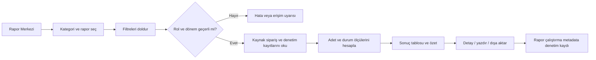
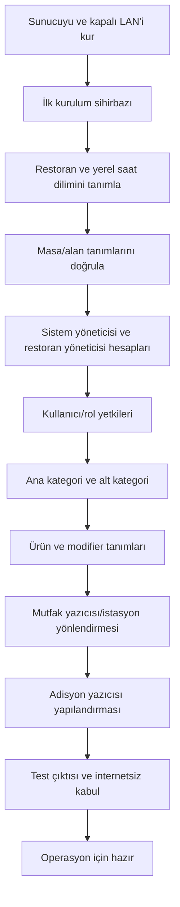
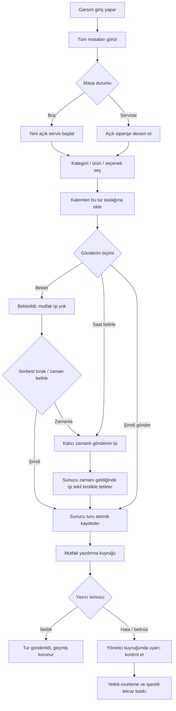
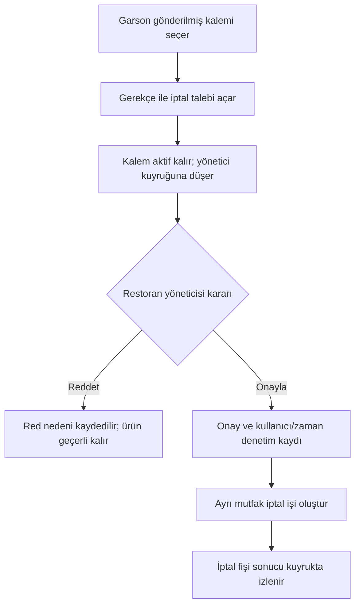
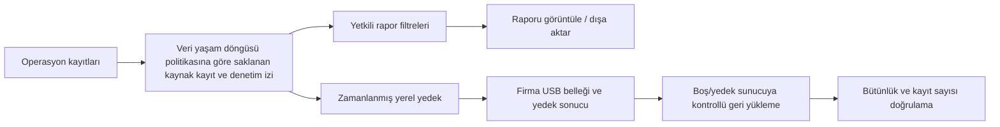
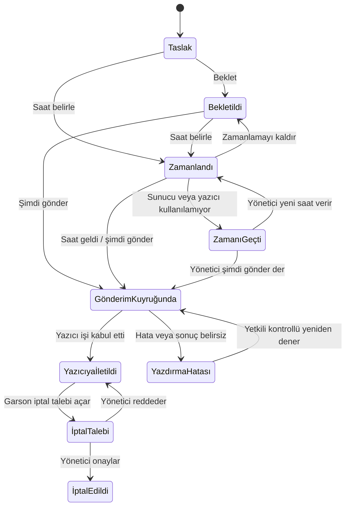
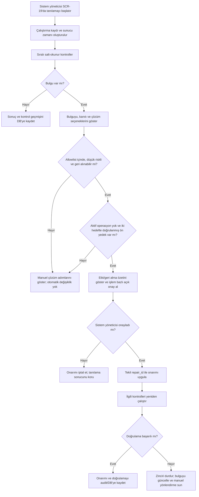

# ALACARTE — Ürün Mimarisi ve Çalışma Prensipleri

---

## 1. Amaç

Her alakart restoranın kendi kapalı yerel ağında çalışan; garsonların masa ve sipariş girdiği, siparişin restorandaki sunucuda kaydedildiği ve mutfak yazıcısından çıktığı bir restoran operasyon sistemi oluşturmak.

Sistem internet, otelin kurumsal ağı, otel PMS'i ve ödeme servisleri olmadan çalışmalıdır. Uluslararası 5 yıldızlı otel ve fine-dining masa servis standartlarına uygun masa, sipariş ve servis akışları ile modern, yüksek kontrastlı ve Alacarte'a özgü ekranlar üretilecektir.


## 2. Kapsam ve sınırlar

### Kapsamda

- Restoran ilk kurulum sihirbazı
- Restoran, masa, kullanıcı ve rol tanımları
- Ana kategori, alt kategori, ürün ve mutfak istasyonu/yazıcı eşlemesi
- Masa açma, sipariş oluşturma, siparişi mutfağa gönderme ve ek sipariş
- Mutfak ve adisyon yazdırma
- İptal talebi ve yönetici onayı/red akışı
- Aktif masa ve siparişlerin yönetici görünümü
- Kullanıcı, sipariş, yazdırma ve iptal denetim geçmişi
- Veritabanında tutulan tüm tarihsel operasyon kayıtlarına göre raporlama; yapılandırılabilir veri saklama politikası
- Yerel yedekleme, geri yükleme ve çevrimdışı güncelleme yöntemi

### Kapsam dışında

- Kart, nakit veya başka yöntemle ödeme/tahsilat
- Fiyat, toplam, vergi veya ödeme bilgisini adisyon fişinde gösterme
- Otel PMS/oda hesabı entegrasyonu
- Otel ağı, internet, bulut servisleri veya dış API bağımlılığı

## 3. Hedef mimari

```text
Garson telefonu ───────┐
Kasa/yönetici tarayıcısı ├── Restorana özel Wi-Fi/LAN ── Yerel sunucu
Mutfak yazıcısı ────────┤                            ├─ Next.js uygulaması
Adisyon yazıcısı ───────┘                            ├─ PostgreSQL
                                                     ├─ Yazdırma kuyruğu/işçisi
                                                     ├─ İşletim sistemi yazdırma kuyrukları
                                                     └─ USB bellek (günlük, 15 günlük döngüsel yedek)
```

- Uygulama ve PostgreSQL restoranın yerel sunucusunda çalışır.
- İstemciler sunucuya yalnız restoranın LAN'ı üzerinden erişir. PostgreSQL portu kullanıcı cihazlarına açılmaz; yalnız uygulama sunucusu bağlanır.
- Otel ve misafir ağlarından erişim ağ kuralıyla engellenir. Yerel yönlendiricide WAN bağlantısı kapalı tutulur; bakım/güncelleme gerektiğinde paketler güvenilir bir bakım bilgisayarı üzerinden taşınır.
- Sunucu sabit yerel IP veya yerel DNS adıyla erişilir.
- Uygulama, adisyon ve mutfak yazdırma işlerini sunucuda oluşturur ve sunucunun işletim sistemi yazdırma kuyruklarına bırakır. Her yazıcı için işletim sistemi kuyruğu, uygun sürücü/ham baskı ayarı ve hedef bağlantısı kurulur; uygulamanın doğrudan USB portu veya yazıcı protokolünü yönetmesi gerekmez. Başarısız/bekleyen işler arayüzde görünür ve yetkili kontrollü tekrar deneyebilir.
- Uygulamanın yazdırma katmanı tek bir işletim sistemi kuyruğu veya Port 9100 RAW soket arayüzü kullanır. Mutfak yazıcısı doğrudan dahili Ethernet portu üzerinden mutfaktaki kablosuz mesh AP'nin Ethernet portuna bağlanır; mutfaktan kasaya kablo çekimi yoktur.
- Sipariş gönderimlerinde istemci tekrar denemeleri çift sipariş üretmemelidir. Sipariş ve yazdırma işi veritabanında izlenebilir kimliklerle kaydedilir.
- Next.js self-hosting altyapısı yerel sunucuda üretim dağıtımını ve tek sunuculu kurulumda yerel disk önbelleğini destekler; sistem internet bağlantısına veya CDN'e ihtiyaç duymayacak şekilde paketlenmiştir.

## 4. Kullanıcı akışları

### 4.1 İlk kurulum

1. Yönetici kurulum ekranını açar.
2. Restoran adını, masa sayısını ve ilk sistem yöneticisini tanımlar.
3. Sistem masaları oluşturur; masa adları/numaraları düzenlenebilir.
4. Restoran yöneticisi ve garson hesapları açılır, roller atanır.
5. Ana kategoriler, alt kategoriler ve ürünler girilir.
6. Her ürünün mutfak yazıcısı/istasyonu atanır.
7. Adisyon ve mutfak yazıcısına test çıktısı gönderilir.
8. Sistem internet/otel ağı olmadan temel sipariş akışıyla çalıştığı doğrulanır.

### 4.2 Garson siparişi

1. Garson kişisel hesabıyla oturum açar.
2. Tüm masaları ve masa durumlarını görür; masayı seçer.
3. Kategori ve ürünü seçer; miktar ve mutfak notu girer.
4. Siparişi sunucuya gönderir.
5. Sunucu siparişi atomik olarak kaydeder, mutfak yazdırma işini sıraya koyar.
6. Garson siparişin kaydedildiğini ve yazdırma durumunu görür.
7. Ek sipariş ayrı bir ek fiş olarak yazdırılır; önceki sipariş kalemleri tekrar basılmaz.

### 4.3 İptal onayı

1. Garson gönderilmiş kalem için iptal talebi ve gerekçe oluşturur.
2. Kalem silinmez; yönetici ekranında bekleyen talep görünür.
3. Restoran yöneticisi talebi onaylar veya reddeder.
4. Karar, gerekçe, talep eden ve karar veren kullanıcı ile zaman damgası denetim kaydına yazılır.
5. Onay sonrası mutfağa iptal bildirimi çıktısı gönderilir; önceki sipariş ve çıktı geçmişi korunur.

### 4.4 Adisyon çıktısı

Sistem yöneticisi veya restoran yöneticisi, mutfak siparişinden ayrı bir **fiyatsız servis özeti** yazdırabilir. Bu bir ödeme/hesap kapatma işlemi değildir. Çıktı restoran adı, masa, sipariş kalemleri, adet, not/modifier, tarih-saat ve adisyon referansını içerebilir; fiyat, ara toplam, vergi, bakiye, ödeme/tahsilat, tender veya PMS/oda bilgisi içermez. Garsonun adisyon yazdırma yetkisi verilmesi bu planın kapsamı değildir.

### 4.5 Masa listesi ve açık siparişe devam etme

1. Oturum açan garson tüm masaları masa planında ve aranabilir listede görür.
2. Masa kartı en az masa numarası/adı, alanı ve aşağıdaki operasyon durumlarından birini taşır: **Boş**, **Serviste**, **Yeni sipariş gönderilecek**, **Mutfak çıktısı bekliyor/hatalı**, **İptal kararı bekliyor**. Kullanıcıya atama bu görünürlüğü kısıtlamaz.
3. Boş masa seçildiğinde yeni masa oturumu ve açık sipariş başlatılır. Sistem masa, açılış zamanı, oluşturan garson ve benzersiz sipariş referansını kaydeder.
4. Servisteki masa seçildiğinde yeni sipariş açılmaz; o masanın mevcut açık siparişi getirilir. Böylece sonraki garson veya aynı garson ek servis turuna devam edebilir.
5. Masa kartlarında ek sipariş bekliyor, mutfağa gönderim bekliyor, yazdırma hatası veya yönetici kararı bekliyor gibi iş durumları görsel işaretlerle ayrılır.
6. Masa servisi tamamlandı/masayı yeniden boşalt işlemi ayrı bir durum geçişidir; sipariş geçmişini silmez. Bu işlemi yalnız restoran yöneticisi yapabilir; eylem audit'e yazılır.
7. Aynı açık masaya iki garson aynı anda eriştiğinde her ikisi de son sipariş sürümünü görür. Değişiklikler sessizce birbirinin üzerine yazılmaz; yeni kalemler işlem kimliğiyle eklenir ve aynı gönderim tekrarlandığında mükerrer sipariş oluşturulmaz. Çakışan iptal talebi veya masa kapatma ikinci kez onaylanmaz.

Bu yaklaşım, uluslararası masa servisi standartlarındaki açık check özetleri ve var olan check'i tekrar açma operasyon akışına dayanır.

### 4.6 Sipariş ekranında ürün seçimi

1. Açık sipariş ekranı masa ve sipariş referansını, açılış zamanını, garsonu ve isteğe bağlı misafir/kuver sayısını gösterir. Garson check açarken veya açık siparişte misafir sayısını girip değiştirebilir. Sipariş kalemlerine koltuk numarası atanması desteklenir; varsayılan olarak zorunlu değildir. Yerel sistem yöneticisi menü/ürün sınıfı ayarından yeni kalem eklenirken koltuk sorulmasını etkinleştirebilir.
2. Garson ana kategori → alt kategori → ürün tuşu yoluyla ürün seçer; ürün arama da sunulur.
3. Ürün tuşuna dokunulduğunda kalem sipariş özetine eklenir. Adet artırma/azaltma, ürün notu ve tanımlı modifier/tercihler kalemle ilişkilendirilir.
4. Özet önceki servis turlarını ve bu turdaki yeni kalemleri ayrı durum işaretleriyle gösterir. Fiyat veya ödeme alanları ürün seçim ekranında bulunmaz.
5. Ürün yanlışlıkla seçildiyse, gönderilmemiş taslak kalemin silinmesi de kullanıcı kimliği ve denetim olayıyla kaydedilir. Garsonun taslak düzeltmesi gönderilmiş siparişin iptalinden ayrıdır.

**Misafir ve koltuk yönetimi:** Misafir sayısı masa servis check'ine ait toplam kuver değeridir; koltuk numarası her bir sipariş kaleminin masada hangi misafire ait olduğunu gösterir. İşlem ekranından misafir sayısı artırılabilir/azaltılabilir veya sayı girişiyle belirlenebilir. Koltuklar işlem sırasında artırılabilir; kalem seçilip `Koltuk Değiştir` ile başka koltuğa taşınabilir. Paylaşılabilir olarak tanımlanan ürün birden fazla koltuğa atanabilir. Ürün sınıfı ayarı koltuk numarasını her ana ürün eklemesinde sormayı açıp kapatabilir. Alacarte varsayılanında koltuk ataması isteğe bağlıdır; işletme isterse bu soruyu ürün sınıfı bazında zorunlu hale getirir. Misafir sayısı ile atanmış koltuk sayısı uyuşmadığında sistem bunu sessizce düzeltmez; kullanıcıya gösterir ve yetkili düzeltmesine izin verir. Koltuk filtresi/ayrıntısı servis ve ürün teslimini kolaylaştırmak içindir; ödeme, hesap bölme veya tahsilat işlemi bu sistemde bulunmaz.

Alacarte işlem ekranı check ayrıntısı, ürün arama, misafir/koltuk, menü grupları, ürün tuşları ve sipariş işlevlerini ergonomik bir işlem ekranında toplar; operasyonel akışta maliyet, indirim, vergi ve ödeme öğelerine yer verilmez.

### 4.7 Servis turu ve mutfağa gönderim

1. Garson yeni ürünleri seçtiğinde bu kalemler **Taslak / Bu tur** durumunda kalır; mevcut sipariş satırları değişmeden korunur.
2. Garson **Mutfağa Gönder** eylemini verdiğinde sunucu, açık siparişe bağlı yeni turu bir defa kaydeder ve mutfak yazdırma işini ayrı bir yazdırma kimliğiyle kuyruğa koyar.
3. Mutfak fişi yalnız bu turda gönderilen kalemleri, adetleri, masa/garson/sipariş referansını, zaman bilgisini ve mutfak notlarını içerir. Fiyat, toplam, vergi, ödeme ve PMS bilgisi basılmaz.
4. Sunucu onayı geldikten sonra tur **Kaydedildi / yazdırma bekliyor / yazıcıya iletildi / yazıcı hatası** durumlarından uygun olanına geçer. Ekran siparişin sunucuya kaydedilmesiyle yazıcının işi almasını birbirinden ayrı gösterir.
5. Yeni ek sipariş yeni tur ve ayrı mutfak fişi oluşturur; önceki turdaki ürünleri tekrar basmaz. Garson masaya geri dönüp açık siparişe devam edebilir.
6. Yazıcıdan çıktı alındığı belirsizse otomatik tekrarla ikinci bir sipariş üretilemez. Yönetici yazıcı kuyruğunu ve iş kimliğini inceler; tekrar baskı açıkça **TEKRAR BASKI** olarak işaretlenir.

#### Bekletme, serbest bırakma ve zamanlı gönderim

1. Garson sipariş taslağındaki tek ürünü veya seçili ürün grubunu **Beklet** olarak işaretleyebilir. Bekletilen ürün adisyon özetinde ve masa görünümünde belirgin bir etiketle kalır; mutfak yazdırma kuyruğuna henüz iş oluşturulmaz.
2. Garson, yeni eklediği ürünler için **Bu turdaki ürünleri beklet** seçeneğini açabilir. Seçenek açıkken eklenen her ürün bekletilir; kullanıcı seçeneği kapatıp durumunu ekranda doğrulayabilir.
3. Garson bekleyen kalem(ler)i seçip **Şimdi gönder** ile derhal mutfağa yönlendirebilir veya **Saat belirle** ile restoranın yerel saat diliminde gelecekteki gönderim zamanını seçebilir. Ürün bazında ya da seçili grup/tur için aynı zaman uygulanabilir.
4. Bekletilen kalemin durumu **Bekletildi**; saat atanmış kalemin durumu **Zamanlandı · GG.AA.YYYY SS:DD** olarak görünür. Sipariş listesi ve yönetici ekranı bu ürünleri ve yaklaşan gönderimleri filtreleyebilir.
5. Planlanmış saat geldiğinde yerel sunucu görevi yürütür; garson cihazının açık veya ağa bağlı olması gerekmez. Sunucu, zamanlanmış işi ve mutfak yazdırma işini tekil kimlikle ilişkilendirir; yeniden başlama/tekrar deneme aynı sipariş turunu veya fişi ikinci kez oluşturmaz.
6. Gönderim başlamadan önce garson kendi bekleyen/zamanlanmış ürününün saatini değiştirebilir veya zamanlamayı kaldırabilir. Restoran yöneticisi bütün masalardaki bekleyen/zamanlanmış işleri görebilir, saatini değiştirebilir, iptal edebilir veya **Şimdi gönder** ile serbest bırakabilir. Her değişiklik kullanıcı ve zaman bilgisiyle denetim kaydına yazılır.
7. Zamanlı gönderim sunucu saatine göre planlanan anda çalışır; normal işleyişte gecikmeli gönderim davranışı yoktur. Sunucu kapalıyken veya yazdırma kuyruğu kullanılamazken iş zamanında yürütülemezse sessizce geç gönderilmez: **Zamanında yürütülemedi** olarak işaretlenir ve yöneticiye bildirilir. Yönetici açıkça **Şimdi gönder** veya yeni saat seçer; böylece arıza sonrası eski sipariş mutfağa habersiz düşmez.
8. Zamanı gelerek mutfağa iletilmiş bir ürün artık bekleyen/zamanlanmış değildir; iptali 4.8'deki yönetici onaylı iptal akışına tabidir. Bekletme/zamanlama, iptal yetkisini atlatmaz.

Uluslararası masa servisi standartlarında servis turunu mutfak cihazına gönderme ile check'in daha sonra çağrılabilmesi ayrışır. Tek kalemi veya tüm turu bekletme, belirli saat için zamanlı gönderim, gönderim saatini değiştirme ve bekleyen kalemleri görüntüleme standart operasyon akışıdır. Alacarte bu işlevleri yerel sunucu tarafından yürütülen, fiyat/ödeme/PMS kapsamı dışında kalan sipariş durumları olarak uygular.

### 4.8 Gönderilmemiş turu iptal etme ve gönderilmiş kalemi iptal talebi

- Taslak tur gönderilmeden önce garsonca düzeltilebilir; her kaldırma yine denetim geçmişine yazılır. Bu taslak işlemi, mutfağa gönderilmiş kalemin iptaliyle aynı şey değildir.
- Mutfağa gönderilmiş bir veya daha fazla kalemin kaldırılması için garson gerekçe yazarak **iptal talebi** açar. Talep beklerken orijinal satır silinmez/değiştirilmez ve masa/sipariş geçmişinde görünür.
- Restoran yöneticisi talebi inceler, onaylar veya reddeder. Onay/ret kararı kimlik, zaman ve gerekçeyle kaydedilir. İptal, yalnızca yönetici onayı verildiğinde yürürlüğe girer.
- Onaylı ve daha önce mutfağa iletilmiş kalem için ayrı iptal bildirimi mutfak yazdırma kuyruğuna gönderilir. İptal bildirimi orijinal fişi değiştirmez; masa, sipariş turu, ürün, adet ve iptal referansını belirtir.
- Reddedilen talepte orijinal ürün siparişi geçerli kalır; garson ve yönetici karar sonucunu görür.
- Bir gönderim turundaki yalnız gönderilmemiş kalemlerin çıkarılması durumunda dahi Alacarte'ta sessiz silme yapılmaz; denetim (audit) kaydı korunur. Garsonun mutfağa iletilmiş sipariş kalemini iptali için yönetici onayı her zaman zorunludur.

Sistem, çalışan rolü ve yetkisine göre POS işlevlerini sınırlar; iptal gerekçeleri yapılandırılmışsa iptal sırasında zorunlu gerekçe seçtirir. Garson rolünden ayrı, yetkili roller onay verebilir.

**Alacarte için önerilen müdür yokluğu çözümü:** İşletme, vardiya başlamadan önce restoran yöneticisi dışında kendi hesabıyla giriş yapan bir veya daha fazla **vardiya iptal yetkilisi** belirleyebilir. Bu kişiye yalnız gönderilmiş kalem iptal talebini onaylama/reddetme yetkisi verilir; kullanıcı/menü/yedek/audit yönetimi gibi diğer yönetici ayrıcalıkları verilmez. Garson talebi açan kişi ise aynı talebi onaylayamaz. Gerekçe listesi zorunlu tutulur; seçilen nedenin yanında kısa açıklama alınır ve talep eden, karar veren, masa, kalem/adet, servis turu, zaman, gerekçe ve mutfağa giden iptal fişi tek audit zincirinde tutulur. Vardiya yetkilisi atanmamışsa veya erişilemiyorsa mevcut güvenli kural geçerlidir: talep bekler, sipariş satırı etkin kalır, otomatik/garson kaynaklı iptal yapılmaz. Yetkilendirme rollerinde yalnız gerekli iptal izni açılır; kullanıcılar arasında parola/PIN paylaşımı kesinlikle kullanılmaz. İşletme onayı verilene kadar varsayılan olarak yalnız restoran yöneticisi iptal kararı verebilir.

### 4.9 Mutfak yazıcısı ve fiyatsız adisyon yazıcısı

- **Mutfak yazdırması:** garsonun gönderdiği servis turu veya yönetici onaylı iptal bildirimi mutfak yazdırma kuyruğuna gider. Mutfağa gönderim ile adisyon basımı ayrı eylem, ayrı çıktı şablonu ve ayrı yazdırma işi olarak tutulur.
- **Fiyatsız adisyon:** sistem yöneticisi veya restoran yöneticisinin başlattığı, masanın servis kalemlerini özetleyen misafir/operasyon çıktısıdır. Siparişi mutfağa göndermez, servisi/masayı kapatmaz ve ödeme kaydı oluşturmaz.
- Adisyon yazdırma isteği için sipariş sürümü kaydedilir; çıktının hangi servis turlarını kapsadığı, kim tarafından ve ne zaman alındığı kayda geçer.
- Yazıcı erişim hatası siparişi veritabanından geri almaz. Kuyruk hatası yöneticiye görünür ve yetkili yeniden deneyebilir. Sonucun belirsiz olduğu tekrar baskı ekranda ve çıktıda yeniden basım olarak belirtilir.

İşlem ekranında yazdırma (`Yazdır`) ve mutfağa iletim (`Gönder`) ayrı komutlardır. Alacarte bu ayrımı kesin olarak korur; operasyonel akışta maliyet, toplam, vergi veya ödeme içeriğine yer vermez.

#### 4.9.1 Uluslararası Servis Standartlarında Çıktı Düzenleri ve Fiş Şablonları

Sipariş cihazı çıktısı (mutfak sipariş fişi) ile servis adisyonu yazdırma birbirinden bağımsız iki ayrı operasyonel eylemdir. Bir servis turu mutfağa gönderilebilir; servis adisyonu ise talep üzerine basılabilir. Mutfak sipariş fişlerinde ürün adı, miktar, masa/garson bilgisi, hazırlama seçenekleri (modifier), koltuk numarası ve iptal işareti gibi unsurlar yapılandırılabilir. Alacarte bu bilgi hiyerarşisini ve iş akışını uluslararası 5 yıldızlı otel alakart standartlarına uygun olarak sunar.

**Uygulama için bağlayıcı çıktı kuralları:** Mutfak gönderimi ile adisyon yazdırma arayüzde ayrı düğmeler, sunucu komutları, denetim olayları, kuyruk işleri ve şablonlardır. Birinin çalışması diğerini tetiklemez. “Mutfağa Gönder” adisyon basmaz; “Adisyon Yazdır” mutfağa sipariş göndermez, masa/servisi kapatmaz ve ödeme/tahsilat oluşturmaz. Mutfak fişinde adet (1 olsa da), masa, sipariş ve servis turu referansı, fişi gönderen garson, gönderim zamanı, ilgili istasyon, ürün ve varsa modifier/not zorunludur. Koltuk numarası yalnız siparişte girilmişse ürün satırında gösterilir. Fiyat ve finansal/PMS alanları hiçbir mutfak fişinde veya fiyatsız adisyon özetinde yer almaz.

**A. Mutfak sipariş fişi — yeni servis turu**

```text
              ALACARTE / RESTORAN ADI
                 MUTFAK SİPARİŞİ
                   YENİ TUR
MASA: 12                         TUR: 03
Sipariş: A-2026-000184       Saat: 20:14
Garson: Deniz                 İstasyon: SICAK
------------------------------------------------
2 x Izgara Köfte
   - Az pişmiş
   - Soğansız
   NOT: Sos ayrı servis edilsin
1 x Mevsim Salata
   NOT: Lütfen bekletmeyin
------------------------------------------------
Gönderim: 20:14:32       Fiş: K-000391
```

- Her fiş yalnız o gönderim turunda eklenen ve ilgili mutfak istasyonuna yönlenen kalemleri taşır; önceki tur tekrar basılmaz. Ürün adı/fiş adı, miktar, seçenek/modifier, not, masa, garson, tur, gönderim zamanı ve tekil fiş numarası zorunlu olarak görünür.
- Adet 1 olsa da miktar basılır. Modifier ve not ana ürünün altında ayırt edilen satır yapısıyla görünür. İstasyon yönlendirmesi menü ayarına göre yapılır; istasyon tanımsızsa varsayılan istasyon ya da gönderim öncesi hata uygulanır.
- Fiyat, toplam, vergi, ödeme/tahsilat ve PMS/oda bilgisi basılmaz. Bekletilmiş/gönderilmemiş kalemler basılmaz. Zamanı gelerek serbest bırakılan kalemler yeni tur/fiş oluşturur.
- Garsonun gönderilmiş kalemi iptal etmesi yönetici onayına bağlıdır. Onayda orijinal fiş ve sipariş kaydı değiştirilmez; masa/tur/ürün/adet, özgün sipariş/fiş referansı, onaylayan yönetici, zaman ve gerekçe bilgisi taşıyan ayrı, belirgin **İPTAL / VOID BİLDİRİMİ** oluşturulur ve ilgili mutfak istasyonuna gönderilir. Gönderilmemiş taslak kalemin kaldırılması denetim kaydıdır; mutfağa iptal fişi üretmez.
- Tekrar baskı `TEKRAR BASKI` ibaresi ve ilk yazdırma işi referansıyla belirtilir; yeni sipariş/tur veya ürün adedi oluşturmaz. Baskı işi değişmez içerik anlık görüntüsü (snapshot) ve tetikleyen sipariş/tur olayıyla ilişkilendirilir.
- Zorunlu MVP varsayılanı: aynı tur ve istasyona ait kalemleri tek fişte toplamak; ürün/modifier ilişkisini korumak. Kalem başına fiş veya dopplebon kapsam dışıdır.

#### 4.9.2 Tek Fiziksel Mutfak Yazıcısı ve Çoklu Mantıksal İstasyon İşleyişi

Standart alakart restoran paketimizde mutfakta **1 adet fiziksel termal mutfak yazıcısı (Epson TM-T88VII-112 Termal Fiş Yazıcı - Dahili Ethernet)** yer alır. Ancak mutfak operasyonu şef ve tezgâhlar bazında birden çok bölüme ayrılır:

1. **Mantıksal İstasyonlar (KitchenStation):** Sistemde 4 ana istasyon tanımlıdır:
   - `SICAK MUTFAK` (Fırın, tava, sıcak başlangıçlar)
   - `SOĞUK / MEZE` (Soğuk mezeler, salatalar, ceviche, zeytinyağlılar)
   - `IZGARA İSTASYONU` (Kırmızı etler, kömür/döküm ızgara, balık ızgara)
   - `TATLI / BAR` (Tatlılar ve servis barı içecekleri)
2. **Tek Yazıcıya Eşleme:** Tüm bu mantıksal istasyonlar varsayılan olarak restorandaki tek fiziksel mutfak yazıcısına (`Mutfak-Windows` / Port 9100 RAW) yönlendirilmiştir.
3. **Seri Fiş Basımı & Şef Dağıtımı:** Garson bir masadan aynı turda hem Soğuk Meze hem Izgara Steak sipariş ettiğinde, mutfaktaki tek yazıcıdan otomatik kağıt kesimiyle **2 ayrı fiş** peş peşe çıkar:
   - 1. Fişin başlığında `İstasyon: SOĞUK / MEZE` yazar.
   - 2. Fişin başlığında `İstasyon: IZGARA` yazar.
   - Mutfak Şefi çıkan ilk fişi Meze tezgâhına, ikinci fişi Izgara ustasına asar; tezgâhlar arası sipariş karışıklığı yaşanmaz.
4. **Geleceğe Yönelik Genişleme (Sıfır Kod Değişikliği):** Eğer restoranda ileride ikinci bir mutfak yazıcısı eklenirse, tek bir satır kod değiştirmeden Sistem Yöneticisi panelinden (SCR-17) ilgili istasyon yeni yazıcı kuyruğuna atanır ve sistem anında çoklu fiziksel yazıcı moduna geçer.

**B. Fiyatsız adisyon / servis özeti**

```text
              ALACARTE / RESTORAN ADI
              ADİSYON / SERVİS ÖZETİ
Masa: 12            Sipariş: A-2026-000184
Çıktı zamanı: 20:42   Kapsam: Tüm gönderilmiş turlar
------------------------------------------------
Tur 01  19:48  2 x Izgara Köfte
                 Az pişmiş; soğansız
Tur 02  20:14  1 x Mevsim Salata
                 Sos ayrı servis edilsin
------------------------------------------------
TOPLAM SERVİS KALEMİ: 3        Sayfa 1/1
```

- Yalnız restoran yöneticisi masa ve sipariş kapsamını (seçili tur/tüm gönderilmiş turlar) seçer, önizler ve yazdırır. Yalnız kaydedilmiş, mutfağa gönderilmiş etkin kalemler özete girer; bekletilmiş/taslak kalemler dahil edilmez. İptal edilen kalemler ayrı bir bölümde **İPTAL** durumuyla gösterilir; etkin adet toplamına katılmaz.
- Fiyat, ara toplam, toplam, vergi, bakiye, ödeme/tahsilat, tender, indirim veya PMS/oda alanı yoktur. Yazdırma mutfağa gönderim, masa kapatma veya ödeme değildir.
- Uzun çıktıda masa/sipariş referansı ve sayfa numarası her sayfada yinelenir. Tekrar baskı işaretlenir ve kullanıcı, zaman, sipariş snapshot sürümü kaydedilir.

Her iki formatta özgün Alacarte başlıkları ve tipografi kullanılır. Büyük masa/durum hiyerarşisi, ürün-modifier ilişkisi, boşluk ve okunabilirlik uluslararası ergonomi ve termal baskı standartlarına dayanır; ölçü, renk, logo ve gereksiz ibareler kopyalanmaz. HTML önizlemesi ile gerçek 80 mm çıktı ayrı ayrı kabul edilir; Türkçe karakter, uzun ürün adı/not, çoklu adet, kesim, yeni tur ve tekrar baskı kontrol edilir.

### 4.10 Restoran yöneticisi servis kontrolü

1. Yönetici tüm masa ve açık siparişleri; son sipariş zamanı, servis turu, mutfak yazdırma durumu ve atanmış/işlemi yapan garsonla birlikte görüntüler.
2. Bekleyen iptal talepleri ayrı listede gerekçe ve gönderilmiş/taslak kalem bilgisiyle gösterilir.
3. Yönetici talebi açar, önceki ve bu turdaki kalemleri görür, onay/red verir. Onaylı iptalde mutfak iptal fişi kuyruğa düşer.
4. Yönetici fiyatsız adisyon yazdırır, yazıcı kuyruğundaki sorunları görür ve gerekirse açıkça işaretli tekrar baskı başlatır.
5. Kullanıcı, sipariş, iptal, yazdırma ve masa kapatma olayları tarih sırasıyla denetim kaydında aranabilir.

### 4.11 Yerel ağ/sunucu sorunu

1. Garson cihazı sunucuya erişemezse ekranda bağlantı kaybı belirgin gösterilir; kullanıcıya **Kaydedildi** veya **Mutfağa gönderildi** denmez.
2. Girilmiş ama sunucuya onaylatılmamış taslak cihazda geçici olarak korunabilir ve **Gönderilmedi** etiketiyle kalır.
3. Bağlantı geldikten sonra tekrar gönderimde istemci işlem kimliği kullanılır; sunucu aynı sipariş/servis turunu ikinci kez oluşturmaz.
4. Mutfağa gönderme ile yazıcının işi alıp almadığı ayrı durumlar olarak görünür. Yetkili, belirsiz baskı sonucunu kontrol etmeden sessiz otomatik tekrar başlatmaz.

Bağlantı kesildiğinde veya çevrimdışı kalındığında gönderilmemiş taslak uyarısı açıkça gösterilir; Alacarte yerel sunucu modelinde sunucu onayı ve yazıcı sonucu ayrımı net bir şekilde kullanıcıya sunulur.

#### 4.11.1 Tüm sistem için kullanıcı ve zaman damgalı denetim izi

Sistemdeki iş akışlarının tamamı denetim izi üretir. Kayıtlar sunucu tarafından oluşturulur; tarayıcı/cihaz saatine güvenilmez. Her olayda sunucunun kendi saatinden alınan tarih-saat damgası, sunucuda ayarlı saat dilimi, kullanıcı kimliği ve işlem anındaki kullanıcı adı, rol, restoran, cihaz/oturum, olay türü, etkilenen nesne kimliği (masa/sipariş/kalem/tur/yazdırma işi vb.), işlem sonucu ve varsa gerekçe bulunur. Değişikliklerde önceki ve yeni değerler; onay akışlarında talep eden ve karar veren ayrı aktörler saklanır. İlgili olaylar ortak bir işlem/izleme kimliğiyle birbirine bağlanır.

Denetim kapsamı en az şunlardır:

- Oturum açma/kapama, başarısız girişler, oturum süresi dolması ve yetki reddi.
- Restoran/alan/masa, kullanıcı/rol/yetki, kategori/alt kategori/ürün/modifier, istasyon ve yazıcı tanımlarının eklenmesi, değiştirilmesi, pasifleştirilmesi.
- Masa açma ve durum değişikliği; sipariş/kalem/tur oluşturma, düzenleme, taslak kaldırma, bekletme, zamanlama, zaman değiştirme, serbest bırakma ve mutfağa gönderme.
- İptal talebi, onay/red ve gerekçe; mutfak/adisyon yazdırma isteği, yazıcıya iletim sonucu, hata, sonucu belirsiz iş ve tekrar baskı.
- Rapor çalıştırma, filtreler, dışa aktarma/yazdırma; yedek başlatma/sonucu ve geri yükleme işlemleri; sistem yapılandırması ve yetkili müdahaleleri.

Denetim kayıtları uygulama içinden salt okunur görüntülenir; kullanıcılar ve restoran yöneticileri olayları düzenleyemez veya silemez. Yerel sistem yöneticisi saklama politikasını yönetebilir; süre sonunda silme/anonimleştirme yapılacaksa önce denetim aralığı ve olay sayısını içeren, hash zincirinin son hash'ini ve kapsanan aralığı koruyan imzalı arşiv/manifest dışa aktarılır, ardından silme işlemi gerekçe ve sonuçla audit'e kaydedilir. Bu nedenle “değiştirilemez” ifadesi uygulama arayüzü ve normal iş akışında değiştirilemez, hash zinciriyle müdahalesi fark edilebilir anlamındadır; ayrıcalıklı Windows/DB yöneticisine karşı mutlak değişmezlik garantisi değildir. Düzeltme gerekiyorsa önceki olayı koruyan yeni bir düzeltme/karşı olay eklenir. Parola, oturum belirteci veya başka sırlar kayda yazılmaz. Denetim günlüğü kullanıcı, rol, olay türü, nesne/masa/sipariş, sonuç ve tarih-saat aralığıyla aranabilir. Denetim verisi hem USB hem yerel dizin yedeğine dahildir; saklama süresi yerel sistem yöneticisinin politikasına tabidir.

Otomatik zamanlayıcı, yedekleme görevi ve işletim sistemi yazdırma kuyruğu gibi kullanıcı oturumu olmadan çalışan eylemlerde aktör `SİSTEM` olarak yazılır; olayı planlayan/başlatan kullanıcı ve bağlı iş kimliği ayrıca korunur. Olay zamanı sunucunun kendi sistem saatinden alınır; istemci saati kullanılmaz ve uygulama saati başka bir kaynağa göre değiştirmez. Sunucunun yapılandırılmış saat dilimiyle birlikte damga kaydedilir/gösterilir. İşlem ve audit olayı aynı veritabanı işlemi içinde kaydedilir.

Sistem yöneticisi her kurulumda yerel bir roldür. Restoranlar birbirlerinin sunucularına/hesaplarına erişemez; ortak merkezi panel, uzaktan yönetim veya veri eşitleme bulunmaz.

**Kabul ölçütü:** Her başarılı ve reddedilmiş kritik işlem için aktör ve sunucu zaman damgası bulunmalı; bir siparişin masa açılışından tur gönderimine, mutfak baskısına ve varsa iptal/onay/tekrar baskısına kadar olay zinciri tekil referanslarla izlenebilmeli. Yetkisiz rolde görüntüleme ve değiştirme sunucu tarafında engellenmeli. Saklama sonu arşiv/silme provasında imzalı manifest, kapsanan aralık ve hash zinciri doğrulanmalı; yedekten dönüşte geri yükleme öncesi/sonrası bakım günlüğü ve audit izi ilişkilendirilebilmeli.

### 4.12 Ekran envanteri ve ekran gereksinimleri

Aşağıdaki liste planlanan her kullanıcı ekranını, ana içeriğini, eylemlerini ve kritik durumlarını tanımlar. Ekranların görsel prototipleri ve geliştirme sırasında doğrulanmış gerçek uygulama görünümleri ayrı teslimatlardır; bu bölüm ekran gereksinimlerini tanımlar, tek başına tüm ekranların tasarlanmış veya uygulanmış olduğu anlamına gelmez.

| ID / ekran | Kullanıcı ve cihaz | İçerik ve ana eylemler | Zorunlu durumlar ve kurallar                                                                                         |
| ---------- | ------------------ | ---------------------- | -------------------------------------------------------------------------------------------------------------------- |
| SCR-01     | Tüm roller;        | Kullanıcı adı,         | Hatalı giriş, devre dışı hesap, oturum süresi doldu, sunucuya erişilemiyor; hata metni kullanıcıya Türkçe            |
| Giriş      | telefon/kasa       | parola/PIN politikası, | gösterilir.                                                                                                          |
|            |                    | giriş, oturum kapatma  |                                                                                                                      |
| SCR-02 İlk | Sistem yöneticisi; | Restoran adı, masa     | Adım adım ilerleme, kısa bağlama duyarlı yardım, zorunlu alan doğrulama, geri dönme, ayar önizlemesi ve kurulum      |
| kurulum    | kasa               | adedi/numaraları, ilk  | sonrası kontrol listesi; yarıda kalırsa güvenli devam. Teknik terimler açıklamasız bırakılmaz.                       |
| sihirbazı  |                    | yönetici, yerel saat   |                                                                                                                      |
|            |                    | dilimi; adım özeti,    |                                                                                                                      |
|            |                    | doğrula ve devam et    |                                                                                                                      |
| SCR-03     | Garson/yönetici;   | Alan/masa kartları,    | Boş, serviste, taslak var, zamanlandı/bekliyor, mutfak gönderim/baskı bekliyor-hatalı, iptal kararı bekliyor; tüm    |
| Masa planı | telefon ve         | masa arama, durum      | garsonlar tüm masaları görür. Son sunucu eşitleme zamanı/bağlantı durumu görünür; eski veriyle işlemde güncelleme    |
| ve masa    | dokunmatik kasa    | filtreleri, masayı     | uyarısı çıkar.                                                                                                       |
| listesi    |                    | açma veya açık         |                                                                                                                      |
|            |                    | siparişe dönme         |                                                                                                                      |
| SCR-04     | Garson/yönetici;   | Masa/sipariş başlığı,  | Taslak, kaydedilmemiş, kaydediliyor, kaydedildi, bekletildi, zamanlandı, gönderim/baskı durumu; fiyat/ödeme alanı    |
| Sipariş /  | telefon ve         | kişi sayısı            | hiçbir rolde gösterilmez. Yönetici öğrenme modunu açtıysa garson bağlama duyarlı ipuçlarını görebilir veya adım adım |
| işlem      | dokunmatik kasa    | (opsiyonel),           | sipariş rehberini başlatabilir. Hata/yeniden denemede aynı istek kimliği korunur; çift tıklama çift sipariş          |
| ekranı     |                    | kategori-alt           | oluşturmaz. Eşzamanlı düzenlemede taslak korunur ve yenile/çakışmayı çöz sunulur.                                    |
|            |                    | kategori-ürün tuşları, |                                                                                                                      |
|            |                    | ürün arama, mevcut     |                                                                                                                      |
|            |                    | kalemler ve yeni tur,  |                                                                                                                      |
|            |                    | adet/not/modifier,     |                                                                                                                      |
|            |                    | kaydet/gönder geri     |                                                                                                                      |
|            |                    | bildirimi, öğrenme     |                                                                                                                      |
|            |                    | ipuçları ve adım       |                                                                                                                      |
|            |                    | paneli                 |                                                                                                                      |
| SCR-05     | Sipariş girebilen  | Adet, tanımlı          | Yalnız gönderilmemiş kalem düzenlenebilir; gönderilmiş kalem düzenlemesi iptal talebine yönlendirir. Zorunlu seçenek |
| Ürün       | rol; telefon/kasa  | seçenek/modifier,      | eksikliği gönderimi engeller ve öğrenme modu açıksa eksik adımı anlaşılır biçimde açıklar.                           |
| seçeneğive |                    | mutfak notu, kalem/tur |                                                                                                                      |
| kalem      |                    | seçimi, taslağı        |                                                                                                                      |
| düzenleme  |                    | kaldırma;              |                                                                                                                      |
|            |                    | seçenek/not/koltuk     |                                                                                                                      |
|            |                    | ipuçları               |                                                                                                                      |
| SCR-06     | Garson/yönetici;   | Kalem/grup/turu        | Bekletildi, zamanlandı, zamanı geldi, gönderim hazırlanıyor, gönderildi, zamanı geçti/gönderilemedi, iptal edildi;   |
| Bekletmeve | telefon/kasa       | bekletme, “bu          | saat restoran yerel saati ve saat dilimi açık olmalı. Öğrenme modu bekletme/zamanlamanın mutfağa henüz iş            |
| zamanlama  |                    | turdakileri beklet”,   | göndermediğini açıklar.                                                                                              |
|            |                    | tarih-saat seçimi,     |                                                                                                                      |
|            |                    | zaman değiştir/kaldır, |                                                                                                                      |
|            |                    | şimdi gönder; bağlama  |                                                                                                                      |
|            |                    | duyarlı yardım         |                                                                                                                      |
| SCR-07     | Restoran           | Tüm masa durumları,    | Filtre/sıralama; alarmın okunmadı/incelemede/çözüldü durumu ve önerilen sonraki eylem; masa açma ve işlem            |
| Yönetici   | yöneticisi; kasa   | son hareket, açık tur, | ayrıntısına geçiş. Her gösterge Normal/Uyarı/Kritik/Bilinmiyor, son ölçüm yaşı ve son hata/başarı zamanını sunar;    |
| operasyon  |                    | bekletilmiş/zamanlanmı | tıklama SCR-19 tanılama ayrıntısına gider. Eski heartbeat yeşil kalmaz. AP sağlık sorgusu desteklenmiyorsa yalnız    |
| panosu     |                    | ş işler, yazıcı        | yerel erişim/son görülen istemci bilgisi gösterilir ve AP kesin sağlıklıymış gibi sunulmaz. Göstergeler bilgi        |
|            |                    | uyarıları ve bekleyen  | amaçlıdır; tanılama/onarım yetkisi vermez. Öğrenme modu varsayılan kapalıdır; yalnız restoran yöneticisi açıp        |
|            |                    | iptal kararları;       | kapatabilir.                                                                                                         |
|            |                    | garson öğrenme modu    |                                                                                                                      |
|            |                    | anahtarı;              |                                                                                                                      |
|            |                    | sunucu/uygulama+DB,    |                                                                                                                      |
|            |                    | adisyon/mutfak         |                                                                                                                      |
|            |                    | yazıcıları ve Windows  |                                                                                                                      |
|            |                    | kuyrukları, yerel      |                                                                                                                      |
|            |                    | LAN/AP/gateway ve      |                                                                                                                      |
|            |                    | garson cihazları için  |                                                                                                                      |
|            |                    | ışıklı bağlantı        |                                                                                                                      |
|            |                    | göstergeleri           |                                                                                                                      |
| SCR-08     | Restoran           | Tüm turlar, kalem      | Gönderilmiş kalem geçmişi silinemez; yönetici eylemleri rol/izin kontrolü ve denetim kaydıyla yapılır.               |
| Sipariş ve | yöneticisi; kasa   | durumları, işlem       |                                                                                                                      |
| masa       |                    | yapanlar, mutfak       |                                                                                                                      |
| ayrıntısı  |                    | işleri, zamanlanmış    |                                                                                                                      |
|            |                    | gönderiler, olay       |                                                                                                                      |
|            |                    | geçmişi                |                                                                                                                      |
| SCR-09     | Garson talep açar; | Talep gerekçesi,       | Bekliyor, onaylandı, reddedildi; çift karar engeli; onay sonrası ayrı mutfak iptal işi ve baskı durumu. Garson karar |
| İptal      | restoran           | kalem/tur, talep eden, | veremez.                                                                                                             |
| talepleri  | yöneticisi karar   | zaman; onayla/reddetve |                                                                                                                      |
|            | verir;             | karar gerekçesi        |                                                                                                                      |
|            | kasa/telefon       |                        |                                                                                                                      |
| SCR-10     | Restoran           | Mutfak ve adisyon      | Bekliyor, gönderiliyor, yazıcıya iletildi, hata, sonucu belirsiz, tekrar baskı; belirsiz işte otomatik çift baskı    |
| Yazıcılarv | yöneticisi/sistem  | cihazı,                | yok. Kullanıcıya anlaşılır çözüm adımları ve yöneticinin destek için dışa aktaracağı tanılama kaydı sunulur.         |
| e yazdırma | yöneticisi; kasa   | çevrimiçi/erişim       |                                                                                                                      |
| kuyruğu    |                    | durumu, iş kimliği,    |                                                                                                                      |
|            |                    | çıktı türü, deneme ve  |                                                                                                                      |
|            |                    | zaman, hata            |                                                                                                                      |
|            |                    | kodu/açıklaması, son   |                                                                                                                      |
|            |                    | başarılı iş, tekrar    |                                                                                                                      |
|            |                    | baskı/şimdi dene       |                                                                                                                      |
| SCR-11     | Sistem/restoran    | Masa ve sipariş/tur    | Fiyat/toplam/vergi/ödeme/PMS alanı yok; yazdırma masa kapatma veya mutfak gönderme yapmaz.                           |
| Fiyatsız   | yöneticisi; kasa   | kapsamı, çıktı         |                                                                                                                      |
| adisyon    |                    | önizlemesi, yazdır,    |                                                                                                                      |
| önizleme/y |                    | yazdırma geçmişi       |                                                                                                                      |
| azdırma    |                    |                        |                                                                                                                      |
| SCR-12     | Sistem/restoran    | Rapor kategorileri ve  | Boş sonuç, geçersiz filtre, yükleniyor, uzun sorgu/arka plan, hata; etkin filtreler ve veri dönemi açıkça görünür;   |
| Rapor      | yöneticisi;        | hazır raporlar,        | sonuç adetleri kaynak sipariş/audit kayıtlarıyla tutarlıdır. Fiyat/ödeme raporu yok; filtre ve çalıştırma audit'e    |
| merkezi    | dokunmatik kasa    | arama/sık              | yazılır.                                                                                                             |
|            |                    | kullanılanlar,         |                                                                                                                      |
|            |                    | tarih/masa/garson/kate |                                                                                                                      |
|            |                    | gori/ürün/durum        |                                                                                                                      |
|            |                    | filtreleri,            |                                                                                                                      |
|            |                    | çalıştır/temizle,      |                                                                                                                      |
|            |                    | tablo/özet, kaynak     |                                                                                                                      |
|            |                    | ayrıntısı, yazdır/dışa |                                                                                                                      |
|            |                    | aktar                  |                                                                                                                      |
| SCR-13     | Yerel sistem       | Kullanıcı/rol, olay    | Her olay sunucu sistem saatinden damgalı; salt okunur; saklama, yedekleme ve dışa aktarma yönetimi yalnız yerel      |
| Denetim    | yöneticisi; kasa   | türü,                  | sistem yöneticisinde; restoran yöneticisi görüntüleyemez.                                                            |
| günlüğü    |                    | nesne/masa/sipariş,    |                                                                                                                      |
|            |                    | sonuç ve sunucu        |                                                                                                                      |
|            |                    | tarih-saat aralığı     |                                                                                                                      |
|            |                    | arama; önceki-yeni     |                                                                                                                      |
|            |                    | değer ve olay zinciri; |                                                                                                                      |
|            |                    | yetkili dışa aktarma   |                                                                                                                      |
| SCR-14     | Yerel sistem       | Restoran bilgisi,      | Kullanımdaki masa silinmez; açık siparişte masa değişikliği ayrı ve denetimli işlem olur.                            |
| Restoran/m | yöneticisi; kasa   | alanlar, masa          |                                                                                                                      |
| asa/alan   |                    | numarası/adı/aktifliği |                                                                                                                      |
| tanımları  |                    | ;                      |                                                                                                                      |
|            |                    | ekle/düzenle/pasifleşt |                                                                                                                      |
|            |                    | ir                     |                                                                                                                      |
| SCR-15     | Yerel sistem       | Ana kategori, alt      | Taslak/aktif/pasif; kullanım geçmişi korunur; kategori veya ürün pasifleştirme açık siparişi silmez. Menü sürümü     |
| Menü       | yöneticisi; kasa   | kategori, ürün, ad/fiş | sunucuda etkinleştirilir; istemcilerin güncel sürümü aldığı doğrulanır ve eski menü kullanan oturum uyarılır. Fiyat  |
| yönetimi   |                    | adı, etkinlik,         | alanı kapsam dışıdır.                                                                                                |
|            |                    | sıralama, modifier ve  |                                                                                                                      |
|            |                    | mutfak                 |                                                                                                                      |
|            |                    | istasyonu/yazıcı       |                                                                                                                      |
|            |                    | eşlemesi; değişiklik   |                                                                                                                      |
|            |                    | özeti, doğrula ve      |                                                                                                                      |
|            |                    | yayınla                |                                                                                                                      |
| SCR-16     | Yerel sistem       | Kullanıcı              | Varsayılan ret; kullanıcı başına tekil hesap; son etkin sistem yöneticisi kaldırılamaz; her kullanıcı/rol/izin       |
| Kullanıcıv | yöneticisi; kasa   | adı/ad-soyad, kişisel  | değişikliği önce/sonra değerleriyle audit'e yazılır. Restoranlar arası hesap/rol eşitlemesi yoktur.                  |
| e rol      |                    | PIN/parola oluşturma   |                                                                                                                      |
| yönetimi   |                    | veya sıfırlama,        |                                                                                                                      |
|            |                    | aktiflik/oturum        |                                                                                                                      |
|            |                    | iptali, temel rol      |                                                                                                                      |
|            |                    | atama, izin modülleri  |                                                                                                                      |
|            |                    | (görüntüle/oluştur/düz |                                                                                                                      |
|            |                    | enle/pasifleştir), POS |                                                                                                                      |
|            |                    | eylem izinleri,        |                                                                                                                      |
|            |                    | kapsamve değişiklik    |                                                                                                                      |
|            |                    | önizlemesi             |                                                                                                                      |
| SCR-17     | Yerel sistem       | Yazıcı adı/IP, işletim | Bağlı/erişilemiyor/hatalı; test çıktısı açıkça test diye işaretlenir; işletim sistemi ve kuyruk sürücü/bağlantı      |
| Yazıcı ve  | yöneticisi; kasa   | sistemi kuyruk adı,    | eşleşmesi pilotta doğrulanır.                                                                                        |
| istasyon   |                    | bağlantı türü, görev   |                                                                                                                      |
| yapılandır |                    | (mutfak/adisyon), ürün |                                                                                                                      |
| ması       |                    | yönlendirme, test      |                                                                                                                      |
|            |                    | çıktısı                |                                                                                                                      |
| SCR-18     | Yerel sistem       | USB ve yerel dizin     | Günlük arka plan işi; hedef yok/alan yetersiz/hata/başarılı; geri yükleme önizlemesi ve açık onay; işlem sonrası     |
| Yedeklemev | yöneticisi;        | hedeflerinin durumu,   | sürüm, kayıt sayısı, audit ve hash zinciri doğrulaması.                                                              |
| e geri     | sunucu/kasa        | son otomatik yedek     |                                                                                                                      |
| yükleme    |                    | zamanı/sonucu, hedef   |                                                                                                                      |
|            |                    | seçimi, günlük+manuel  |                                                                                                                      |
|            |                    | toplam en fazla 15     |                                                                                                                      |
|            |                    | kopya listesi, şimdi   |                                                                                                                      |
|            |                    | yedekle, seçili        |                                                                                                                      |
|            |                    | kopyayı geri yükle     |                                                                                                                      |
| SCR-19     | Sistem yöneticisi; | Sunucu/uygulama/DB,    | Her adımın aşaması, süresi, sonucu, önem derecesi, ilk hata/son başarı zamanı ve olay kimliği görünür; varsayılan    |
| Sistem     | kasa               | disk/saat, yerel       | tarama salt okunurdur. Uygun onarım yalnız yerel sistem yöneticisinin işlem bazlı açık onayı ve doğrulanmış ön       |
| durumu ve  |                    | ağ/istemci heartbeat,  | yedekten sonra başlar. İnternet/otel ağı gerektirmez; sipariş servisi sağlık kontrolü gerçek hazır olma durumunu     |
| bakım      |                    | Windows spooler ve iki | yansıtır.                                                                                                            |
|            |                    | yazdırma kuyruğu,      |                                                                                                                      |
|            |                    | yazıcı erişimi, yedek  |                                                                                                                      |
|            |                    | hedefi/bütünlüğü ve    |                                                                                                                      |
|            |                    | sürüm; sıralı          |                                                                                                                      |
|            |                    | tanılamayı             |                                                                                                                      |
|            |                    | başlat/durdur,         |                                                                                                                      |
|            |                    | bulgu/öneri/onarım     |                                                                                                                      |
|            |                    | planı, onaylı onarım,  |                                                                                                                      |
|            |                    | onarım sonrası         |                                                                                                                      |
|            |                    | doğrulama, geçmiş ve   |                                                                                                                      |
|            |                    | güvenli dışa aktarım   |                                                                                                                      |

#### 4.12.1 Ekran düğmeleri ve işlev davranışları

Bu katalog, ekrandaki düğmenin tetikleyicisini, beklenen sonucunu ve operasyonel sınırını tanımlar. Ekran yerleşimi sipariş özeti, ürün arama, misafir/koltuk, menü kategorileri, ürün tuşları ve `Yazdır`/`Gönder` alanlarını uluslararası dokunmatik POS ergonomisine uygun olarak sunar. Fiyat, ödeme, indirim, vergi, kasa çekmecesi ve PMS işlemleri sistem kapsamı dışındadır.

| Ekran | Görünür ana düğmeler/alanlar | Tetikleyici ve sonuç                            | Yetki, hata ve denetim kuralı                                                          |
| ----- | ---------------------------- | ----------------------------------------------- | -------------------------------------------------------------------------------------- |
| SCR-0 | `Giriş Yap` ,                | Giriş, kullanıcı hesabını doğrular ve izin      | E-posta, SMS veya internet üzerinden parola sıfırlama                                  |
|       |                              | verilen ana ekrana yönlendirir;                 |                                                                                        |
| 1     | `Yönetici Yardımı` ,         | çıkış oturumu kapatır. Şifresini/PIN'ini unutan | yoktur. Yönetici geçici kimlik bilgisini verir; ilk                                    |
|       |                              | çalışan yerel sistem                            |                                                                                        |
| Giriş | `Çıkış Yap`                  | yöneticisinden sıfırlama ister.                 | girişte yenisi belirlenir ve önceki oturumlar geçersiz kılınır. Başarısız denemeler    |
|       |                              |                                                 | audit'e yazılır, sırlar loglanmaz.                                                     |
| SCR-0 | `Geri` , `Devam` ,           | Restoran adı, masa/alan ve saat dilimi          | Kurulum yalnız sunucunun yerel ekranından başlatılır;                                  |
|       |                              | doğrulanır; ilk sistem yöneticisi tek           |                                                                                        |
| 2 İlk | `Kontrol Et` ,               | kullanımlık kurulum anahtarıyla oluşturulur;    | varsayılan ortak yönetici parolası yoktur. İlk yönetici                                |
|       |                              | son adımda yerel sunucu kurulumu                |                                                                                        |
| kurul | `Kurulumu Tamamla`           | tamamlanır.                                     | hesabı açılınca kurulum anahtarı ve ilk kurulum uç noktası geçersizleşir.              |
| um    |                              |                                                 |                                                                                        |
| SCR-0 | Alan sekmesi, `Ara` , durum  | Masa kartı açık siparişe gider; boş masa        | Tüm garsonlar bütün masaları görür. `Servisi Tamamla`                                  |
|       |                              | `Yeni Servis` ile açılır; açık masa             |                                                                                        |
| 3     | filtreleri, masa kartı,      | tekrar seçilince yeni sipariş açmak yerine      | yalnız restoran yöneticisine açıktır ve neden/sonuç                                    |
|       |                              | mevcut servis sürdürülür. Tamamlama             |                                                                                        |
| Masa  | `Yeni Servis` ,              | masa/servisi operasyonel olarak bitirir,        | audit izi üretir; aynı masa için eşzamanlı ikinci servis açılmaz.                      |
| planı | `Açık Siparişe Dön` ,        | hesap/ödeme kapatmaz.                           |                                                                                        |
|       | `Servisi Tamamla`            |                                                 |                                                                                        |
| SCR-0 | Kategori/alt kategori,       | Ürün tuşu kalemi yeni taslak tura ekler. Arama  | `Masa Servisi` varsayılan işlem türüdür; başka servis                                  |
|       |                              | açılır, sorgu uygulanır ve                      |                                                                                        |
| 4     | `Ürün Ara` , `Temizle` ,     | `Temizle` tüm menüyü geri getirir. Misafir      | türü tanımlı değilse tür seçici gösterilmez. Misafir                                   |
|       |                              | sayısı check düzeyinde                          |                                                                                        |
| Sipar | ürün tuşu, misafir/kuver     | girilir/değiştirilir; koltuk numarası kalem     | sayısı isteğe bağlıdır; koltuk ataması varsayılan                                      |
|       |                              | düzeyinde seçilir, mevcut kalem                 |                                                                                        |
| iş/iş | sayısı, `Koltuk Ekle` ,      | taşınabilir veya paylaşılabilir ürün birden     | olarak isteğe bağlıdır ve menü/ürün sınıfı ayarından                                   |
|       |                              | fazla koltuğa atanabilir. Kalem                 |                                                                                        |
| lem   | `Koltuk Ata/Değiştir` ,      | geçmişinde önceki tur `*` , bekletilmiş         | ekleme sırasında sorulabilir/zorunlu kılınabilir. Koltuk ve paylaşım değişiklikleri    |
|       | `Ürünü Paylaştır` , servis   | `BEKLETİLDİ` , iptal edilmiş `İPTAL` olarak     | sipariş yetkisi olan garson veya yönetici tarafından yapılır ve audit'e yazılır.       |
|       | turu, `İşlemler` ,           | ayırt edilir. `Mutfağa Gönder` kesintisiz       | Gönderim çift dokunma/idempotency korumalıdır. Öğrenme modu kapalıysa eğitim düğmeleri |
|       | `Mutfağa Gönder` , `Yardım`  | servis akışı mantığıyla (Send and Stay) mevcut  | görünmez; açıkken yalnız restoran yöneticisi modu kapatır. Yardım/rehber adımı sipariş |
|       | , `Adım Adım Rehber`         | gönderilebilir kalemleri OS kuyruğuna verir;    | verisini değiştirmez; gerçek işlem yine garsonun açık eylemiyle yapılır.               |
|       |                              | masa açık kalırve kullanıcı aynı servis         |                                                                                        |
|       |                              | üzerinde çalışmaya devam eder. `Yardım` kısa    |                                                                                        |
|       |                              | bağlamsal ipuçlarını, `Adım Adım Rehber` sıralı |                                                                                        |
|       |                              | öğrenme akışını açar.                           |                                                                                        |
| SCR-0 | `+` , `−` ,                  | Adet ve modifier/not değişikliği `Uygula` ile   | Sıfır/negatif adet engellenir; zorunlu modifier eksikse                                |
|       |                              | taslağa yansır;                                 |                                                                                        |
| 5     | `Seçenekleri Düzenle` ,      | `Koltuk Ata/Değiştir` seçili kalemi yeni        | gönderim kapalıdır. Gönderilmiş kalem kaldırma veya                                    |
|       |                              | koltuğa taşır, `Ürünü Paylaştır`                |                                                                                        |
| Kalem | modifier seç/çıkar, `Not` ,  | yalnız paylaşılabilir menü ürününü seçilen      | sessiz değiştirme yoktur; koltuk değişimi siparişin                                    |
|       |                              | koltuklara bağlar. Taslak kalem                 |                                                                                        |
| /seçe | `Yardım` ,                   | kaldırılır; gönderilmiş kalem miktar/modifier   | ürün adet sayısını değiştirmez. Öğrenme modu açıksa                                    |
|       |                              | olarak değiştirilemez ve                        |                                                                                        |
| nek   | `Koltuk Ata/Değiştir` ,      | yönetici onaylı iptal talebine yönelir; koltuk  | zorunlu modifier ve koltuk adımı kısa açıklamayla gösterilir.                          |
|       | `Ürünü Paylaştır` , `Uygula` | düzeltmesi audit'li yapılabilir.                |                                                                                        |
|       | , `Taslaktan Kaldır` ,       |                                                 |                                                                                        |
|       | `İptal Talebi`               |                                                 |                                                                                        |
| SCR-0 | `Kalemi Beklet` ,            | Kalem bazlı bekletme sadece seçili ürünü; tur   | Uluslararası bekletme ve zamanlı ateşleme (Hold/Timed                                  |
|       |                              | bekletme turun uygun kalemlerini                |                                                                                        |
| 6     | `Turu Beklet` ,              | etkiler. `Bekleyenleri Gönder` bekletilmemiş    | Fire) akışı uygulanır; bekletilen/zamanlanan kalem                                     |
|       |                              | kalemleri gönderir;                             |                                                                                        |
| Bekle | `Bekleyenleri Gönder` ,      | `Bekletilenleri de Gönder` tutulanları serbest  | gönderilmedikçe mutfak işine dönüşmez. Otomatik                                        |
|       |                              | bırakır; seçili gönderim o                      |                                                                                        |
| tme/z | `Bekletilenleri de Gönder` , | kalemleri yeni mutfak işi yapar. Zaman          | tetikleyici aktörü `SİSTEM` , planı kuran kullanıcı                                    |
|       |                              | ata/değiştir/kaldır, sunucu                     |                                                                                        |
| amanl | `Seçileni Şimdi Gönder` ,    | zamanlayıcısındaki kalıcı işi günceller.        | ayrıca kayıtlıdır. Tüm değişiklikler audit'e yazılır. Öğrenme modu açıksa bekletme ve  |
| ama   | `Zaman Ata` ,                |                                                 | zamanlama sonucu, mutfağa gönderimle farkı açıklanır.                                  |
|       | `Saati Değiştir` ,           |                                                 |                                                                                        |
|       | `Zamanlamayı Kaldır` ,       |                                                 |                                                                                        |
|       | `Gönderim Saatlerini Gör` ,  |                                                 |                                                                                        |
|       | `Yardım`                     |                                                 |                                                                                        |
| SCR-0 | Durum filtresi, `Yenile` ,   | Seçilen kart/listeden ilgili yönetim ekranına   | Göstergeler veri yaşı eşiği geçince Bilinmiyor/Uyarı                                   |
|       |                              | gider; `Yenile` sunucu ve cihaz                 |                                                                                        |
| 7     | `Masa Ayrıntısı` ,           | heartbeat bilgilerini tekrar okur. Bağlantı     | olur; erişilemeyen AP'nin durumu tahmin edilmez.                                       |
|       |                              | göstergesi tıklanınca sistem                    |                                                                                        |
| Yönet | `İptal Talepleri` ,          | yöneticisi yetkisi gerektiren SCR-19            | Restoran yöneticisi onarım başlatamaz. Her operasyonel                                 |
|       |                              | ayrıntısına yönlendirilir; restoran             |                                                                                        |
| ici   | `Zamanlı İşler` ,            | yöneticisine yalnız operasyonel durum           | karar ve öğrenme modu değişikliği aktör/sunucu zamanı/eski-yeni değerle audit'e        |
| panos | `Yazdırma Kuyruğu` ,         | gösterilir.                                     | yazılır.                                                                               |
| u     | bağlantı ışıkları,           |                                                 |                                                                                        |
|       | `Garson Öğrenme Modu: Aç/Kap |                                                 |                                                                                        |
|       |  at`                         |                                                 |                                                                                        |
| SCR-0 | Tur sekmeleri, kalem         | Tur ve kalem detayları açılır. `Masa Taşı` ,    | Taşıma ve tamamlama restoran yöneticisine aittir; hedef                                |
|       |                              | açık siparişi hedef masaya aynı                 |                                                                                        |
| 8     | ayrıntısı, `Masa Taşı` ,     | kimlik ve geçmişle taşır; eski ve yeni masa     | masa boş değilse çakışma uyarısı verilir ve işlem yapılmaz; fiyat/check settlement     |
| Sipar | `Servisi Tamamla` ,          | birlikte güncellenir.                           | yoktur.                                                                                |
| iş/ma | yazdırma/olay geçmişi        |                                                 |                                                                                        |
| sa    |                              |                                                 |                                                                                        |
| ayrın |                              |                                                 |                                                                                        |
| tısı  |                              |                                                 |                                                                                        |
| SCR-0 | `Onayla ve Mutfağa Bildir` , | Talep edilen gönderilmiş kalem/adet için karar  | Yalnız restoran yöneticisi; gerekçe zorunlu; önceki                                    |
|       |                              | verilir. Onay, ayrı iptal                       |                                                                                        |
| 9     | `Reddet` , gerekçe alanı,    | mutfak işi oluşturur; red ürünü etkin bırakır.  | gönderim değişmez. `İptal/VOID` ve `İade/RETURN` ayrıdır: iade/refund ve kapalı mali   |
| İptal | `Detay`                      |                                                 | check işlevleri kapsam dışıdır.                                                        |
| talep |                              |                                                 |                                                                                        |
| leri  |                              |                                                 |                                                                                        |
| SCR-1 | `İş Ayrıntısı` ,             | OS kuyruğunun kabul/hata sonucu görüntülenir.   | Belirsiz fiziksel çıktı otomatik çoğaltılmaz; yeniden                                  |
|       |                              | `Kontrollü Tekrar Dene` aynı iş                 |                                                                                        |
| 0     | `Kontrollü Tekrar Dene` ,    | kimliği üzerinden yeniden dener; kullanıcı      | deneme yetkili tarafından seçilir. OS kuyruğuna kabul                                  |
|       |                              | kaynaklı tekrar baskı ayrı iş                   |                                                                                        |
| Yazdı | `Tekrar Baskı` ,             | olarak `TEKRAR BASKI` işaretini alır.           | fiziksel kağıt çıktısının kesin kanıtı olarak sunulmaz.                                |
| rma   | `Yazıcı Testi`               |                                                 |                                                                                        |
| kuyru |                              |                                                 |                                                                                        |
| ğu    |                              |                                                 |                                                                                        |
| SCR-1 | Masa/tur kapsamı, `Önizle` , | Önizleme seçilen gönderilmiş turların fiyatsız  | Restoran yöneticisi veya sistem yöneticisi; mutfak                                     |
|       |                              | servis özetini gösterir;                        |                                                                                        |
| 1     | `Yazdır` , `Geri`            | `Yazdır` yalnız adisyon OS kuyruğunu            | kuyruğunu, masa durumunu veya ödeme durumunu değiştirmez.                              |
| Fiyat |                              | çalıştırır.                                     |                                                                                        |
| sız   |                              |                                                 |                                                                                        |
| adisy |                              |                                                 |                                                                                        |
| on    |                              |                                                 |                                                                                        |
| SCR-1 | Rapor kategorisi, hazır      | Seçilen rapora özgü filtreler uygulanır; filtre | Raporlar finansal olmayan operasyon verisidir; rol,                                    |
|       |                              | özeti ve veri dönemi                            |                                                                                        |
| 2     | raporlar/sık kullanılanlar,  | doğrulanır; sonuç tablosu/ayrıntı açılır, çıktı | tarih aralığı, rapor sürümü ve filtreler audit'e yazılır. Boş/hatalı sonuç ve uzun     |
| Rapor | filtre alanları,             | hazırlanır.                                     | çalışma durumu açıklanır.                                                              |
| merke | `Filtreleri Temizle` ,       |                                                 |                                                                                        |
| zi    | `Raporu Çalıştır` , `Yazdır` |                                                 |                                                                                        |
|       | , `CSV/PDF İndir` , `Detay`  |                                                 |                                                                                        |
|       | , `Geri`                     |                                                 |                                                                                        |
| SCR-1 | Arama/filtre, `Olayı Aç` ,   | Olayın aktör, sunucu zamanı, önceki/yeni değer, | Saklama ve dışa aktarım yalnız yerel sistem                                            |
|       |                              | iş kimliği ve sonuç ayrıntısı                   |                                                                                        |
| 3     | `Dışa Aktar` ,               | gösterilir; yetkili dışa aktarım yapılır.       | yöneticisinde; salt okunur olaylar değiştirilemez.                                     |
| Denet | `Saklama Ayarı`              |                                                 |                                                                                        |
| im    |                              |                                                 |                                                                                        |
| günlü |                              |                                                 |                                                                                        |
| ğü    |                              |                                                 |                                                                                        |
| SCR-1 | `Ekle` , `Düzenle` ,         | Restoran, alan ve masa bilgisi doğrulanıp       | Yerel sistem yöneticisi; kullanılan masa/sipariş varken                                |
|       |                              | kaydedilir; pasifleştirme yeni                  |                                                                                        |
| 4     | `Kaydet` , `Vazgeç` ,        | kullanımını kapatır, geçmiş kayıtları silmez.   | silme yok, değişiklik audit'e yazılır.                                                 |
| Resto | `Pasifleştir`                |                                                 |                                                                                        |
| ran/m |                              |                                                 |                                                                                        |
| asa   |                              |                                                 |                                                                                        |
| tanım |                              |                                                 |                                                                                        |
| ları  |                              |                                                 |                                                                                        |
| SCR-1 | Kategori/alt kategori        | Ürün ve modifier bilgisi kaydedilir; ürün       | Yerel sistem yöneticisi; açık ve geçmiş siparişlerde                                   |
|       |                              | mutfak istasyonuna atanır; modifier             |                                                                                        |
| 5     | seçimi, `Ekle` , `Düzenle` , | grupları oluşturulup seçenekleri virgülle/alt   | kayıtlı ürün adı snapshot'ı korunur; zorunlu hazırlık                                  |
|       |                              | alta eklenir; pasifleştirme yeni                |                                                                                        |
| Menüv | `Kaydet` , `Vazgeç` ,        | siparişte görünmesini kaldırır.                 | seçenekleri dinamik yönetilir ve şefe gönderimde eksik seçim denetlenir; ürün          |
| e     | `Sırala` , `Pasifleştir` ,   |                                                 | sınıfında koltuk sorusu ve ürünün birden fazla koltuğa atanabilirliği ayarlanır; fiyat |
| Modif | istasyon seçimi, koltukta    |                                                 | alanı yoktur.                                                                          |
| ier   | paylaşılabilir, kalem        |                                                 |                                                                                        |
| yönet | eklerken koltuk sor,         |                                                 |                                                                                        |
| imi   | `Yeni Modifier Grubu Ekle` , |                                                 |                                                                                        |
|       | `Grubu Düzenle/Sil` ,        |                                                 |                                                                                        |
|       | `Zorunlu Kuralı Belirle (min |                                                 |                                                                                        |
|       |  /max)`                      |                                                 |                                                                                        |
| SCR-1 | `Kullanıcı Ekle` , `Düzenle` | Sistem yöneticisi kullanıcıyı ekler, kişisel    | Yalnız yerel sistem yöneticisi; ortak hesap yok; son                                   |
|       |                              | giriş bilgisini verir, rol/ek                   |                                                                                        |
| 6     | , `Rol Ata` ,                | izin atar ve kaydetmeden önce erişim özetini    | etkin sistem yöneticisi pasifleştirilemez; yetki değişikliği hemen uygulanır; aktif    |
| Kulla | `İzinleri Gör/Düzenle` ,     | inceler.                                        | oturumlar kesilir; her işlem eski/yeni rol ve izinlerle audit'e girer. Garson talebi   |
| nıcı/ | `Erişim Sıfırla` ,           |                                                 | onaylayan kullanıcı olamaz.                                                            |
| rol   | `Oturumları Kapat` ,         |                                                 |                                                                                        |
|       | `Etkinleştir/Pasifleştir` ,  |                                                 |                                                                                        |
|       | `Önizle` , `Kaydet` ,        |                                                 |                                                                                        |
|       | `Vazgeç`                     |                                                 |                                                                                        |
| SCR-1 | `Kuyruk Ekle/Düzenle` ,      | OS kuyruğu seçilen mutfak/adisyon görevine      | Yerel sistem yöneticisi; gerçek mutfak/adisyon işleri                                  |
|       |                              | bağlanır; ürünler istasyona göre                |                                                                                        |
| 7     | `İstasyon Eşle` ,            | yönlendirilir; test baskısı açıkça test işidir. | birbirine karışmaz; kuyruk ve ürün eşlemesi değişikliği audit'e yazılır.               |
| Yazıc | `Test Baskısı` , `Kaydet`    |                                                 |                                                                                        |
| ı/ist |                              |                                                 |                                                                                        |
| asyon |                              |                                                 |                                                                                        |
| SCR-1 | USB ve yerel dizin           | Her iki hedefteki günlük ve manuel yedekler     | Yerel sistem yöneticisi; geri yükleme açık onay ve                                     |
|       |                              | listelenir; kaynak/hedef seçilerek              |                                                                                        |
| 8     | hedeflerinin durumu, hedef   | doğrulama ve geri yükleme başlatılır; geri      | bütünlük kontrolü ister; her hedefte toplam                                            |
|       |                              | yükleme öncesi etki özeti                       |                                                                                        |
| Yedek | seçimi, `Şimdi Yedekle` ,    | gösterilir.                                     | günlük+manuel kopya sayısı en fazla 15'tir; başarısız işlem audit'e yazılır.           |
| /geri | yedek listesi, `Doğrula` ,   |                                                 |                                                                                        |
| yükle | `Geri Yüklemeyi Başlat` ,    |                                                 |                                                                                        |
| me    | `Vazgeç`                     |                                                 |                                                                                        |
| SCR-1 | `Durumu Yenile` ,            | Sıralı tanılama çalışma/sürüm/sunucu saati →    | Yalnız yerel sistem yöneticisi başlatır, durdurur,                                     |
|       |                              | uygulama readiness → PostgreSQL                 |                                                                                        |
| 9     | `Tanılamayı Başlat` ,        | salt-okunur sağlık sorgusu → disk/yerel+USB     | geçmişi görüntüler ve dışa aktarır. Varsayılan salt                                    |
|       |                              | hedefi ve son yedek manifest/hash               |                                                                                        |
| Siste | `Kontrolü Durdur` ,          | doğrulaması → LAN/gateway erişimi ve garson     | okunurdur; gerçek sipariş/masa/menü/audit                                              |
|       |                              | heartbeat/son eşitleme → Windows                |                                                                                        |
| m     | `Bulguyu Aç` ,               | Print Spooler ve iki OS kuyruğu →               | değiştirilmez, mutfağa gerçek sipariş gönderilmez. Her                                 |
|       |                              | mutfak/adisyon yazıcı erişimi →                 |                                                                                        |
| durum | `Önerilen Onarımı İncele` ,  | bekleyen/belirsiz iş incelemesi → canlı veriyi  | bulgu için neden, etkilenen işlev/kimlik, önem, çözüm,                                 |
|       |                              | değiştirmeyen uçtan uca                         |                                                                                        |
| u/bak | ` Ön Yedek Al ve Onarımı     | tutarlılık kontrollerini yürütür. Kontrol       | etki/önkoşul/geri alma adımı sunulur. İzinli, güvenli                                  |
|       | Onay                         | ilerlemesi, atlanan/bilinmeyen                  |                                                                                        |
| ım/ta | la` ,                        | adımlar ve bulgular gösterilir; fiziksel test   | ve tekrarlanabilir onarım başına ayrı açık onay                                        |
|       |                              | fişi ayrıca onaylanır ve                        |                                                                                        |
| nı    | `Onarım Sonrası Doğrula` ,   | `TEST/TANILAMA` olarak işaretlenir.             | gerekir; doğrulanmış ön yedek olmadan, aktif servis/iş varken veya gerekli yedek       |
|       | `Tanılama Paketini Dışa Akta |                                                 | hedefi doğrulanmadığında otomatik onarım başlatılmaz. Belirsiz baskı yeniden           |
|       | r` ,                         |                                                 | gönderilmez; başarısız doğrulamada sonraki onarım zinciri durur. Tüm aşamalar DB ve    |
|       | `Bakım Paketini İçeri Al` ,  |                                                 | değiştirilemez audit/bakım izine yazılır.                                              |
|       | `Bakımı Başlat` , `Geri`     |                                                 |                                                                                        |

**Kapsam uyarlaması:** Bu işlev kataloğu konaklama ve ödeme odaklı modülleri içermez. İndirim, fiyat, vergi, tahsilat, mali iade/ödeme kapatma, PMS, rezervasyon/bekleme listesi, personel vardiya kartı, stok/envanter ve KDS Alacarte kapsamı dışındadır. Hesap bölme (split-check) gibi ödeme odaklı işlemler de yer almaz. Aktif siparişi başka masaya taşıma operasyonu kapsamdadır.

#### SCR-12 ayrıntısı — Özgün Raporlar arayüzü ve operasyonel rapor kataloğu

Operasyonel raporlama sistemi; açık/tamamlanan servisler, ürün sipariş adetleri, garson işlem günlüğü, bekletilen/zamanlı kalemler ve masa hareketlerini kapsar. Alacarte **kategori → filtre → çalıştır → tablo/ayrıntı → yazdır** gezinme mantığını kullanır; arayüz bileşenleri dokunmatik kasa ekranına uygun olarak özgün üretilir. SCR-12 rapor merkezi, güvenlik ve veri bütünlüğü gereği yönetici ve sistem yöneticisi için kasa dokunmatik ekranında sunulur.

**Görsel arayüz ve etkileşim:**

1. **Rapor ana sayfası:** üst başlıkta restoran ve dönem; altında büyük dokunmatik kategori kartları: Operasyon Özeti, Masa Hareketleri, Ürün Adetleri, Garson İşlem Günlüğü, Açık/Bekleyen Siparişler, Bekletilen/Zamanlı Kalemler, İptal ve Onaylar, Yazdırma Günlüğü. Kartlar adını ve cevapladığı soruyu açıklar.
2. **Filtreler:** tarih/saat başlangıç-bitiş, bugün/dün/son 7 gün/özel aralık, garson, masa/alan, ana-alt kategori, ürün, servis turu ve işlem durumu. `Filtreleri Temizle` ile `Raporu Çalıştır` ayrı düğmelerdir. Tarih arayüzü restoran yerel saatini kullanır.
3. **Sonuç:** rapor adı ve filtre özeti; üstte yalnız operasyon adetleri/süreleri; altta sıralanabilir/sayfalanabilir tablo. Masa/sipariş/fiş referansından ayrıntı açılır. Durumlar metin ve ikonla gösterilir, renk tek başına anlam taşımaz.
4. **Eylemler:** Yazdır, CSV indir, uygun raporlarda PDF kaydet, Filtrelere Dön, Kapat. Her rapor üretimi ve dışa aktarım kullanıcı, tarih, filtre ve rapor sürümüyle kaydedilir.
5. **Arayüz durumları:** yükleniyor, sonuç bulundu, boş sonuç, filtre hatası, erişim/veri hatası, yazdırma/dışa aktarma bekliyor-hatalı. Geniş tarih aralıklı sorgularda yüklenme bildirimi, sayfalama ve gerekli olduğunda arka plan rapor işi kullanılır; yaşa göre sabit rapor sınırı uygulanmaz.

| Alacarte raporu | Operasyonel Tanım / İşlev | Gösterilecek alanlar (finansal değer olmadan)                                                                             | Yetki |
| --------------- | ------------------------- | ------------------------------------------------------------------------------------------------------------------------- | ----- |
| Operasyon Özeti | Genel operasyon ve servis | Açılan masa/sipariş, servis turu, kayıtlı misafir/kuver toplamı, mutfağa gönderilen ürün adedi, iptal/bekleyen kalem,     | Siste |
|                 | hacmi özeti               | bekletilen/zamanlanan kalem, yazdırma başarı/hata sayıları                                                                | m/res |
|                 |                           |                                                                                                                           | toran |
|                 |                           |                                                                                                                           | yönet |
|                 |                           |                                                                                                                           | icisi |
| Masa            | Masa bazlı servis ve      | Masa/alan, servis oturumu sayısı, sipariş/tur ve ürün adedi, kayıtlı misafir/kuver sayısı, ilk açılış/son işlem, açık     | Siste |
| Hareketleri     | devir hareketleri         | kalma süresi, tamamlanma. Masa devir süresi yalnız açılış-bitiş olayları varsa hesaplanır.                                | m/res |
|                 |                           |                                                                                                                           | toran |
|                 |                           |                                                                                                                           | yönet |
|                 |                           |                                                                                                                           | icisi |
| Ürün Adet       | Kategori ve ürün bazında  | Kategori, alt kategori, ürün, sipariş adedi, mutfağa gönderilen adet, iptal adedi, etkin gönderim adedi; garson/masa/tur  | Siste |
| Özeti/Detayı    | mutfak sipariş adetleri   | kırılımı. Fiyat, indirim, brüt/net satış yok.                                                                             | m/res |
|                 |                           |                                                                                                                           | toran |
|                 |                           |                                                                                                                           | yönet |
|                 |                           |                                                                                                                           | icisi |
| Açık Siparişler | Anlık açık masa ve aktif  | Masa, sipariş ref, açan/son işlem yapan, açılış/son hareket zamanı, tur sayısı, taslak, yazdırma durumu,                  | Siste |
|                 | servis listesi            | bekletilmiş/zamanlanmış kalem adedi                                                                                       | m/res |
|                 |                           |                                                                                                                           | toran |
|                 |                           |                                                                                                                           | yönet |
|                 |                           |                                                                                                                           | icisi |
| Tamamlanan      | Tamamlanan servis         | Tamamlanma zamanı/işlemi, masa, sipariş ref, tur/ürün adetleri, tamamlayan kullanıcı; ödeme/hesap kapama yok              | Siste |
| Servis          | oturumları geçmişi        |                                                                                                                           | m/res |
| Oturumları      |                           |                                                                                                                           | toran |
|                 |                           |                                                                                                                           | yönet |
|                 |                           |                                                                                                                           | icisi |
| Bekletilen ve   | Bekletilen ve ileri saate | Ürün, adet, masa, bekleten, bekletme zamanı, planlı serbest bırakma, istasyon, durum, son işlem                           | Siste |
| Zamanlı         | planlanan siparişler      |                                                                                                                           | m/res |
| Kalemler        |                           |                                                                                                                           | toran |
|                 |                           |                                                                                                                           | yönet |
|                 |                           |                                                                                                                           | icisi |
| Garson İşlem    | Personel bazlı operasyon  | Sıralı masa açma, ürün/tur ekleme, mutfağa gönderme, bekletme/zamanlama, iptal talebi/kararı, adisyon isteği, tekrar      | Siste |
| Günlüğü         | işlem günlüğü             | baskı; kullanıcı, masa, sipariş, zaman, sonuç                                                                             | m/res |
|                 |                           |                                                                                                                           | toran |
|                 |                           |                                                                                                                           | yönet |
|                 |                           |                                                                                                                           | icisi |
| Sipariş/Masa    | Sipariş ve masa bazlı     | Tur/kalem değişiklikleri; önceki-yeni durum, aktör, zaman, gerekçe, yazdırma işi ve iptal bağlantısı                      | Siste |
| Denetim Günlüğü | denetim geçmişi           |                                                                                                                           | m/res |
|                 |                           |                                                                                                                           | toran |
|                 |                           |                                                                                                                           | yönet |
|                 |                           |                                                                                                                           | icisi |
| İptal ve        | Yönetici onaylı iptal ve  | Kalem/adet, gerekçe, talep eden/karar veren, karar zamanı/sonucu, mutfak iptal fişi durumu; olay silinmez                 | Siste |
| Onaylar         | void kayıtları            |                                                                                                                           | m/res |
|                 |                           |                                                                                                                           | toran |
|                 |                           |                                                                                                                           | yönet |
|                 |                           |                                                                                                                           | icisi |
| Yazdırma        | Mutfak ve adisyon         | Fiş ID, çıktı türü, yazıcı, sipariş turu, isteyen, zaman, deneme, sonuç, tekrar baskı bağı                                | Siste |
| Günlüğü         | yazdırma kuyruğu günlüğü  |                                                                                                                           | m/res |
|                 |                           |                                                                                                                           | toran |
|                 |                           |                                                                                                                           | yönet |
|                 |                           |                                                                                                                           | icisi |

**Raporlama sınırları ve saklama:**

- Finansal özet, bahşiş, vergi, tahsilat, indirim, net/brüt satış ve kasa denkleştirme raporları Alacarte’ta bulunmaz; sistem fiyat veya ödeme verisi tutmaz.
- Adet ölçüleri `sipariş edilen`, `mutfağa gönderilen`, `iptal edilen`, `etkin gönderim` olarak ayrılır. Tekrar baskı miktarı değiştirmez; onaylı iptal orijinal gönderime bağlı ayrı olaydır.
- Rapor tarih arayüzü restoran/sunucu yerel saatini kullanır; kayıt damgası sunucu sistem saati ve yapılandırılmış saat dilimiyle saklanır. Eski kayıtlar o tarihteki ürün adı snapshot’ından raporlanır; kaynak kayıt silinmedikçe raporlanabilir.
- Rapor çıktısı her çalıştırmada veritabanındaki kaynak kayıtlardan üretilir; rapor dosyaları/snapshot’ları sunucuda ayrıca arşivlenmez. Denetim için rapor adı/sürümü, filtreler, kullanıcı ve üretim zamanı metadata olarak kaydedilir. Kullanıcı açıkça dışa aktarırsa dosya indirilir; merkezi saklama ayrı bir gereksinim olarak tanımlanmadıkça yapılmaz.
- Raporlarda sabit 5 yıl veya başka bir yaş sınırı olmaz; kullanıcı, sistemde tutulan tarih aralığının tamamını filtreleyebilir. Kaynak veri silme/arsivleme süresi veri yaşam döngüsü kararıyla belirlenir ve raporların erişilebilir geçmişini de o kaynak politikasının sonucu belirler.
- Geniş kapsamlı sorgularda tarih indeksi, sayfalama, toplam satır sınırı veya arka plan işi ile performans sağlanır; bu teknik korumalar eski kayıtları dışlamaz.
- Rapor ve export yetkisi sistem/restoran yöneticisine aittir. Garson yalnız kendi siparişinin operasyon durumunu görür; rapor merkezi/indirme yetkisi verilmez.



#### Ortak ekran davranışı

- Dokunmatik kasada ve telefonda aynı yetki kuralları sunucu tarafında uygulanır; telefonda başparmakla kullanılabilir büyük hedefler, kasada masa/ürün işlemleri için yoğun ama okunabilir görünüm kullanılır.
- Her veri değiştiren ekranda işlem sürüyor, başarılı, başarısız ve tekrar denenebilir durumlar ayrılır. Başarılı kayıt sunucu onayı olmadan gösterilmez.
- Sipariş, yazdırma ve zamanlama durumları renk yanında metin/ikonla da belirtilir; renk tek başına anlam taşımaz.
- Kayıp bağlantıda taslak varsa açıkça “sunucuya kaydedilmedi / mutfağa gönderilmedi” görünür. Yeniden gönderimde aynı istemci işlem kimliği kullanılır.
- Fiyat, tutar, vergi, tahsilat, ödeme yöntemi ve oda hesabı bileşenleri arayüzde ve rapor filtrelerinde bulunmaz.
- Tehlikeli/geri alınması zor işlemlerde (masa servisini bitirme, kullanıcıyı pasifleştirme, zamanlı işi iptal etme, geri yükleme) kapsam/etki özeti ve rol kontrolü gösterilir.

#### Arayüz ve Tasarım Mimarisi

- Ekran envanteri (SCR-01–SCR-19), uluslararası masa servisi standartları, yüksek kontrastlı salon aydınlatması ve dokunmatik POS ergonomisi esas alınarak geliştirilmiştir.
- Kasa dokunmatik ekranı (18.5" 1080p Tiwox TP-8610) ve garson el terminali (Mobil PWA / iOS-Android Web) için optimize edilmiş duyarlı (responsive) tekil React/Next.js bileşen mimarisi uygulanır.
- İlk kullanım yardımı, restoran yöneticisi kontrollü Garson Öğrenme Modu, SCR-07 bağlantı ışıkları ve SCR-19 sıralı sistem tanılaması doğrudan arayüzde yerleşik olarak çalışır.


### 4.13 Sistem akış şemaları

#### Kurulum ve menü hazırlığı



#### Garson siparişinden mutfak çıktısına



#### Gönderilmiş sipariş kalemini iptal etme



#### Rapor/yedek ve geri yükleme



#### Zamanlı gönderim iş durumları



Bu akışlardaki “işletim sistemi kuyruğuna alındı” durumu fiziksel kâğıdın kesin çıktığı anlamına gelmez. Kuyruk kabulü, yazıcı/print server geri bildirimi ve fiziksel baskı teyidi ayrı durumlar olarak gösterilir; bunların hangi seviyede doğrulanabildiği Faz 0/4 pilotunda belirlenir.

### 4.14 Uçtan uca servis senaryosu

1. Garson giriş yapar, bütün masa planını görür ve boş masayı açar.
2. Sistem yeni bir açık sipariş referansı oluşturur; garson gerekiyorsa misafir sayısını girer.
3. Garson kategorilerden ürünleri seçer, adet/not/modifier ekler ve taslak turu kontrol eder.
4. **Mutfağa Gönder** eylemi sadece bu turdaki yeni kalemleri yerel sunucudan mutfak yazıcısına gönderir. Başarı/hatada durum kullanıcıya bildirilir.
5. Masa açık kalır. Aynı veya başka yetkili garson masayı seçerek aynı açık siparişe ek tur ekleyebilir.
6. Gönderilmiş kalemin iptali gerektiğinde garson gerekçeli talep açar; yönetici onayı/red kararı denetim kaydına yazılır. Onaylanırsa mutfağa iptal bildirimi çıkar.
7. Restoran yöneticisi gerekirse ayrı adisyon yazıcısından fiyatsız servis özeti alır. Bu eylem mutfak gönderimi, ödeme veya masa kapatma değildir.
8. İşletme politikasına göre yetkili servisi tamamlandı işaretler; kayıtlar ve yazdırma geçmişi saklanır.

### 4.15 Sipariş bütünlüğü ve arıza davranışı

- **Servisi Tamamla önkoşulları:** Taslak kalem, bekletilmiş/zamanlanmış kalem, bekleyen iptal kararı veya sonucu belirsiz mutfak baskısı varsa servis kapatılamaz. Ekran engel listesini ve çözüm eylemlerini gösterir. Restoran yöneticisi her kalemi açıkça gönderir, kaldırır/iptal akışına alır veya zamanlamasını iptal eder; sistem bu işleri sessizce düşürmez. Servisi tamamlama ancak tüm açık işlerin durumu çözüldüğünde gerçekleşir.
- **Eşzamanlı garson işlemleri:** Her masa/sipariş sürümlenir. Birden fazla garson aynı anda düzenlerse ilk başarılı sunucu kaydı sürümü ilerletir; eski sürümdeki ikinci gönderim reddedilir, kullanıcının taslağı korunur ve yenileme/çakışma çözümü istenir. Aynı masa için iki açık servis oluşması veritabanı kısıtıyla engellenir; gönderim/iptal kararı atomik ve tekrarlı isteğe dayanıklı yürütülür.
- **Tek mutfak yazıcısı:** Birden çok mantıksal hazırlık istasyonu tanımlanabilir ancak bu kurulumda tüm mutfak fişleri tek mutfak Windows kuyruğuna yönlendirilir. Sipariş sırası sunucu tarafından tekil sıra numarasıyla korunur; bir servisin istasyon fişleri aynı iş kimliği ve alt sıra numaralarıyla ilişkilendirilir. Donanım kapsamı genişletilmedikçe ayrı istasyon yazıcısı varsayılmaz.
- **Garson cihazı ve oturum güvenliği:** Her garson kendi hesabıyla giriş yapar; cihaz kaydı yerel kurulumda tutulur. Oturum zaman aşımında kilitlenir, çıkışta yerel taslak/kimlik bilgisi temizlenir. Kullanıcı devre dışı bırakıldığında sonraki sunucu isteği reddedilir; kayıp cihaz erişimi yerel yönetici tarafından kullanıcı/oturum devre dışı bırakılarak kesilir. Çevrimdışı cihazda yeni sipariş kabul edilmez; gönderilmemiş taslak sunucuda kaydedilmediği açıkça gösterilir.
- **Sunucu saati:** İşlem damgalarının kaynağı yerel Ubuntu Linux sunucu saatidir; saat dilimi Kıbrıs (KKTC / Lefkoşa) saati olan `Asia/Nicosia` olarak belirlenmiştir ve Docker container seviyesinde `TZ=Asia/Nicosia` olarak zorunlu kılınır. İnternet/otel NTP bağlantısı varsayılmaz. Saat düzeltmesi yalnız yerel sistem yöneticisince yapılır, önce/sonra değerleri audit'e yazılır ve istemcilere uyarı gösterilir.
- **Denetim günlüğü bütünlüğü:** Uygulama katmanında olaylar eklemeli (append-only) tutulur; normal UI/API ile güncelleme/silme yoktur. Olaylar sıralı kimlik ve önceki olayın özetiyle hash-zincir kontrolüne tabi tutulur; yedek doğrulamasında zincir de kontrol edilir. Veritabanı/Linux işletim sistemi yöneticisi yetkileriyle doğrudan müdahale uygulama dışı ayrıcalık sayılır ve işletim sistemi erişimi sınırlandırılır.
- **Operasyonel menü hazırlama seçenekleri:** Uluslararası masa servisi standartlarındaki modifier modeli uygulanır: her ürün için gruplandırılmış varsayılan, zorunlu ve isteğe bağlı seçenekler; minimum/maksimum adet; “ekstra”, “çıkar”, “yerine koy”, “sossuz/yanında” gibi hazırlama talimatları; gerekiyorsa pişme derecesi ve alerjen/diyet etiketleri. Zorunlu seçimler tamamlanmadan gönderim yapılamaz. Fiyatlı modifier, vergi ve toplam alanları Alacarte kapsamı dışındadır; mutfak fişinde seçilen talimatlar görünür. Menü yöneticisi bu verinin doğruluğundan sorumludur.

### 4.16 Kullanıcı, rol ve yetkilendirme modeli

Kullanıcı kimliği ile rol/işlem yetkisi birbirinden bağımsızdır: her çalışan kendi kişisel kimliğiyle oturum açar; rol tabanlı erişim kontrolü (RBAC), o kimliğe atanmış rol ve izinlere göre her eylemi denetler. Roller POS işlemlerini ve yönetim modüllerini ayrı ayrı sınırlandırır; örneğin garson sipariş ve servis yetkisine sahipken, yönetici iptal ve kritik operasyonları onaylayabilir. Kimlik doğrulamasında benzersiz çalışan numarası/PIN kullanılır; yetkili kullanıcı başka bir çalışanın onay gerektiren işlemini kendi kimliğiyle doğrular.

**Alacarte uygulama kuralları:**

- Her kullanıcıya yerel restoran sunucusunda benzersiz hesap verilir; ortak garson/yönetici hesabı yasaktır. Girişte kullanıcı adı ve parola veya hızlı POS oturumu için kişiye özel PIN kullanılır. Yönetici hesabı daha güçlü kimlik bilgisi ister; PIN/paylaşılmış parola ile yönetici işlevi açılamaz.
- Parolalar açık metin veya geri çözülebilir biçimde saklanmaz; Argon2id gibi güncel, tuzlu ve uyarlanabilir parola özetleme yöntemi kullanılır. Kısa POS PIN'leri de yalnız düz metin olmayan özetle tutulur; hesap bazlı hız sınırlaması ve deneme gecikmesi uygulanır. Varsayılan eşik art arda 5 başarısız denemede geçici kilit/gecikmedir; kilitlenme diğer garsonların çalışmasını durdurmaz ve yerel yönetici hesabı kurtarma akışı audit'e yazılır.
- Oturumlar sunucuda tutulur; boşta kalma zaman aşımı ve mutlak oturum süresi sunucuda uygulanır. Çıkış, hesap pasifleştirme ve parola/PIN yenileme eski oturumları geçersiz kılar. Oturum çerezi `Secure`, `HttpOnly`, uygun `SameSite` niteliğiyle gönderilir; oturum kimliği URL/localStorage içinde tutulmaz. Yönetici onay ve kritik yetki değişikliklerinde kimlik yeniden doğrulanır.
- Garson telefonu ile sunucu arasındaki tüm uygulama trafiği internet olmadan çalışan yerel HTTPS/TLS üzerinden yapılır. Kapalı LAN için sunucu sertifikası güvenli kurulum yöntemiyle garson cihazlarına tanıtılır; sertifika süresi, yenileme ve cihaz değişimi akışı tanımlanır. HTTP ile kimlik bilgisi/oturum taşıma yoktur. Router yönetici parolası değiştirilir; WAN kapalı, istemci izolasyonu kapalı, veritabanı portu yalnız sunucuda erişilebilir ve kullanılmayan servisler kapalı olmalıdır.
- Varsayılan erişim **reddet** şeklindedir. Her ekran ve API işlemi sunucuda yetki kontrolünden geçer; düğmenin arayüzde gizlenmesi tek başına güvenlik kontrolü sayılmaz. Yetki yoksa işlem kaydedilmez, neden kullanıcıya gösterilir ve reddedilen kritik deneme audit'e yazılır.
- Yetkiler iki düzeyde tanımlanır: (1) yönetim modülü verileri için görüntüle/oluştur/düzenle/pasifleştir; (2) POS operasyonları için masa aç, taslak düzenle, sipariş gönder, beklet/zamanla, fiyatsız adisyon yazdır, rapor al, iptal talebi aç, iptal kararı ver, yazdırma kuyruğunu yönet, yedekle/geri yükle ve audit yönet. Fiyat, tender/ödeme, kasa çekmecesi ve PMS yetkileri üründe tanımlanmaz.
- **Sistem yöneticisi** yalnız kendi restoran kurulumunda kullanıcı/rol/izin, masa, menü/modifier, yazıcı, sistem ayarı, yedek/geri yükleme ve audit saklama/dışa aktarma işlemlerini yapar. Bu rol restoranlar arasında geçerli değildir.
- **Restoran yöneticisi** günlük POS işlerini görebilir/yönetebilir; iptal talebini karara bağlar, servis/masa işlemlerini yönetir, fiyatsız adisyon ve operasyon raporlarını alır, yazıcı hatalarına müdahale eder. Sistem kullanıcı/rol veya yedek/audit saklama ayarlarını değiştiremez.
- **Garson** tüm masaları görür; servis açar, taslak sipariş hazırlar, sipariş gönderir, kendi gönderilmemiş kalemlerini düzenler, bekletir/zamanlar ve gönderilmiş kalem için gerekçeli iptal talebi açar. Başka garsonun hesabına, yönetici ekranlarına, raporlara ve audit/yedek/menü ayarlarına erişemez; gönderilmiş kalemin iptalini onaylayamaz.
- Müdür yokluğu için §4.8'de önerilen **vardiya iptal yetkilisi**, ana rolü yükseltilmiş ortak hesap değildir; yerel sistem yöneticisinin belirli kullanıcıya verdiği, yalnız iptal talebi kararı kapsamlı ayrıcalıktır. Yetki ataması ve kaldırılması audit'e yazılır. İşletme bu yetkiyi kabul etmedikçe yalnız restoran yöneticisi karar verebilir.
- Yetkili onayı gereken eylemde ilk kullanıcı ve onaylayan ayrı kimlik alanlarında kaydedilir. Onaylayan tekrar kendi işlemini onaylayamaz; yetkisiz, devre dışı, oturumu süresi dolmuş veya bu restoran için kapsamı olmayan hesap onay veremez. Yöneticinin kimliği onay sırasında yeniden doğrulanır; parola/PIN ekranda/logda gösterilmez.
- Kullanıcı/rol değişikliği ileriye dönük uygulanır; açık siparişin geçmiş aktörü değiştirilmez. Hesap devre dışı bırakıldığında yeni istekleri derhal reddedilir ve etkin oturumları iptal edilir. Son etkin sistem yöneticisi kaldırılamaz. Rol değişikliğinde önce/sonra izin özeti ve etkilenecek ekran/işlemler yöneticiye gösterilir.
- Her restoran kurulumunda aynı başlangıç rol şablonları kullanılır; özelleştirilmiş izinler yalnız o yerel kurulumda geçerlidir. Başka restoranlara kullanıcı/rol eşitleme veya uzaktan merkezi rol yönetimi yoktur.

**Rol/izin yönetimi akışı:** Sistem yöneticisi kullanıcıyı oluşturur → kişisel giriş bilgisini atar → temel rolü seçer → gerekiyorsa sınırlı ek izin verir → izin özetini inceler ve kaydeder. Yetki iptali/değişikliği aynı kullanıcı ve izin geçmişini koruyarak yapılır. İptal yetkilendirme akışı: garson talebi/gerekçeyi girer → restoran yöneticisi veya işletme onayıyla atanmış vardiya yetkilisi kendi hesabıyla yeniden doğrulanır → sistem rol, işlem kapsamı, aynı kişi olmama ve restoran kapsamını sunucuda doğrular → karar ve ayrı iptal yazdırma işi audit'e yazılır. Uygun onaylayan yoksa talep beklemede kalır.

### 4.17 Kullanılabilirlik, Dayanıklılık ve Kalite Gereksinimleri

Sektörel saha deneyimleri ve lüks alakart restoran operasyonlarının gereksinimleri doğrultusunda Alacarte için aşağıdaki doğrulanabilir ürün koşulları belirlenmiştir:

- **Öğrenilebilirlik:** Garsonun temel masa → ürün/modifier → siparişi kaydet/gönder akışı az adımlı ve tutarlı kalır. Ekranlar işlem sürüyor, tamamlandı, başarısız ve sonraki eylem durumlarını aynı terimlerle açıklar. Garson ve yönetici için kısa, bağlama duyarlı yardım verilir; yardım sipariş akışını kapatmaz veya alanları temizlemez.
- **Garson öğrenme modu:** Restoran yöneticisi SCR-07'de restoran genelinde özelliğin kullanılabilirliğini açıp kapatır; değişiklik kullanıcı, sunucu zamanı ve önceki/yeni değerle audit'e yazılır. Mod açıkken garson SCR-04'te geçerli ekrana özgü kısa ipuçlarını görebilir veya adım adım rehberi başlatabilir, duraklatabilir, geri/ileri gidebilir, kapatıp `Yardım`'dan yeniden açabilir. Rehber masa seçimi → isteğe bağlı misafir/koltuk bilgisi → kategori/ürün → adet/modifier/not → sipariş özeti → beklet/zamanla/hemen gönder seçimi → sunucu kaydı ve mutfak kuyruğu sonucunu açıklar. Rehber kontrolü vurgular ama masa/ürün seçimini, sipariş kaydını veya mutfak gönderimini kullanıcı adına yapmaz. Mod kapalıysa ipuçları/rehber düğmeleri sunulmaz; modu kapatmak açık sipariş taslağını silmez.
- Öğrenme modu yalnız sunum/yardım katmanıdır: kullanıcı yetkilerini genişletmez, erişim kısıtlarını atlamaz, sipariş/yazdırma işi kendiliğinden oluşturmaz ve PIN/parola ya da personel performans profili tutmaz. Kullanıcı her gerçek işlemi kendisi yapar; sunucu onayı olmadan başarı durumu gösterilmez.
- **Cihazlar arası güncellik:** Sunucu veritabanı tek doğruluk kaynağıdır. Masa/check sürümü, menü sürümü ve son başarılı eşitleme istemci/yönetici ekranlarında görülebilir. Sunucu sürümünden geri kalan cihazda kaydetme/gönderme öncesi yenileme veya güvenli çakışma çözümü sunulur; eski istemci verisi sessizce yeniyi ezemez. Menü değişikliği taslakta doğrulanıp sunucudan yayınlanır; etkinleşme ve istemcilere ulaşma durumu izlenir.
- **Performans ve dayanıklılık:** Eşzamanlı 10 garson ve p95 süre hedefleri korunur. Pilot profilinde bu yük en az 15 dakika masa listesi, arama, ürün seçimi, sipariş kaydı/gönderimi, eşzamanlı masa düzenlemesi ve yönetici pano yenilemesini kapsar; hedefler isteklerin en az %99'unda başarılı yanıt, sipariş kaybı/mükerrerliği sıfır ve veri tutarlılığı %100'dür. İstemci eyleminden kullanıcıya görünen sonuca kadar gecikme ölçülür. Bunlar pilot kabul hedefidir; saha öncesi işletme onayıyla netleştirilir.
- **Yazdırma belirsizliği:** Aynı istemci işlem anahtarının 10 kez yinelenmesi bir sipariş turu ve her hedef için en fazla bir özgün işletim sistemi yazdırma işi üretir. Kuyruk kabulünden sonra yanıt kaybı veya uygulama yeniden başlatma, iş sonucunu belirsiz gösterebilir; kendiliğinden ikinci fiziksel kopya vaat edilmez. Yetkili kontrollü tekrar aynı kaynak işine bağlanır ve `TEKRAR BASKI` olarak işaretlenir. İşletim sistemi (CUPS / Raw Socket) kuyruğuna kabul ile kâğıdın fiziksel olarak çıkması ayrı kanıt düzeyleridir.
- **Raporların açıklığı ve tutarlılığı:** Hazır rapor adları, kısa “ne gösterir?” açıklaması, sık kullanılan tarih aralıkları ve aktif filtre özeti sağlanır. Rapor satır/adetleri sipariş ve audit kaynak sorgularıyla karşılaştırılır; iptal, tekrar baskı, saat dilimi ve tarih sınırı sayım kuralları açık olur. Uzun sorgu sessiz bekleme yerine ilerleme/arka plan durumu ve tamamlanınca sonuç bildirimi gösterir.
- **Kurulum ve tanılama:** Kurulum ayarları tamamlanmadan önce özetlenip doğrulanır; kurulum sonrası sunucu/DB/LAN/yazıcı/USB yedek/saat kontrol listesi sunulur. Hata ekranı ilgili iş/cihaz/zaman kimliğini, son başarılı işlemi, anlaşılır nedeni ve güvenli sonraki adımı gösterir. Yerel sistem yöneticisi parola, PIN, oturum belirteci ve kurtarma sırrı içermeyen tanılama paketini manuel dışa aktarabilir; paket dışa aktarımı audit'e yazılır.
- **Pilot kullanılabilirlik kapısı:** Daha önce sistemi kullanmamış en az 3 garson ve 1 restoran yöneticisiyle görev gözlemi yapılır. Garsonların en az %90'ı kısa başlangıç açıklamasından sonra masa açma → ürün/modifier seçme → mutfağa gönderme görevini yardımsız ve yanlış/mükerrer işlem olmadan tamamlamalıdır. Yönetici, hazır rapor şablonuyla tanımlı operasyon sorularını bulmalı ve yazıcı/bağlantı alarmının önerilen ilk adımını doğru anlamalıdır. Görev süresi ve hata sayısı kaydedilir; eşikler üretim pilotundan önce işletme tarafından onaylanır. Bu kapı performans veya entegrasyon testinin yerine geçmez.
- **Öğrenme modu pilotu:** Aynı yeni garson kullanıcıları temel sipariş görevini mod kapalıyken ve yönetici açtıktan sonra bağlamsal yardım/adım adım rehberle tamamlar. İpuçlarının anlaşılırlığı, görev hataları ve tamamlanma süresi gözlemlenir; rehberin hiçbir sipariş işlemini kullanıcı adına yürütmediği doğrulanır.
- **Öğrenme modu ayar kuralı:** Restoran seviyesindeki mod başlangıçta kapalıdır. Yalnız restoran yöneticisi SCR-07'den değiştirebilir; sistem yöneticisi ve garson ayarı değiştiremez. Yönetici modu kapatınca açık rehber tüm oturumlarda sonlandırılır, garson normal sipariş ekranına döner ve taslak/form değerleri korunur. Rehberin geçici adım durumu yalnız aktif istemcide tutulur; kalıcı kullanıcı puanı/izleme kaydı oluşturulmaz. Başarılı değişiklik ve yetkisiz değiştirme girişimi audit'e alınır.

### 4.18 Sistem arıza tanılama ve güvenli onarım modülü

**Amaç ve erişim:** SCR-19 içindeki bu modül yerel sistem yöneticisinin açıkça başlattığı, adımları sırayla çalıştıran arıza tanılama aracıdır. Normal çalışma kendiliğinden onarım yapmaz. Restoran yöneticisinin SCR-07 bağlantı ışıkları yalnız gözlem ve operasyonel yönlendirme içindir; tanılama başlatma, teknik ayar değiştirme veya onarım yetkisi sağlamaz. Sistem restoran başına yerel kalır; merkezi yönetim/otel ağı/internet bağlantısı gerektirmez.

**Tanılama kontrol sırası:**

1. Sistem saati, uygulama sürümü, servis/process çalışma ve uygulama readiness kontrolü.
2. PostgreSQL bağlantısı, salt-okunur sağlık sorgusu ve gerekli tabloların erişilebilirliği; tanılama sırasında veri yazımı/değişikliği yoktur.
3. Disk alanı; sunucu içi ve USB yedek hedeflerinin erişilebilirliği; son yedek manifesti, dosya boyutu ve bütünlük/hash kontrolü.
4. Yerel LAN/gateway erişimi, cihazların son heartbeat/son eşitleme zamanı ve istemci sürümü. Erişilebilirlik sorgusu desteklemeyen AP için kesin sağlık iddiası üretilmez.
5. Linux CUPS / Ağ yazdırma köprüsü servisleri, adisyon ve mutfak işletim sistemi kuyrukları, kuyrukta bekleyen/eski/sonucu belirsiz işler ve yazıcıların ağ erişimi. Fiziksel test baskısı salt-okunur taramanın parçası değildir; ayrıca açık onayla, test işareti taşıyarak çalışır.
6. Uygulama iş akışlarının salt-okunur tutarlılık kontrolü: masa/sipariş/tur/audit/spool iş referansları ve sıra/bağlantı bütünlüğü. Canlı sipariş veya mutfak işi yaratılmaz; sentetik test gerekiyorsa ayrı test veritabanı ya da geri alınabilir/no-op doğrulama kullanılır.

Her kontrol `Bekliyor / Çalışıyor / Başarılı / Uyarı / Hatalı / Bilinmiyor / Atlandı / Durduruldu` durumlarından birini, başlangıç-bitiş sunucu zamanını, geçen süreyi, önem seviyesini, bileşeni, olay/iş kimliğini, ilk hata ve son başarılı kontrol bilgisini, etkilenen işlevi ve sonraki adımı üretir. Kullanıcı ara aşamada taramayı durdurabilir; tamamlanan sonuçlar korunur ve bağımsız sonraki kontrollerin çalışıp çalışmadığı açıkça gösterilir. Eski ölçüm/heartbeat yeşil görünmez. Tanılama sonuçları gizli bilgi veya sipariş içeriği gereksiz yere toplamadan PostgreSQL'e kaydedilir; uygulama sürümü ve çalıştıran sistem yöneticisiyle ilişkilendirilir. PostgreSQL erişilemiyorsa kayıp olmaması için yalnız sunucuda korunan, erişim izinleri kısıtlı append-only yerel bakım günlüğüne geçici yazılır; DB geri gelince aynı kimliklerle içeri alınır ve aktarım audit'lenir. DB erişilemiyorken veritabanı gerektiren onarım başlatılamaz.

**Bulgu ve çözüm önerisi:** Her bulguya kararlı kod/kimlik, önem, tespit kanıtı, etkilenen bileşen ve işler, ilk hata/son başarı, muhtemel neden (kesinlik düzeyiyle), kullanıcı dilinde açıklama, önerilen manuel adım, otomatik onarım uygunsa önkoşullar, beklenen etki, risk ve geri alma yöntemi eklenir. Tanılama çalıştırmaları ve her kontrol/bulgu/öneri/onarım durumu DB'de geçmiş olarak saklanır; SCR-19 üzerinden filtrelenir, yeniden açılır ve yalnız sistem yöneticisi dışa aktarır. Dışa aktarım parolaları, PIN'leri, session/cookie/token değerlerini, kurtarma sırlarını ve gereksiz kişisel/sipariş verisini maskeleyip audit'e yazılır.

**Onaylı otomatik onarım sınırları:** Otomatik işlem yalnız önceden tanımlı allowlist içindeki dar kapsamlı, geri alınabilir ve idempotent bakım eylemleri için değerlendirilebilir. Sistem yöneticisi her eylem için değiştirilecek bileşeni/değeri, nedeni, etkiyi, önkoşulları, yedek ve geri alma adımını ayrı bir onay ekranında görüp yeniden kimlik doğrulamasıyla onaylar; genel `Hepsini düzelt` yoktur. Önce SCR-18 akışıyla koruma yedeği alınır ve manifest/hash ile okunabilirliği doğrulanır. Otomatik onarım için USB ve yerel yedek hedefinin ikisinde de yeni ön yedek başarılı ve doğrulanmış olmalıdır; 15 kopya döngüsünde silinecek eski kopya varsa onaydan önce gösterilir. Hedeflerden biri başarısız/erişilemez, yedek doğrulanamıyor, etkin servis veya yazdırma/zamanlama işi varsa işlem bloke edilir ve manuel adımlar sunulur. Her onarım kilitli ve tekil `repair_id` ile yürür; zaman aşımında kör tekrar yapılmaz, gerçek durum yeniden okunup sonuç `Belirsiz` işaretlenir. Sonrasında aynı kontroller tekrar edilir; doğrulama başarısızsa onarım zinciri durur, güvenli geri alma denenmesi de ayrıca onaya ve audit'e tabidir.

**Otomatik onarım dışı işlemler:** Sipariş/masa/menü/audit verisini değiştirme veya silme, DB kayıt/şema onarımı ya da migration, yedekten geri yükleme, Linux güvenlik duvarı/ağ/AP/yazıcı yapılandırmasını değiştirme, CUPS/yazıcı kuyruğunu boşaltma, belirsiz işi yeniden basma, zamanlı siparişi serbest bırakma ve aktif servis sırasında uygulama/DB container servisini yeniden başlatma otomatik yapılamaz. Bu bulgularda ayrıntılı ve insan tarafından uygulanacak çözüm adımları sunulur.

**SCR-07 bağlantı ışıkları:** Sunucu+uygulama/DB readiness, Linux CUPS / Ağ yazdırma köprüsü ile mutfak/adisyon kuyrukları, yerel LAN/AP/gateway ve bağlı garson cihazları ayrı gösterilir. Her biri metin+ikon+renkle Normal/Uyarı/Kritik/Bilinmiyor; son ölçümün yaşı ve son hata/başarı zamanı gösterir. Garson kartında çevrimiçi cihaz adedi, son heartbeat/son eşitleme; yazıcı kartında hedef başına erişim ve kuyruk; ağ kartında sunucunun gözlemleyebildiği gateway/istemci durumu belirtilir. Eşik aşımı gri/Bilinmiyor veya Uyarı üretir; cihazın sağlık bilgisinin alınamadığı durum “sağlıklı” varsayılmaz. Restoran yöneticisi kartı açarak ilgili iş/cihaz kuyruğu ve operasyonel sonraki adımı görür; teknik tanılama/onarım yalnız sistem yöneticisi SCR-19'da yapılır.

**Tanılama ve onarım akışı:**



**Veri ve audit modeli:** `diagnostic_runs` çalıştıran aktör, sunucu başlangıç/bitiş zamanı, sürüm, genel sonuç ve durdurma bilgisini; `diagnostic_checks` sıra numarası, bileşen, durum, süre, olay kimliği ve maskeli kanıtı; `diagnostic_findings` kod, önem, etkilenen kayıt, neden/öneri ve durum geçişlerini; `repair_runs` onaylayan kimlik, ön yedek kimlikleri/manifest hash'leri, allowlist eylemi, onay, uygulama/geri alma sonucu ve son doğrulamayı tutar. İlişkili değişmez audit olayı her geçişi sunucu saatinde zincirler. DB erişim kesintisi için yerel bakım günlüğü aynı kimlikleri ve sunucu zamanını taşır; DB'ye aktarım mükerrer kayıt üretmez. Tanılama geçmişi de SCR-18 günlük yedek kapsamındadır; dışa aktarma/saklama yönetimi yerel sistem yöneticisindedir.


## 5. Roller ve erişim kuralları

| İşlem                                     | Sistem yöneticisi |               Restoran yöneticisi |                                                                      Garson |
| ----------------------------------------- | ----------------: | --------------------------------: | --------------------------------------------------------------------------: |
| Restoran/masa yapılandırması              |   Evet (yalnız bu |                             Hayır |                                                                       Hayır |
|                                           |          kurulum) |                                   |                                                                             |
| Kullanıcı ve rol yönetimi                 |   Evet (yalnız bu |                             Hayır |                                                                       Hayır |
|                                           |          kurulum) |                                   |                                                                             |
| Kategori/ürün yönetimi                    |   Evet (yalnız bu |                             Hayır |                                                                       Hayır |
|                                           |          kurulum) |                                   |                                                                             |
| Restoran genelinde garson öğrenme modunu  |             Hayır |                              Evet |                                                                       Hayır |
| açma/kapatma                              |                   |                                   |                                                                             |
| Sistem tanılamasını başlatma/durdurma,    |   Evet (yalnız bu |                             Hayır |                                                                       Hayır |
| bulgu geçmişi ve dışa aktarım             |          kurulum) |                                   |                                                                             |
| Tanılama önerisini görüntüleme            |              Evet | Yalnız SCR-07 operasyonel uyarısı |                                                 Kendi cihaz bağlantı durumu |
| Onarım planını onaylama/uygulama ve son   | Evet (işlem bazlı |                             Hayır |                                                                       Hayır |
| doğrulama                                 |             onay) |                                   |                                                                             |
| Tüm masaları görme                        |              Evet |                              Evet |                                                                        Evet |
| Sipariş oluşturma/gönderme                |              Evet |                              Evet |                                                                        Evet |
| Misafir sayısı ve koltuk atama/düzeltme   |              Evet |                              Evet |                                                   Evet (sipariş yetkisiyle) |
| Servisi Tamamla / masayı boşalt           |             Hayır |                              Evet |                                                                       Hayır |
| Ürün/turu bekletme ve zamanlı gönderim    |              Evet |        Tüm masalarda görüntüleme, |                 Kendi eklediği gönderilmemiş kalemleri bekletme, zamanlama, |
| planlama                                  |                   |         düzenleme, iptal ve şimdi |                                 düzenleme/iptal; zamanlı işi şimdi gönderme |
|                                           |                   |                          gönderme |                                                                             |
| Diğer garsonların bekletilmiş/zamanlanmış |              Evet |                              Evet |                                Hayır; görüntüleme kapsamı ayrıca tanımlanır |
| işlerini yönetme                          |                   |                                   |                                                                             |
| Gönderilmiş sipariş iptali                | Politika yönetimi |                          Onay/red |                                                           Yalnız talep açma |
| Fiyatsız adisyon yazdırma                 |              Evet |                              Evet |                                                                       Hayır |
| Yazdırma kuyruğunu izleme/yeniden deneme  |              Evet |                              Evet |                                            Kendi siparişinin durumunu görme |
| Rapor alma                                |              Evet |                              Evet |                                                                       Hayır |
| Denetim kaydını görüntüleme, saklama,     |   Evet (yalnız bu |                             Hayır |                                                                       Hayır |
| yedekleme ve dışa aktarma                 |          kurulum) |                                   |                                                                             |

En az yetki ilkesi uygulanır. Yetki denetimi API/sunucu katmanında her istekte yapılır; ekranda düğme gizlemek yetkilendirme yerine geçmez. Kullanıcılar ortak hesap paylaşmaz. Kritik yönetim ve iptal kararları kullanıcı kimliğine bağlanır. Özel görev yetkisi gerektiğinde yeni bir kapsamlı rol açmak yerine sınırlı ek izin olarak atanır; izin verilmedikçe varsayılan ret sürer.

## 6. Veri ve kayıt saklama planı

Temel veri kümeleri:

- Restoran, masa, kullanıcı, rol ve yetki
- Kategori, alt kategori, ürün, modifier/seçenek grupları, varsayılan/isteğe bağlı/zorunlu seçimler, ekle/çıkar/yerine koy gibi fiyat içermeyen niteleyiciler, alerjen/diyet etiketleri ve mutfak yönlendirmesi
- Masa oturumu (isteğe bağlı misafir/kuver sayısı), sipariş ve servis turu, sipariş kalemi (isteğe bağlı koltuk numarası, paylaşım yapılan koltuklar), not/değişiklik
- İptal talebi ve yönetici kararı
- Yazdırma işi, hedef yazıcı, deneme sayısı ve son durum
- Denetim olayı ve rapor üretim kaydı
- Tanılama çalıştırması/adımları/bulguları/önerileri; onaylı onarım, ön yedek doğrulaması ve onarım sonrası kontrol kayıtları

Saklama ilkesi:

- Siparişler, iptal/değişiklikler ve rapor üretiminin kaynak verileri veritabanında tanımlı veri yaşam döngüsü politikasına göre tutulur. Rapor ekranı için ayrıca 5 yıllık sorgu sınırı koyulmaz; kaynak kaydı tutulduğu sürece rapor geçmişte o kaydı kapsar.
- Raporlar mümkün olduğunca saklanan kaynak kayıtlardan yeniden üretilebilir olmalıdır.
- Veri saklama, arşivleme, dışa aktarma ve silme/anonimleştirme işlemleri yerel sistem yöneticisinin yetkisindedir. İşlemler saklama politikasıyla yürütülür, kapsam ve etki önizlemesi/onayı ister ve aktör, sunucu zamanı, gerekçe ve sonuçla audit'e kaydedilir. Sistem rapor yaşı nedeniyle kendiliğinden kaynak kayıtları silmez; yöneticiye hangi raporların etkileneceği gösterilir.
- Rapor dışa aktarımları yetkili kullanıcıya, tarih aralığı ve üretim zamanıyla ilişkilendirilir.
- Check misafir/kuver sayısı, sipariş kaleminin koltuk numarası veya birden fazla koltuğa paylaşım ilişkisi ile değişikliklerin önceki/yeni değerleri saklanır; paylaşılan ürün sipariş ve adet raporunda tek sipariş kalemi olarak sayılır.
- Kayıtlar silinmek yerine iş gereği durum geçişleri ve denetim olaylarıyla korunur.

## 7. Uygulama yedeği ve geri yükleme

- Firma tarafından sağlanan USB bellek sunucuya bağlı tutulur; donanım satın alma paketine dahil değildir. Aynı günlük yedek sunucudaki veya sistem yöneticisinin belirlediği yerel dizindeki ikinci hedefe de yazılır.
- Sistem her gün arka planda her iki hedefe yedek alır; her hedefte en fazla 15 günlük kopya tutulur. 16. kopyada o hedefin en eski kopyası döngüsel kaldırılır. Bir hedef başarısız olursa diğer hedefteki başarılı kopya korunur; hata yerel sistem yöneticisine bildirilir ve audit'e kaydedilir. USB'nin kaybı/değişimi işletmenin sorumluluğundadır.
- Yedek kapsamı: PostgreSQL veritabanı (siparişler, audit ve tanılama geçmişi dahil), uygulama için gerekli yüklenmiş dosyalar ve geri kurulum yapılandırması. Sırlar yedekte korunacak şekilde güvenli biçimde paketlenir.
- Yedekler ve dışa alınan audit arşivleri taşınabilir medyada şifreli tutulur. Şifreleme/imza anahtarları kurulum başına üretilir ve sürümlenir; yedek kopyasının yanında tek başına saklanmaz. Geri yükleme anahtarı yerel sistem yöneticisinin sunucudan ve USB'den ayrı güvenli yerde tuttuğu kurtarma bilgisiyle elde edilir; anahtar kaybı ve rotasyonu için prosedür tanımlanır. Audit arşivinin doğrulama açık anahtarı ve anahtar sürümü manifestte tutulur; imza özel anahtarı ve yedek çözme bilgisi korunur. Yanlış/eksik anahtarda mevcut veritabanının üzerine yazılmaz.
- Yerel sistem yöneticisi ekrandan elle yedek başlatabilir; yedek listesi, hedefi, tarihi, sonucu ve doğrulama bilgisi görünür.
- Geri yükleme yalnız yerel sistem yöneticisi tarafından USB'den veya belirlenen yerel dizinden yapılır; ekran her iki kaynağı ve hedefin son başarı/hata durumunu gösterir. Yedek doğrulanır; mevcut verinin üzerine yazılacağı gösterilip onay alınır ve mümkünse önce koruma yedeği oluşturulur. Geri yükleme öncesi başlatma olayı, veritabanından bağımsız yerel bakım günlüğüne ve erişilebilir yedek hedefine yazılır; geri yükleme sonrasında veritabanı audit'ine sonuç olayı eklenir ve bakım günlüğüyle ilişkilendirilir. Böylece geri yüklenen eski snapshot, geri yükleme işleminin başlatma/sonuç izini tek başına silemez. Uygulama/veritabanı/audit bütünlüğü ve hash zinciri kontrol edilir.
- Otomatik günlük yedekleme için hedeflenen en kötü veri kaybı, son başarılı yedek yaşıyla sınırlıdır (yaklaşık 24 saat); çalıştırma saati ve tamamlanma durumu izlenir. Sunucu arızasında hizmete dönüş ve elektrik sürekliliği bu USB yedeğinden ayrı iş sürekliliği senaryolarıdır; ayrıca tasarlanacaktır.
- Elle alınan kopyalar da günlük kopyalarla aynı hedef başına 15 kopya sınırına dahildir; yeni kopyada hedefin en eski kopyası kaldırılır ve işlem öncesi ekranda gösterilir. Yedekten geri yükleme provası kabul öncesi yapılır. Her hedefte kopya sayısı 15'i aşmaz; rapor tarih aralığı bu yedek döngüsünden bağımsızdır.


## 8. Başlıca riskler ve önlemler

| Risk                                            | Önlem                                                                                                                         |
| ----------------------------------------------- | ----------------------------------------------------------------------------------------------------------------------------- |
| Wi-Fi yazıcı mode linde Wi-F i'ın opsi yonel    | Tam SKU/aksesuar listesini satın almadan doğrulamak; yerel ağ protokolüyle prototip yapmak; Ethernet yedeği                   |
| olması veya bulut serv isine bağı mlılık        |                                                                                                                               |
| Kabl osuz kaps ama veya kanal yoğu nluğu        | Restoran alanında saha ölçümü, sabit AP, istemci izolasyonu ve kapsama testi                                                  |
| Sunucu arız asının rest oranı durd urması       | Ayrı sunucu arızası/iş sürekliliği senaryosu hazırlanır; uygulama yedeği tek başına hizmet sürekliliği sağlamaz               |
| USB yedek bell eğinin arız ası/ kaybı veya dolm | Günlük yedek sonucu/alanı izlenir; hata yerel sistem yöneticisine bildirilir; ek yedek kopya gereksinimi ayrı karar olarak    |
| ası                                             | değerlendirilir                                                                                                               |
| Elek trik kesi ntisi                            | Elektrik altyapısının restoran sunucusuna kesintisiz enerji sağladığı saha testiyle doğrulanır                                |
| Yazı                                            | Donanım seçimi ve satın alma öncesi kabulünde incelenir; uygulama işletim sistemi kuyruğunun durumunu gösterirve belirsiz     |
|                                                 | durumda çift baskı riskini kullanıcıya                                                                                        |
| cıya gönd eril diği halde kağıtçıkm aması       | bildirir                                                                                                                      |
| Sipa riş tekr arının iki kayıt oluş turm ası    | İstemci işlem anahtarı/idempotency ve veritabanı bütünlüğü                                                                    |
| Otom                                            | Varsayılan salt-okunur çalışma; dar allowlist; iki hedefte manifest/hash doğrulanmış ön yedek; işlem başına yeniden           |
|                                                 | doğrulamalı sistem yöneticisi onayı; aktif iş                                                                                 |
| atik tanı lama nın yanlış pozi tif bulgu veya   | kilidi; onarım sonrası kontrol ve başarısızlıkta duruş; veri/şema/ ağ/yazıcı değişikliği ve otomatik restore                  |
| onarımın serv                                   |                                                                                                                               |
| is/v eri kesi ntisi yara tması                  | kapsam dışı                                                                                                                   |
| Pers onelöğre nme güçlüğü, teknik arıza teşh    | Basit ve tutarlı görev akışları; sürüm/eşitleme göstergesi; SCR-19 olay kimlikli tanılama ve çözüm adımları; ilk              |
| isi geci kmel                                   |                                                                                                                               |
| eri veya term inal /menü günc ellik uyum suzl   | kullanım ve çoklu istemci kabul ölçütleri (§4.17)                                                                             |
| ukları                                          |                                                                                                                               |
| Rapor sonuçlarının anlaşılm aması veya birb     | Tanımlı ölçüm sözlüğü, aktif filtre/dönem özeti, kaynak kayıt karşılaştırması ve rapor görevi kullanılabilirlik               |
| iriyle tuta rsız                                |                                                                                                                               |
| görü nmesi                                      | kabulü (§4.17)                                                                                                                |
| Tari hsel veri nin zama nla büyü mesi           | Veri hacmi ölçümü, indeksleme, sayfalama/arka plan raporu, yedek kapasite planı ve gerektiğinde onaylı arşiv politikası; eski |
|                                                 | raporlara sessiz yaş filtresi koymama                                                                                         |
| Karm aşık POS arayüzle rinin oper asyo nel      | Uluslararası fine-dining standartlarında, sade, dokunmatik ergonomisine uygun ve Alacarte'a özgü ekranlar tasarlamak          |
| zorluk yara tması                               |                                                                                                                               |
