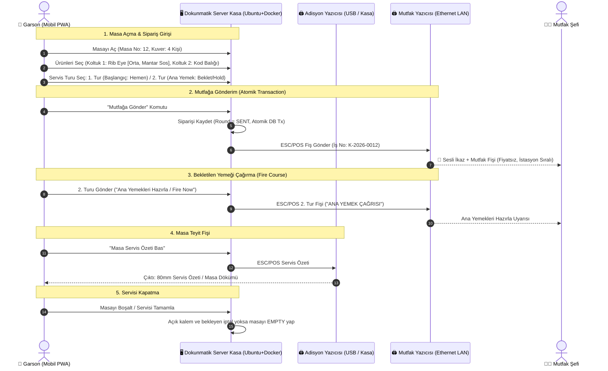
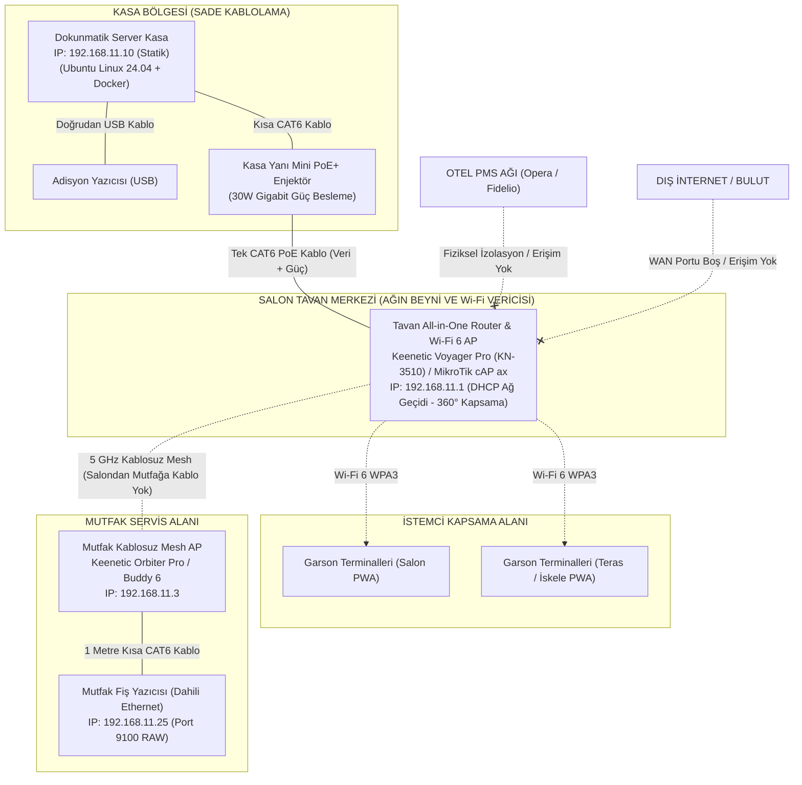

# MERİT ROYAL HOTEL & CASINO —  A LA CARTE RESTORAN
## Özel Dijital Servis ve İzole Ağ Mimarisi Proje Dokümantasyonu


**Tarih:** 14 Ekim 2026  
**Lokasyon:** Alsancak / Girne, Kuzey Kıbrıs Türk Cumhuriyeti (KKTC)  
**Tesis:** Merit Royal Hotel & Casino & Merit Royal Diamond Hotel  
**Saat Dilimi:** `Asia/Nicosia` (Kıbrıs / KKTC Standart Saati)  
**Kapsamdaki Restoranlar:**  
1. **The Roof Garden** (Panoramik Teras & Dünya / Füzyon & Lounge)  
2. **The Steak House** (Merit Royal Diamond Dry-Aged Amerikan Steakhouse)  
3. **Blue Sea** (Denize Sıfır Akdeniz & Ege Deniz Ürünleri)  
4. **Royal Mandarin** (Uzak Doğu & Kanton & Sushi Bar)  
5. **Bella Merit** (Otantik İtalyan & Taş Fırın & Trattoria)  

---

## 1. YÖNETİCİ ÖZETİ VE MİSYON TANIMI

Bu rapor; Merit Royal tesislerindeki 5 seçkin A La Carte restoranda devreye alınacak olan **Merit A La Carte Dijital Servis ve Mutfak Sevk Sistemi**nin ağ altyapısı, donanım dağılımı, gastronomi/menü iş akışları ve sunucu mimarisini eksiksiz olarak belirlemek amacıyla hazırlanmıştır.

### Sistemin Temel Prensipleri:
1. **Endüstri Standardı Servis Mantığı (Sıfır Sürtünme):** Sistem, uluslararası 5 yıldızlı lüks otellerde ve fine-dining operasyonlarında dünya standardı kabul edilen masa, kuver, koltuk, modifier (hazırlama seçenekleri), servis turları (courses) ve mutfak sevk akışını esas alır. Sektör çalışanlarının aşina olduğu bu ergonomi korunurken, hantal yapılar tamamen elenmiştir.
2. **%100 Fiyatsız ve Tahsilatsız (Priceless Service Operations):** Sistemde hiçbir menü kalemi, içecek veya hizmet için fiyat, para birimi, KDV, indirim, kupon, servis ücreti, tahsilat veya kasa hesabı kapatma **bulunmaz**. Garson veya yöneticinin bastığı masa kontrol dökümü bir hesap pusulası değil, mutfak ve salon arasındaki servis koordinasyonunu sağlayan fiyatsız bir operasyon belgesidir.
3. **Sıfır Otel PMS / Dış Sistem Bağımlılığı:** Otelin Opera PMS, Fidelio veya diğer ön büro/muhasebe yazılımlarıyla hiçbir API, veri tabanı veya ağ entegrasyonu yoktur. Bu sayede otel ana sisteminde veya internet omurgasında yaşanabilecek kesintiler alakart restoran operasyonunu asla etkileyemez.
4. **Tamamen İzole Kapalı Yerel Ağ (Air-Gapped / Isolated LAN):** Her alakart restoran dış internete (WAN) ve otelin genel misafir/ofis ağına kapalı, bağımsız bir yerel ağ (VLAN veya fiziksel izole LAN) üzerinde çalışır.
5. **Restoran Başına Standart Donanım Paketi:** Her alakart restoranda:
   - **1x Dokunmatik Server Kasa:** Ubuntu Linux 24.04 LTS kurulu, Docker üzerinde çalışan veri tabanı ve web sunucusunu barındıran hepsi-bir-arada (All-in-One) dokunmatik terminal.
   - **Garson Mobil Terminali / Akıllı Cihazlar:** Yalnızca yerel Wi-Fi'a bağlanan, modern PWA mobil istemcisi.
   - **1x Termal Adisyon Yazıcısı (80mm):** Kasa yanında yer alan masa servis dökümü yazıcısı.
   - **1x Termal Mutfak Yazıcısı (80mm Ethernet):** Mutfak hazırlık istasyonuna bağlı, sesli ikaz ziline sahip dayanıklı fiş yazıcısı.

---

## 2. NEDEN ENDÜSTRİ STANDARDI AKIŞI SEÇİLDİ VE GELENEKSEL HANTAL SİSTEMLERİN KRONİK SORUNLARI NASIL ÇÖZÜLDÜ?

### 2.1. Neden Bu Mantık ve Görsel Akış Referans Alındı?
Dünya genelindeki 5 yıldızlı lüks otellerde ve uluslararası fine-dining restoranlarda (Merit Royal dahil) çalışan F&B müdürleri, şefler, restoran kaptanları ve deneyimli servis personeli, uluslararası endüstri standardı operasyonel mantığa (masa krokisi, misafir kuveri, koltuk bazlı sipariş, pişme derecesi/sos modifier'ları, turlar/courses ve mutfak fişi) yıllardır aşinadır. 

Sistemin bu mantıkla tasarlanmasının temel nedeni: **Deneyimli sektör çalışanlarının aşina olduğu iş akışını koruyarak sıfır eğitim süresiyle personelin sisteme anında adapte olmasını sağlamaktır.** Personel yabancı, karmaşık veya alışılagelmişin dışında bir arayüzle vakit kaybetmez; bildiği profesyonel adımlarla doğrudan misafirine odaklanır.

---

### 2.2. Geleneksel Sistemlerden En Çok Şikayet Edilen 7 Temel Sorun ve Çözümlerimiz

Uluslararası otelcilik sektöründe geleneksel POS yazılımlarından en çok şikayet edilen 7 kronik problem derinlemesine incelenmiş ve sistemimizde Merit Royal prestijine yakışır şekilde kökten çözülmüştür:

| #     | Geleneksel Sistemlerdeki Kronik Sorunlar                                   | Merit A La Carte Sistemimizin Getirdiği Çözümler                                           |
| ----- | -------------------------------------------------------------------------- | ------------------------------------------------------------------------------------------ |
| **1** | **Kullanım ve Öğrenme Zorluğu:**<br>Aşırı karmaşık, onlarca alt menüye     | **Sezgisel Arayüz & İnteraktif Öğrenme Modu:**<br>Tamamen modern dokunmatik ekran          |
|       | boğulmuş hantal ekranlar; yeni bir garsonun veya kominin sistemi öğrenmesi | ergonomisi. Restoran yöneticisinin açabildiği yerleşik **"Bağlamsal Öğrenme Modu (Adım     |
|       | haftalar sürer, yoğun serviste yanlış tuşlamalara yol açar.                | Adım Rehber)"** sayesinde yeni başlayan bir personel 15 dakikada tüm sipariş ve mutfak     |
|       |                                                                            | adımlarını hatasız öğrenir.                                                                |
| **2** | **Modüler Olmaması ve Fahiş Özelleştirme Maliyetleri:**<br>Sistem katıdır; | **%100 Esnek, Modüler ve Sıfır Lisans Maliyeti:**<br>Merit Royal'in 5 farklı mutfağının    |
|       | otele veya restorana özel tek bir menü kuralı, yeni bir pişme derecesi     | (Steakhouse'taki et derecelerinden, Mandarin'deki acılık seviyelerine kadar) tüm özel      |
|       | veya garnitür seçeneği eklemek için aylar süren bürokrasi ve on binlerce   | kuralları kod seviyesinde esnek ve modülerdir. Ek lisans ücreti olmadan anında             |
|       | dolarlık ek geliştirme faturaları talep edilir.                            | uyarlanabilir.                                                                             |
| **3** | **Destek ve Sorun Çözümünün Yavaşlığı:**<br>Uluslararası hantal çağrı      | **Sistem Tanılama ve Onarım Seçenekleri Sunarak Çözüm Üretme:**<br>Sistem dış desteğe muhtaç|
|       | merkezleri; cuma/cumartesi yoğun akşam servisinde terminal kilitlendiğinde | değildir. Yerel sunucu üzerinde tek tıkla çalışan sıralı tanılama motoru; veritabanı,      |
|       | veya yazıcı durduğunda saatlerce telefonda bekleme çaresizliği yaşanır.    | yazıcı kuyrukları ve yerel ağı saniyeler içinde tarar, arızayı tespit eder ve yöneticiye    |
|       |                                                                            | tek tıkla uygulanabilir onarım seçenekleri sunarak anında çözüm üretir.                     |
| **4** | **İşlem Gecikmesi ve Donma (Lag / Latency):**<br>Eski nesil Java ve ağır   | **Ultra-Hızlı Next.js 16 + Turbopack Performansı:**<br>Yerel ağda çalışan sistemde tüm     |
|       | Windows servisleri yüzünden terminallerde donmalar yaşanır; garson ekrana  | sayfa ve işlem yanıt süreleri **p95 < 2 saniyenin** altındadır. Dokunmatik tepkiler        |
|       | bastığında 3-5 saniye beklemek zorunda kalır, servis yavaşlar.             | anlıktır, hiçbir bekleme veya donma yaşanmaz.                                              |
| **5** | **Birden Fazla Terminalde Veri Tutarlılığı ve Çakışmalar:**<br>İki garson  | **Atomik Veri Garantisi (`prisma.$transaction`):**<br>Masa açma, ürün ekleme ve mutfağa    |
|       | aynı masayı açtığında veya ağda anlık bir gecikme olduğunda siparişler     | fiş çıkarma işlemleri tek bir atomik veritabanı işlemiyle yürütülür. Kriptografik tekil    |
|       | çakışır, masalar kilitlenir veya mutfağa mükerrer fiş basılır.             | anahtarlar sayesinde mükerrer mutfak fişi basılması matematiksel olarak imkânsızdır.       |
| **6** | **Rapor Oluşturmanın ve Yorumlamanın Zor Olması:**<br>Yüzlerce karmaşık    | **Şeffaf ve Anlaşılır Operasyonel Raporlama:**<br>Kıbrıs yerel saatine (`Asia/Nicosia`)    |
|       | muhasebe parametresi; F&B müdürünün hangi mutfağın ne kadar sürede yemek   | tam uyumlu; mutfak hazırlık sürelerini, istasyon bazlı sipariş yoğunluğunu ve onaylı iptal |
|       | çıkardığını veya hangi kalemin neden iptal edildiğini görmesi saatler      | gerekçelerini tek bakışta gösteren sade ve net rapor paneli.                               |
|       | alır.                                                                      |                                                                                            |
| **7** | **Kurulum Karmaşıklığı ve Yüksek Altyapı Maliyeti:**<br>Ayrı sunucu        | **Ubuntu Linux + Docker ile 2 Dakikada Kurulum:**<br>Pahalı sunucu donanımlarına gerek     |
|       | odaları, pahalı Windows Server ve veritabanı lisansları, karmaşık          | yoktur. Dokunmatik kasa içine gömülü Ubuntu Linux 24.04 üzerinde tek komutla (`docker      |
|       | kablolama ve yüksek kurulum maliyetleri.                                   | compose up -d`) izole olarak kurulur; sıfır ek yazılım maliyeti sunar.                     |

---

## 3. MERİT ROYAL 5 ALACARTE RESTORANIN KÜNYESİ VE OPERASYONEL İHTİYAÇLARI

Merit Royal Hotel & Casino ve Merit Royal Diamond bünyesinde yer alan 5 restoranın mutfak tarzı, fiziksel yerleşimi ve operasyonel özellikleri aşağıda detaylandırılmıştır:

```
┌─────────────────────────────────────────────────────────────────────────────────────────────────┐
│                          MERİT ROYAL HOTEL 5 A LA CARTE GASTRONOMİ PORTFÖYÜ                     │
├────────────────────┬─────────────────────────────┬─────────────────────┬────────────────────────┤
│ Restoran Adı       │ Mutfak Konsepti             │ Konum & Atmosfer    │ Mutfak İstasyonları    │
├────────────────────┼─────────────────────────────┼─────────────────────┼────────────────────────┤
│ The Roof Garden    │ Dünya / Modern Akdeniz /    │ Çatı Katı,          │ Josper Fırın / Kömür,  │
│                    │ Füzyon & Lounge             │ Panoramik Deniz     │ Soğuk Meze, Bar        │
├────────────────────┼─────────────────────────────┼─────────────────────┼────────────────────────┤
│ The Steak House    │ Amerikan Dry-Aged Steak /   │ Diamond Havuz Başı  │ Döküm Izgara,          │
│                    │ Izgara Et Çeşitleri         │ & Şık İç Salon      │ Sıcak Tava & Garnitür  │
├────────────────────┼─────────────────────────────┼─────────────────────┼────────────────────────┤
│ Blue Sea           │ Ege & Akdeniz Deniz         │ Denize Sıfır Kıyı,  │ Balık Izgara/Tava,     │
│                    │ Mahsulleri & Meze Çeşitleri │ İskele Manzaralı    │ Soğuk Meze & Balık Dolap│
├────────────────────┼─────────────────────────────┼─────────────────────┼────────────────────────┤
│ Royal Mandarin     │ Geleneksel Çin, Kanton &    │ Doğu Esintili İç    │ Wok İstasyonu,         │
│                    │ Japon Sushi Bar             │ Salon & Teras       │ Sushi / Teppanyaki Bar │
├────────────────────┼─────────────────────────────┼─────────────────────┼────────────────────────┤
│ Bella Merit        │ Klasik İtalyan / El Açması  │ Romantik İtalyan    │ Taş / Odun Hamur Fırını│
│                    │ Makarna, Pizza & Risotto    │ Sahil Atmosferi     │ Makarna & Sıcak Tava   │
└────────────────────┴─────────────────────────────┴─────────────────────┴────────────────────────┘
```

---

### 3.1. The Roof Garden Restaurant & Lounge Bar
* **Konsept:** Cluster Executive Şef Hüseyin Hummadi imzalı, modern Akdeniz ve dünya lezzetlerini meşe kömürlü Josper fırını dokunuşlarıyla birleştiren fine-dining ve lounge konsepti. Akşamları DJ performansı ve zengin imza kokteyl barı eşlik eder.
* **Mekân Düzeni:** Geniş panoramik açık teras alanı (Salon 1) ve kapalı camlı lounge alanı (Salon 2).
* **Mutfak & Bar Akışı:**
  - **Sıcak İstasyon:** Josper fırını (Rib Eye Steak, Kuzu Karski, Lavender Black Cod).
  - **Soğuk İstasyon:** Kral Yengeç Ceviche, Ilık Ahtapot, Fıstıklı Girit Ezmesi, Patlıcan Konfi.
  - **Bar İstasyonu:** İmza kokteyller, zengin şarap kavı.
* **Zorunlu Hazırlama (Modifier) İhtiyaçları:**
  - Et ve balıklar için pişme derecesi ve garnitür seçimi (Patates Pave, Yer Elması Püresi).
  - "Sosu Ayrı / Yanında", "Trüf Yağsız", "Tuzsuz / Glütensiz".
  - Lounge siparişlerinde servis turu: "İçecekle Birlikte" vs "Yemek Öncesi".

---

### 3.2. The Steak House (Merit Royal Diamond)
* **Konsept:** Amerikan steakhouse kültürünü yansıtan, özel kuru dinlendirme (Dry-Aged) dolaplarında dinlendirilen birinci sınıf et kesimleri (Tomahawk, T-Bone, Dallas, Antrikot, Dana Bonfile).
* **Mekân Düzeni:** Diamond havuz başı açık terası ve klasik ahşap/deri dekorasyonlu ana salon.
* **Mutfak İstasyonları:**
  - **Ana Izgara (Charbroiler / Cast Iron):** Kırmızı etlerin pişirildiği yüksek ısılı ızgara.
  - **Sıcak Hazırlık & Garnitür:** Trüflü patates kızartması, kremalı ıspanak, kuşkonmaz, mac & cheese.
* **Zorunlu Hazırlama (Modifier) İhtiyaçları:**
  - **Zorunlu Pişme Derecesi (Meat Temperature):** `Blue Rare`, `Rare` (Az), `Medium Rare` (Az Orta), `Medium` (Orta), `Medium Well` (Orta İyi), `Well Done` (Çok Pişmiş). Pişme seçilmeden sipariş gönderilemez!
  - **Zorunlu Sos Seçimi:** Chimichurri, Tane Karabiber (Peppercorn), Béarnaise, Trüflü Mantar, Demi-Glace.
  - **Garnitür Seçimi:** Fırın Patates (Ekşi Krema / Frenk Soğanlı), Izgara Kuşkonmaz, Trüflü Püre.

---

### 3.3. Blue Sea Seafood Restaurant
* **Konsept:** Akdeniz'in denize sıfır kıyısında yer alan, günlük taze tutulan balıklar, kabuklu deniz ürünleri, kalamar, ahtapot ve geleneksel Ege-Kıbrıs mezelerinin sunulduğu balık restoranı.
* **Mekân Düzeni:** Denize sıfır dış iskele/teras ve deniz manzaralı camlı iç salon.
* **Mutfak İstasyonları:**
  - **Balık Hazırlık & Pişirme:** Kömür ızgara, tava (unlu/mısır unlu), buğulama ve tuzda balık fırını.
  - **Soğuk Meze İstasyonu:** Lakerda, ahtapot salatası, deniz börülcesi, avokadolu karides, fava.
* **Zorunlu Hazırlama (Modifier) İhtiyaçları:**
  - **Pişirme Yöntemi:** `Kömürde Izgara`, `Tavada Çıtır`, `Buğulama (Sebzeli)`, `Tuzda Fırın (2 Kişilik)`.
  - **Kılçık / Servis Tercihi:** `Kılçıklı Bütün`, `Fileto / Kılçıksız Açılmış`, `Kafasız`.
  - **Meze Servis Zamanlaması:** "Mezeler Hemen / Balık Sonra" (Course 1: Meze -> Course 2: Sıcak Balık).

---

### 3.4. Royal Mandarin Chinese & Sushi Restaurant
* **Konsept:** Çin, Kanton ve Japon mutfaklarını harmanlayan, Pekin ördeği, Dim Sum, Wok tavada noodle/etler ve taze hazırlanan zengin Sushi çeşitlerinin sunulduğu Uzak Doğu fine-dining mekânı.
* **Mekân Düzeni:** Otantik Asya dekorasyonlu iç salon ve sakin teras masaları.
* **Mutfak İstasyonları:**
  - **Wok & Dim Sum İstasyonu:** Yüksek harlı wok ocakları ve bambu buharda pişiriciler.
  - **Sushi Bar:** Şeflerin misafir önünde hazırladığı taze Roll, Nigiri, Sashimi tezgâhı.
* **Zorunlu Hazırlama (Modifier) İhtiyaçları:**
  - **Acılık Seviyesi (Spicy Level):** `Acısız (No Spicy)`, `Az Acılı (Mild)`, `Orta Acılı (Medium)`, `Aşırı Acılı (Extra Hot)`.
  - **Sos & Çeşni:** "Soya Sosu Az Tuzlu", "Ekstra Zencefil (Gari)", "Ekstra Wasabi", "Tatlı Ekşi Sos".
  - **Servis Araçları:** `Chopstick (Çubuk)`, `Eğitim Chopstick'i (Aparatlı)`, `Klasik Çatal-Bıçak`.

---

### 3.5. Bella Merit Italian Restaurant
* **Konsept:** İtalyan trattoria kültürünü Akdeniz zarafetiyle sunan; el açması taze makarnalar (Ravioli, Tagliatelle), porçini mantarlı risotto, odun ateşinde pizza, dana ossobuco ve tiramisu spesiyalleri.
* **Mekân Düzeni:** Sıcak rustik İtalyan iç salonu ve deniz esintili bahçe/teras.
* **Mutfak İstasyonları:**
  - **Pizza & Ekmek Fırını:** Yüksek dereceli taş tabanlı pizza fırını.
  - **Makarna & Tava İstasyonu:** Taze makarna haşlama ve sos bağlama tezgahı.
* **Zorunlu Hazırlama (Modifier) İhtiyaçları:**
  - **İtalyan Servis Sıralaması (Courses):**  
    `Antipasti` (Başlangıç) -> `Primi Piatti` (Makarna/Risotto) -> `Secondi Piatti` (Et/Balık) -> `Dolci` (Tatlı).
  - **Peynir & Çeşni:** "Taze Çekilmiş Parmesan (Bol / Ayrı)", "Acı Biberli Zeytinyağı", "Sarımsaksız".
  - **Pişme:** Risotto ve makarnalar için "Al Dente" (Standart) vs "İyi Pişmiş (Well Done)".

---

## 4. İŞ AKIŞI VE FİŞ FORMATLARI

Sistem, karmaşık tahsilat adımlarını tamamen kaldırarak personelin yalnızca misafir ağırlama ve mutfak koordinasyonuna odaklanmasını sağlar:



### 4.1. Fiş Formatları

> [!NOTE]
> **Tek Fiziksel Mutfak Yazıcısı & Çoklu İstasyon Dağıtımı:** Restoranda 1 adet fiziksel mutfak yazıcısı bulunur; ancak yazılımda 4 mantıksal istasyon (SICAK, SOĞUK/MEZE, IZGARA, TATLI) tanımlıdır ve hepsi bu tek yazıcıya yönlendirilmiştir. Aynı siparişte hem Soğuk Meze hem Izgara Et varsa, mutfaktaki tek yazıcıdan otomatik kesimle bölüm bölüm **2 ayrı fiş** peş peşe çıkar. Mutfak Şefi ilk fişi Soğuk Meze tezgâhına, ikinci fişi Izgara ustasına asar; tezgâhlar arası sipariş karışıklığı önlenir. İleride 2. bir fiziksel yazıcı eklenirse sistem sıfır kodla anında çoklu yazıcıya uyarlanır.

#### A) Mutfak Hazırlama Fişi (Mutfak Yazıcısından Çıkan)
```text
==========================================
     MERIT ROYAL — BLUE SEA SEAFOOD       
           MUTFAK SİPARİŞ FİŞİ            
==========================================
Masa: Masa 04                Kişi: 4
Garson: Mehmet K.            Tarih: 14/10/2026
Saat: 19:42:15               İş No: K-2026-0048
Tur: 1. Tur (BAŞLANGIÇLAR)
------------------------------------------
[KOLTUK 1]
 1x AKDENİZ AHTAPOT SALATASI
    * Sosu Ayrı
[KOLTUK 2]
 1x AVOKADOLU KARİDES
[ORTAYA PAYLAŞIMLI]
 1x FISTIKLI GİRİT EZMESİ
 1x KAYA LEVREĞİ CEVICHE
    * Acısız / Hafif Limonlu
------------------------------------------
** NOT: 2. Tur (Balıklar) Bekletmede (HELD)
==========================================
```

#### B) Masa Servis Döküm Fişi (Adisyon Yazıcısından Çıkan)
> [!NOTE]
> Adisyon çıktısı garson ve servis kaptanı için operasyonel masa özetidir; fiyatsız servis düzeninde kullanılır.

```text
==========================================
        MERIT ROYAL HOTEL & CASINO        
           THE STEAK HOUSE REST.          
          ADİSYON / SERVİS ÖZETİ          
==========================================
Masa: Masa 08 (Teras)        Sipariş: ORD-2026-000192
Çıktı zamanı: 20:30          Kapsam: TÜM KALEMLER
Garson: Ayşe Y. · Misafir/Kuver: 2 · 14/10/2026
------------------------------------------
Tur 01  19:15  1 x DANA T-BONE STEAK [Koltuk 1]
                 Medium-Rare · Trüflü Mantar Sos · Kuşkonmaz
Tur 01  19:15  1 x DALLAS STEAK (500g) [Koltuk 2]
                 Medium · Chimichurri Sos · Fırın Patates
Tur 01  19:15  1 x KREMALI ISPANAK [Paylaşım Koltuk 1,2]
Tur 01  19:15  2 x SAN PELLEGRINO (750ml)
                 Soğuk · Limonlu
------------------------------------------
TOPLAM SERVİS KALEMİ: 5       Sayfa 1/1
==========================================
```

---

## 5. RESTORAN BAŞINA STANDART DONANIM PAKETİ

Her alakart restoranda yer alacak standart donanım seti:

```
┌────────────────────────────────────────────────────────────────────────────────────────┐
│               TEK BİR ALACARTE RESTORANIN STANDART DONANIM BLOKLARI                     │
├─────────────────────────┬──────────────────────────────────────────────────────────────┤
│ Donanım Kalemi          │ Teknik Özellik ve Donanım Rolü                               │
├─────────────────────────┼──────────────────────────────────────────────────────────────┤
│ 1. Dokunmatik Server    │ 1x Tiwox TP-8610 All-in-One POS veya muadili                 │
│    Kasa                 │ • Ubuntu Linux 24.04 LTS kurulu                              │
│                         │ • Docker üzerinde çalışan veri tabanı ve web sunucusunu      │
│                         │   barındıran hepsi-bir-arada (All-in-One) dokunmatik terminal│
│                         │ • 15.6" - 18.5" Dokunmatik Ekran, 16 GB RAM, 256 GB SSD      │
│                         │ • Rol: Restoranın yerel veritabanı, Web POS ve yazdırma motoru│
├─────────────────────────┼──────────────────────────────────────────────────────────────┤
│ 2. Garson Mobil         │ Garson Mobil Terminali / Akıllı Cihazlar                     │
│    Terminali / Cihazlar │ • Yalnızca yerel Wi-Fi'a bağlanan, modern PWA mobil istemcisi│
│                         │ • İşletme tarafından sağlanan akıllı telefon veya tabletler  │
│                         │ • Hızlı masa/ürün seçimi, dokunmatik titreşim ve tam ekran   │
├─────────────────────────┼──────────────────────────────────────────────────────────────┤
│ 3. Termal Adisyon       │ 1x Termal Adisyon Yazıcısı (80mm)                            │
│    Yazıcısı             │ • Kasa yanında yer alan masa servis dökümü yazıcısı          │
│                         │ • Kasaya doğrudan USB kablosuyla bağlı                       │
│                         │ • Fiyatsız masa servis koordinasyon dökümü için kullanılır   │
├─────────────────────────┼──────────────────────────────────────────────────────────────┤
│ 4. Termal Mutfak        │ 1x Termal Mutfak Yazıcısı (80mm Ethernet)                    │
│    Yazıcısı             │ • Mutfak hazırlık istasyonuna bağlı                          │
│                         │ • Dahili 10/100 RJ45 Ethernet portlu dayanıklı fiş yazıcısı  │
│                         │ • Sesli ikaz ziline (Buzzer) ve yağ kapağına sahip           │
│                         │ • Rol: Şef hazırlık ve iptal (Void) fişlerinin anlık basımı  │
├─────────────────────────┼──────────────────────────────────────────────────────────────┤
│ 5. Tavan All-in-One     │ 1x Keenetic Voyager Pro KN-3510 (AX1800) / MikroTik cAP ax   │
│    Router & Wi-Fi 6 AP  │ • Tavan kubbe tipi, dahili bağımsız Gigabit Router & DHCP    │
│                         │ • Kasa arkasındaki harici router kutusu ihtiyacını kaldırır  │
│                         │ • 360° kubbe tavan yayılımı, çift Gigabit port (PoE Girişli) │
├─────────────────────────┼──────────────────────────────────────────────────────────────┤
│ 6. Kasa Yanı PoE+       │ 1x Keenetic / TP-Link TL-POE160S (Gigabit 802.3at 30W)       │
│    Güç Enjektörü        │ • Kasa arkasında mini adaptör boyutunda çalışır              │
│                         │ • Kasadan çıkan tek CAT6 kabloya elektrik basarak tavanı besler│
│                         │ • Tavanda 220V elektrik prizi ihtiyacını tamamen sıfırlar    │
├─────────────────────────┼──────────────────────────────────────────────────────────────┤
│ 7. Mutfak Kablosuz AP   │ 1x Keenetic Orbiter Pro KN-3610 / Buddy 6 (Mesh Node)        │
│    / Mesh Köprüsü       │ • Salondaki tavan Router/AP'ye 5 GHz KABLOSUZ MESH ile bağlı │
│                         │ • Salondan mutfağa KABLO ÇEKİLMEZ; yazıcıyı Ethernet'le besler│
└─────────────────────────┴──────────────────────────────────────────────────────────────┘
```

---

## 6. İZOLE VE GÜVENLİ YEREL AĞ (LAN) TOPOLOJİSİ

Sistemin en kritik güvenlik ve kesintisizlik kuralı: **Restoran ağlarının dış internete (WAN), otelin ortak misafir internetine ve otel ön büro PMS sistemine kesinlikle kapalı olmasıdır.**

### 6.1. Ağ Tasarım Kuralları
1. **İnternet Çıkışı Yok (No WAN / Air-Gapped):** Mini Router üzerinde WAN portu boş bırakılır; hiçbir Default Gateway veya internete çıkış rotası (NAT/WAN) tanımlanmaz.
2. **PMS ve Otel Ağından Tam İzolasyon:** Otelin Opera PMS ağına veya idari ofis VLAN'larına hiçbir erişim verilmez; restoran sistemleri tamamen bağımsız adalardır.
3. **Restoranlar Arası İzolasyon:** Her 5 restoran kendi bağımsız Subnet havuzuna sahiptir:
   - **The Roof Garden:** `192.168.11.0/24`
   - **The Steak House:** `192.168.12.0/24`
   - **Blue Sea:** `192.168.13.0/24`
   - **Royal Mandarin:** `192.168.14.0/24`
   - **Bella Merit:** `192.168.15.0/24`
4. **Statik IP ve DHCP Rezervasyon Şeması (Örnek: The Roof Garden):**
   - `192.168.11.1`: Salon Tavan All-in-One Router & Wi-Fi 6 AP (Keenetic Voyager Pro - DHCP & Ağ Geçidi)
   - `192.168.11.3`: Mutfak Kablosuz Mesh AP (Keenetic Orbiter Pro)
   - `192.168.11.4`: (Blue Sea & Roof Garden) Dış Mekan Mesh AP (Keenetic Stellar 6 IP65)
   - `192.168.11.10`: Dokunmatik Server Kasa (Ubuntu Linux + Docker)
   - `192.168.11.25`: Termal Mutfak Yazıcısı (Mutfak AP Ethernet Portuna Bağlı - Port 9100 RAW)
   - `192.168.11.100 - 192.168.11.150`: Garson Mobil Cihazları (DHCP Havuzu)
5. **Wi-Fi Yapılandırması:**
   - SSID: Gizli (Hidden) örn: `MR-ROOFGARDEN-POS`
   - Şifreleme: WPA2/WPA3-Personal (Güçlü karmaşık anahtar)
   - **Client Isolation (AP İzolasyonu): KESİNLİKLE KAPALI.** Garson el terminallerinin Server Kasa (`192.168.11.10:3000`) ile doğrudan TCP iletişimi kurabilmesi zorunludur.
   - **802.11k/v/r Hızlı Roaming:** Açık tutulur; garson salondan terasa veya mutfağa geçtiğinde kopma yaşanmaz.

### 6.2. Görsel Ağ Topolojisi Şeması



---

## 7. RESTORAN BAZLI DEVREYE ALMA VE KABUL KONTROL LİSTESİ

Sistemin Merit Royal'deki 5 restoranda sorunsuz devreye alınması için takip edilecek adım adım kurulum ve kabul protokolü:

```text
[ ] ADIM 1: FİZİKSEL VE AĞ KURULUMU
    [ ] Dokunmatik Server Kasa montajı ve elektrik bağlantısı.
    [ ] Adisyon yazıcısının USB kablo ile kasaya bağlanması.
    [ ] Kasa arkasına PoE+ enjektörün takılması ve kasadan gelen kısa CAT6 kablo ile bağlanması.
    [ ] Salona Keenetic Voyager Pro tavan All-in-One Router/AP montajı (ve Blue Sea/Roof Garden için Stellar 6 Outdoor AP montajı).
    [ ] Mutfak servis bankosuna Mutfak Mesh AP'sinin yerleştirilmesi ve 5 GHz Mesh ile salona eşlenmesi.
    [ ] Mutfak yazıcısının Mutfak AP Ethernet portuna 1 metrelik kısa kabloyla takılması (Kablo kırma/dökme yok).

[ ] ADIM 2: SUNUCU VE DOCKER BAŞLATMA
    [ ] Ubuntu Linux üzerinde statik IP tanımlanması (Örn: The Steak House için 192.168.12.10).
    [ ] Sistem saat diliminin "Asia/Nicosia" olarak doğrulanması (`timedatectl`).
    [ ] "docker compose -f docker-compose.prod.yaml up -d" komutuyla servislerin başlatılması.
    [ ] http://192.168.12.10:3000 adresinden sistem sihirbazının açılması.

[ ] ADIM 3: RESTORAN VE MENÜ YAPILANDIRMASI
    [ ] Restoran Adı ve Masalarının girilmesi (Örn: Bella Merit - Salon: 10 Masa, Teras: 12 Masa).
    [ ] Mutfak yazıcısı IP adresinin (192.168.12.25:9100) sisteme tanımlanması ve "Test Baskısı" alınması.
    [ ] Restorana özgü menü kalemlerinin, zorunlu modifier gruplarının (pişme, sos, alerjen) yüklenmesi.

[ ] ADIM 4: GARSON MOBİL CİHAZ EŞLEŞTİRMESİ
    [ ] Garson telefonlarının kapalı Wi-Fi ağına (WPA3) bağlanması.
    [ ] Tarayıcıdan "http://192.168.12.10:3000" açılarak "Ana Ekrana Ekle" (PWA) yapılması.
    [ ] Garson hesabı ve PIN'i ile giriş yapılması; çevrimdışı önbelleklemenin teyit edilmesi.

[ ] ADIM 5: CANLI SERVİS SİMÜLASYONU VE TEST KABULÜ
    [ ] Masa açma -> Ürün seçimi -> Zorunlu pişme derecesi kontrolü.
    [ ] "Mutfağa Gönder" basıldığında mutfak yazıcısından 2 saniyede fiş çıkması ve sesli ikaz çalması.
    [ ] 2. Tur (Ana Yemek) Bekletme (Hold) ve Çağırma (Fire) akışının doğrulanması.
    [ ] Yönetici onaylı kısmi iptal (Void) yapılarak mutfaktan kırmızı/belirgin iptal fişinin alınması.
    [ ] Masa Teyit Fişi çıktısının alınması; fiyatsız servis özeti ve kalem dökümünün teyit edilmesi.
    [ ] Test yedeğinin USB belleğe yazıldığının ve SHA-256 hash bütünlüğünün teyit edilmesi.
```

---

## 8. SONUÇ: MERİT ROYAL PRESTİJİNE UYGUN KESİNTİSİZ DESTEK ARACI

Merit Royal Hotel & Casino bünyesindeki **The Roof Garden, The Steak House, Blue Sea, Royal Mandarin ve Bella Merit** restoranları için özel olarak tasarlanan bu mimari:
- Uluslararası lüks otelcilikte personelin aşina olduğu fine-dining servis disiplinini korurken, geleneksel hantal sistemlerin **öğrenme zorluğu, gecikme, donma, yüksek lisans maliyetleri ve destek yavaşlığı** gibi tüm kronik zayıflıklarını kökünden temizlemiştir.
- **Tamamen izole yerel ağ** güvencesiyle dış internet, PMS veya bulut arızalarından bağımsız olarak %100 kesintisiz çalışır.
- Sistem personele veya yönetime bir bürokrasi ya da muhasebe yükü getiren karmaşık bir POS değil; **servis garsonu, salon şefi ve mutfak ekibi arasında pürüzsüz koordinasyon sağlayan güçlü bir operasyonel destek aracıdır**.
- Sipariş hatalarını, unutulan pişme derecelerini ve servis aksamalarını sıfırlayarak Merit Royal misafirlerine sunulan gastronomi deneyimini ve memnuniyetini en üst düzeye çıkarır.
